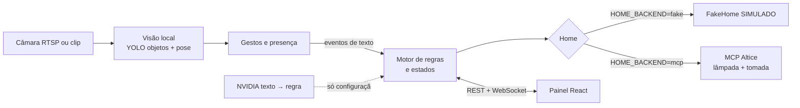

# ObjectOS

**Aveiro Tech City Hackathon 2026 · Desafio 3 — Altice Labs (Connected Home)**

Casa controlada por objetos do dia a dia. Uma câmara observa a divisão; levantar uma **caneca**, um **livro** ou um **comando** ativa um modo da casa (luz e tomada). Quando a divisão fica vazia, o sistema espera, avisa baixando a luz, suspende luz e tomada e repõe tudo quando alguém regressa. Há sempre um botão **Desligar tudo**.

**Privacidade:** o vídeo é processado localmente e nunca é gravado nem enviado para fora. Só existem eventos de texto. A NVIDIA recebe apenas o texto de uma regra a criar. O MCP Altice só pode atuar na lâmpada e na tomada.

## Como funciona



## Stack

| Camada | Tecnologia |
|---|---|
| Backend | Python 3.12, FastAPI, Pydantic v2, asyncio, `uv` |
| Visão (opcional) | OpenCV/FFmpeg, Ultralytics YOLO11 + pose, ByteTrack |
| Casa | `FakeHome` em memória ou SDK `mcp` (Streamable HTTP + OAuth) |
| Regras por texto (opcional) | NVIDIA via SDK `openai` |
| Frontend | React 19, Vite, TypeScript, Mantine, Capacitor (Android) |
| Login | Authentik (OIDC, Authorization Code + PKCE) |
| Infra | Docker Compose, Makefile, GitHub Actions |

Persistência: só `rules.json` e `events.jsonl` (texto). Sem base de dados.

## Requisitos

- Docker com Compose v2 e `make` — chega para o Quick Start.
- Para `make check` / `make test` e para a visão: [`uv`](https://docs.astral.sh/uv/) e Node 22.

## Quick Start (FakeHome, sem câmara nem hardware)

```bash
cp app/.env.example app/.env
make dev
```

1. Abrir <http://localhost:5173>.
2. Iniciar sessão no Authentik com o utilizador `akadmin` e a palavra-passe `homemind-dev` (só desenvolvimento; muda com `AUTHENTIK_ADMIN_PASSWORD`). No primeiro arranque o Authentik demora cerca de um minuto a ficar pronto.
3. Na página **Câmara**, abrir **Cenários de demonstração** e executar «levantar o livro», «sair» e «regressar». Tudo fica marcado **SIMULADO**.

Parar: `Ctrl+C` e `make down`.

| Serviço | URL |
|---|---|
| Painel | <http://localhost:5173> |
| API e OpenAPI | <http://localhost:8000/docs> |
| Authentik | <http://localhost:9000> |

## Configuração (`app/.env`)

O ficheiro de exemplo já arranca em modo simulado. Variáveis principais:

| Variável | Para quê |
|---|---|
| `HOME_BACKEND` | `fake` (omissão, SIMULADO) ou `mcp` (dispositivos reais) |
| `PROFILE` | `demo` reduz a espera antes de suspender de 180 s para 10 s |
| `VIDEO_SOURCE` | URL RTSP ou caminho de um clip (contém credenciais: nunca partilhar) |
| `VISAO_DETETOR` | `homemind.features.visao.detetor:DetetorYolo` liga a visão ao motor |
| `NVIDIA_API_KEY` | Só para criar regras por texto; sem ela o resto funciona |
| `MCP_*`, `ENABLE_PHYSICAL_WRITES` | Ver [docs/mcp-demo.md](docs/mcp-demo.md) |
| `BACKEND_PORT`, `FRONTEND_PORT`, `AUTHENTIK_PORT` | Mudar se as portas estiverem ocupadas |

## Modos

### FakeHome (omissão)

`HOME_BACKEND=fake`. Lâmpada e tomada em memória. `POST /api/simulate` e os cenários do painel injetam eventos marcados `[SIMULADO]`.

### MCP Altice (dispositivos reais)

```bash
make mcp-login      # OAuth no browser, uma vez; tokens em app/.mcp-auth/ (fora do Git)
make mcp-doctor     # só leitura: initialize + tools/list
make mcp-demo       # painel + Authentik + backend com HOME_BACKEND=mcp
make mcp-demo-down
```

Sem mais nada, o modo MCP é **só leitura**. As escritas físicas exigem `ENABLE_PHYSICAL_WRITES=true` **e** uma autorização temporária (`make mcp-writes-on stack=demo minutes=15`). Detalhes e estados de erro: [docs/mcp-demo.md](docs/mcp-demo.md).

### Visão real (opcional, fora do Docker)

A imagem Docker não inclui YOLO/torch. Para gestos reais, correr o backend no host:

```bash
cd app/backend
uv sync --extra visao
uv run python -m homemind.features.visao.pesos     # descarrega yolo11s.pt e yolo11s-pose.pt
uv run --env-file ../.env uvicorn homemind.main:app --host 0.0.0.0 --port 8000
```

com `VIDEO_SOURCE` e `VISAO_DETETOR` definidos em `app/.env`. Noutras duas consolas:

```bash
make auth                                   # só o Authentik (login), em Docker
cd app/frontend && npm ci && npm run dev    # painel em http://localhost:5173, proxy para :8000
```

Não correr `make dev` ao mesmo tempo (ocuparia as portas 8000 e 5173).

## Comandos

| Comando | O que faz |
|---|---|
| `make dev` / `make down` | Sobe / pára a stack de desenvolvimento |
| `make auth` | Sobe só o Authentik, para correr backend e frontend no host |
| `make test` | `pytest` (lógica pura com fakes; sem hardware nem rede) |
| `make check` | Lint + testes + contrato OpenAPI→TypeScript + build + validação do compose (o que o CI corre) |
| `make smoke` | Sobe uma stack isolada, valida backend/frontend/proxy e desliga |
| `make contracts` | Regenera os tipos TypeScript a partir do OpenAPI |
| `make android` | APK de debug (JDK 21 + `ANDROID_HOME`) |
| `make mcp-*` | Login, diagnóstico, demo e autorização de escritas MCP |
| `make worktree b=feat/x` | Cria `../homemind-x` a partir de `origin/main` |

## Problemas comuns

| Sintoma | Causa e solução |
|---|---|
| Login dá erro ou página em branco no primeiro arranque | O Authentik ainda está a aplicar o blueprint; esperar um minuto e recarregar |
| Porta ocupada | Definir `BACKEND_PORT`, `FRONTEND_PORT` ou `AUTHENTIK_PORT` em `app/.env` |
| Painel mostra «offline» | Backend parado ou sessão expirada; ver `docker compose -f app/compose.yaml logs backend` |
| Vídeo «Sem fonte de vídeo configurada» | `VIDEO_SOURCE` vazio (normal em FakeHome) |
| Log «visão desligada» | Falta `VIDEO_SOURCE` e/ou `VISAO_DETETOR`, ou os pesos YOLO |
| Criar regra por texto dá 503 | Falta `NVIDIA_API_KEY` |
| `mcp_ok: false` com aviso de sessão expirada | `make mcp-login` no host |
| Evento «escritas físicas desativadas» | Esperado: ver autorização de escritas em [docs/mcp-demo.md](docs/mcp-demo.md) |

## Estrutura

```text
app/
  backend/src/homemind/
    main.py            app FastAPI
    core/              config, erros, descoberta de routers
    contracts/         modelos partilhados (vídeo, visão, eventos, Home, regras)
    connectors/        FakeHome, McpHome, OAuth Altice, autorização de escritas
    features/          auth, engine, gestos, health, mcp, video, visao
  frontend/src/        app, pages, components, hooks, services, mocks, types
  infra/authentik/     blueprint do login
  compose*.yaml        dev, MCP isolado, demo MCP
docs/                  documentação
Makefile               ponto de entrada único de comandos
```

Os nomes internos `homemind` (pacote Python, cliente OIDC, projeto Compose) são herdados do repositório e mantêm-se por compatibilidade.

## Documentação

| Documento | Conteúdo |
|---|---|
| [docs/estado-para-amanha.md](docs/estado-para-amanha.md) | Estado atual, bloqueios e prioridades |
| [docs/guia-validacao-manual.md](docs/guia-validacao-manual.md) | Roteiro oficial de testes manuais |
| [docs/architecture.md](docs/architecture.md) | Arquitetura e decisões |
| [docs/contratos.md](docs/contratos.md) | Contrato canónico: modelos, REST, WebSocket |
| [docs/mcp-demo.md](docs/mcp-demo.md) · [docs/mcp-capabilities.md](docs/mcp-capabilities.md) | Operação MCP e capacidades observadas |
| [docs/objectos-plano.md](docs/objectos-plano.md) | Plano e estado por área |
| [docs/metrics.md](docs/metrics.md) | Metas e medições |
| [docs/demo-script.md](docs/demo-script.md) · [docs/pitch-outline.md](docs/pitch-outline.md) | Demo e pitch |
| [CLAUDE.md](CLAUDE.md) · [AGENTS.md](AGENTS.md) | Instruções para agentes |
