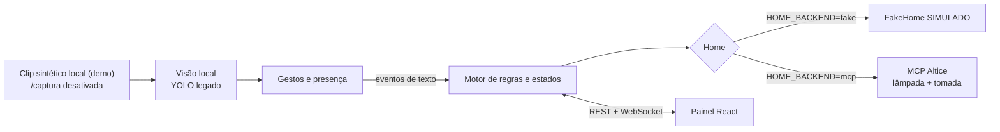

# Conta Certa

**Aveiro Tech City Hackathon 2026 · Desafio 3 — Altice Labs (Connected Home)**

> **Cada um paga o que usa. A casa trata do resto.**

Serviço para **casas partilhadas**: mede o consumo elétrico com o kit Connected Home (via MCP), reconhece aparelhos pela assinatura, atribui cada consumo a um morador ou à conta comum — **perguntando na aplicação** quando há dúvida —, divide a fatura de forma justa e explicada e avisa antes de a conta chegar ao limite de cada um. Três pilares: **Casa Justa**, **Casa Atenta**, **Casa Segura**. Visão completa em [docs/product/vision.md](docs/product/vision.md).

> ### Estado do repositório — ler primeiro
> O produto passou de **ObjectOS** para **Conta Certa**. Na `main` estão **implementados e ligados ao runtime** (`/healthz` + routers descobertos em `features/`): casas e memberships, catálogo de aparelhos, degraus/sessões e classificador (consumidor `energy.steps`), atribuidor com votação D-32, notificações, faturas com fecho e recibos, orçamento 50/80/100 %, presença e segurança (SIMULADAS). A app React usa estes endpoints por papel. Código ObjectOS (motor de regras, gestos, páginas antigas) **ainda existe** mas já não faz parte da navegação; remoção pendente (BASE-04 #74, depende de P2/P3). **PLANEADO / não existe:** interface do assistente, política de atribuição versionada (#87), onboarding avançado, escritas físicas além da lâmpada/tomada. Dados da demo são **SIMULADOS**. Fonte de produto: [v5.1](docs/references/Conta_Certa_Documento_Completo_v5.1.md); decisões: [docs/decisions.md](docs/decisions.md); roadmap: issue [#129](https://github.com/souofrancisco/homemind/issues/129).

**Interface principal (planeada):** a aplicação React/Mantine/Capacitor, para moradores e senhorios, com centro de notificações, confirmações interativas e assistente de IA. **Não há Telegram nem bots** ([decisão D-01](docs/decisions.md)).

**Privacidade:** o vídeo é processado localmente e nunca é gravado nem enviado para fora; só existem eventos de texto; sem reconhecimento facial. O senhorio vê totais por quarto, nunca presença nem imagens. O MCP Altice só pode atuar na lâmpada e na tomada.

## Implementado hoje vs planeado

| | Implementado (código na `main`) | Planeado (Conta Certa) |
|---|---|---|
| Produto | Conta Certa: consumo → atribuição → fatura → recibo, por papel (morador/senhorio/operador) | Política versionada, assistente com UI, fase 2 de segurança |
| Backend | FastAPI, Pydantic v2, SQLite + barramento; features `households`, `appliances`, `energy`, `billing`, `notifications`, `presence`, `safety`, `agent`, `integration` + legado `engine`, `gestos`, `visao`, `video`, `mcp` | Remoção do legado (BASE-04) |
| Persistência | SQLite (`domain_event`, domínio por feature) | — |
| Casa | `FakeHome` (SIMULADO) ou `McpHome` (MCP Altice real) | Mantém-se; leituras com proveniência |
| Visão | YOLO + linha na porta, só eventos (PRES-02) | — |
| Frontend | Shell por papel: Início (dashboard), Casa, Consumo, Aparelhos, Contas e recibos, Notificações (voto), Orçamento, Diagnóstico, Definições | Assistente (UI), edição de aparelhos |
| Login | Authentik (OIDC, PKCE); `sub` → membership | Utilizadores demo no Authentik (ver demo-offline.md) |

## Arquitetura

Implementada hoje (ObjectOS), que é a que corre:



Alvo (Conta Certa), **planeado**: ver [docs/architecture/overview.md](docs/architecture/overview.md), [event-flow](docs/architecture/event-flow.md) e [data-model](docs/architecture/data-model.md).

## Stack

| Camada | Tecnologia |
|---|---|
| Backend | Python 3.12, FastAPI, Pydantic v2, asyncio, `uv` |
| Visão (opcional) | OpenCV/FFmpeg, Ultralytics YOLO11 + pose, ByteTrack |
| Casa | `FakeHome` em memória ou SDK `mcp` (Streamable HTTP + OAuth) |
| Texto → regra (opcional) | NVIDIA via SDK `openai` |
| Frontend | React 19, Vite, TypeScript, Mantine, Capacitor (Android) |
| Login | Authentik (OIDC, Authorization Code + PKCE) |
| Infra | Docker Compose, Makefile, GitHub Actions |

## Requisitos

- Docker com Compose v2 e `make` — chega para o Quick Start.
- Para `make check` / `make test` e para a visão: [`uv`](https://docs.astral.sh/uv/) e Node 22.

## Quick Start (código atual, FakeHome, sem câmara nem hardware)

```bash
cp app/.env.example app/.env
make dev
```

1. Abrir <http://localhost:5173>.
2. Iniciar sessão no Authentik com o utilizador `akadmin` e a palavra-passe `homemind-dev` (só desenvolvimento; muda com `AUTHENTIK_ADMIN_PASSWORD`). No primeiro arranque o Authentik demora cerca de um minuto a ficar pronto.
3. Na página **Câmara**, abrir **Cenários de demonstração** (ObjectOS) e executar os cenários. Tudo fica marcado **SIMULADO**.

Parar: `Ctrl+C` e `make down`.

| Serviço | URL |
|---|---|
| Painel | <http://localhost:5173> |
| API e OpenAPI | <http://localhost:8000/docs> |
| Authentik | <http://localhost:9000> |

## Configuração (`app/.env`)

O ficheiro de exemplo já arranca em modo simulado. Variáveis principais:

| Variável | Para quê |
|---|---|
| `HOME_BACKEND` | `fake` (omissão, SIMULADO) ou `mcp` (dispositivos reais) |
| `PROFILE` | `demo` reduz a espera do motor antigo de 180 s para 10 s |
| `VIDEO_SOURCE` | Só clip sintético em `app/data/privacy-test-clips/` com `PROFILE=demo`, `HOME_BACKEND=fake` e flag dev; RTSP recusado |
| `VISAO_DETETOR` | `homemind.features.visao.detetor:DetetorYolo` liga a visão ao motor |
| `NVIDIA_API_KEY` | Só para criar regras por texto; sem ela o resto funciona |
| `MCP_*`, `ENABLE_PHYSICAL_WRITES` | Ver [docs/integrations/mcp-demo.md](docs/integrations/mcp-demo.md) |
| `BACKEND_PORT`, `FRONTEND_PORT`, `AUTHENTIK_PORT` | Mudar se as portas estiverem ocupadas |

## Modos

### FakeHome (omissão)

`HOME_BACKEND=fake`. Lâmpada e tomada em memória. `POST /api/simulate` e os cenários do painel injetam eventos marcados `[SIMULADO]`. É a base do **plano B** da demonstração ([docs/development/mvp.md](docs/development/mvp.md)).

### MCP Altice (dispositivos reais)

```bash
make mcp-login      # OAuth no browser, uma vez; tokens em app/.mcp-auth/ (fora do Git)
make mcp-doctor     # só leitura: initialize + tools/list
make mcp-demo         # arranque (reutiliza containers/imagens; 1.ª vez constrói); repara e valida
make mcp-demo-reload  # restart só de backend+frontend (Authentik/Postgres intactos)
make mcp-demo-build   # rebuild só de backend+frontend (após mudar dependências/Dockerfile)
make mcp-demo-logs    # logs de backend+frontend
make mcp-demo-check   # diagnóstico: rede/DNS, proxy, REST, WS, modo MCP (só leitura)
make mcp-demo-down    # paragem (sem -v: volumes e tokens preservados)
```

Sem mais nada, o modo MCP é **só leitura**. As escritas físicas exigem `ENABLE_PHYSICAL_WRITES=true` **e** uma autorização temporária (`make mcp-writes-on stack=demo minutes=15`). Detalhes, estados de erro e evidência de hardware: [docs/integrations/altice-mcp.md](docs/integrations/altice-mcp.md).

### Visão real (opcional, fora do Docker)

A imagem Docker não inclui YOLO/torch. A captura real por RTSP e a rota MJPEG estão desativadas por PRIV-02. Para exercício legado somente com clip sintético local em ambiente de demo:

```bash
cd app/backend
uv sync --extra visao
uv run python -m homemind.features.visao.pesos     # descarrega yolo11s.pt e yolo11s-pose.pt
uv run --env-file ../.env uvicorn homemind.main:app --host 0.0.0.0 --port 8000
```

definir `PROFILE=demo`, `HOME_BACKEND=fake`, `ENABLE_DEV_VIDEO_PREVIEW=true`, um clip sintético allowlisted em `VIDEO_SOURCE` e `VISAO_DETETOR` em `app/.env`. O painel Conta Certa não recebe imagens; a página ObjectOS mostra a captura como desativada. Noutras duas consolas:

```bash
make auth                                   # só o Authentik (login), em Docker
cd app/frontend && npm ci && npm run dev    # painel em http://localhost:5173, proxy para :8000
```

Não correr `make dev` ao mesmo tempo (ocuparia as portas 8000 e 5173).

## Comandos

| Comando | O que faz |
|---|---|
| `make dev` / `make down` | Sobe / pára a stack de desenvolvimento |
| `make auth` | Sobe só o Authentik, para correr backend e frontend no host |
| `make test` | `pytest` (lógica pura com fakes; sem hardware nem rede) |
| `make check` | Lint + testes + contrato OpenAPI→TypeScript + build + validação do compose (o que o CI corre) |
| `make smoke` | Sobe uma stack isolada, valida backend/frontend/proxy e desliga |
| `make contracts` | Regenera os tipos TypeScript a partir do OpenAPI |
| `make android` | APK de debug (JDK 21 + `ANDROID_HOME`) |
| `make mcp-*` | Login, diagnóstico, demo e autorização de escritas MCP |
| `make worktree b=feat/x` | Cria `../homemind-x` a partir de `origin/main` |

## Problemas comuns

| Sintoma | Causa e solução |
|---|---|
| Login dá erro ou página em branco no primeiro arranque | O Authentik ainda está a aplicar o blueprint; esperar um minuto e recarregar |
| Porta ocupada | Definir `BACKEND_PORT`, `FRONTEND_PORT` ou `AUTHENTIK_PORT` em `app/.env` |
| Painel mostra «offline» | Backend parado ou sessão expirada; ver `docker compose -f app/compose.yaml logs backend` |
| Página Câmara sem imagem | Esperado em PRIV-02: `/api/video` está sempre fechado; `VIDEO_SOURCE` não reabre o stream |
| Log «visão desligada» | Falta configuração allowlisted de clip de teste, `HOME_BACKEND=fake`, `VISAO_DETETOR` ou pesos YOLO |
| Criar regra por texto dá 503 | Falta `NVIDIA_API_KEY` |
| `mcp_ok: false` com aviso de sessão expirada | `make mcp-login` no host |
| Evento «escritas físicas desativadas» | Esperado: ver [docs/integrations/mcp-demo.md](docs/integrations/mcp-demo.md) |

## Estrutura do repositório

```text
app/
  backend/src/homemind/      pacote Python (nome herdado, mantém-se)
    main.py                  app FastAPI
    core/                    config, erros, descoberta de routers
    contracts/               modelos partilhados (hoje: vídeo, visão, eventos, Home, regras)
    connectors/              FakeHome, McpHome, OAuth Altice, autorização de escritas
    features/                hoje: auth, engine, gestos, health, mcp, video, visao
  frontend/src/              app, pages, components, hooks, services, mocks, types
  infra/authentik/           blueprint do login
  compose*.yaml              dev, MCP isolado, demo MCP
docs/                        documentação (ver docs/README.md)
Makefile                     ponto de entrada único de comandos
```

Os nomes internos `homemind` (pacote Python, cliente OIDC, projeto Compose) são herdados e mantêm-se por compatibilidade.

## Equipa

| | GitHub | Área |
|---|---|---|
| P1 | `brunovieira88` | MCP, dispositivos, energia e assinaturas |
| P2 | `1Mii` | Visão computacional e presença |
| P3 | `RafaelMat0s-Dev` | Agente de IA, notificações e interação na aplicação |
| P4 | `Amorim3000` | Faturação, repartição, orçamentos e alertas |
| P5 | `souofrancisco` | Arquitetura, integração, frontend e demonstração |

Detalhe em [docs/development/team.md](docs/development/team.md).

## Documentação

Índice completo em **[docs/README.md](docs/README.md)**. Os essenciais:

| Documento | Conteúdo |
|---|---|
| [docs/product/vision.md](docs/product/vision.md) · [personas](docs/product/personas.md) · [requisitos](docs/product/requirements.md) | O que é a Conta Certa e para quem |
| [docs/architecture/overview.md](docs/architecture/overview.md) | Arquitetura implementada vs planeada |
| [docs/architecture/contracts.md](docs/architecture/contracts.md) · [data-model](docs/architecture/data-model.md) | Contratos e modelo de dados **propostos** |
| [docs/architecture/api-implementada.md](docs/architecture/api-implementada.md) | API que existe hoje |
| [docs/architecture/migration.md](docs/architecture/migration.md) | Matriz KEEP / ADAPT / REPLACE / REMOVE |
| [docs/development/team.md](docs/development/team.md) · [roadmap](docs/development/roadmap.md) · [mvp](docs/development/mvp.md) | Quem faz o quê, prioridades, demo |
| [docs/integrations/altice-mcp.md](docs/integrations/altice-mcp.md) | MCP: regras, evidência, operação |
| [docs/decisions.md](docs/decisions.md) | Decisões, pressupostos e pontos por resolver |
| [docs/references/](docs/references/README.md) | PDFs originais da proposta (históricos) |
| [CLAUDE.md](CLAUDE.md) · [AGENTS.md](AGENTS.md) | Instruções para agentes |
