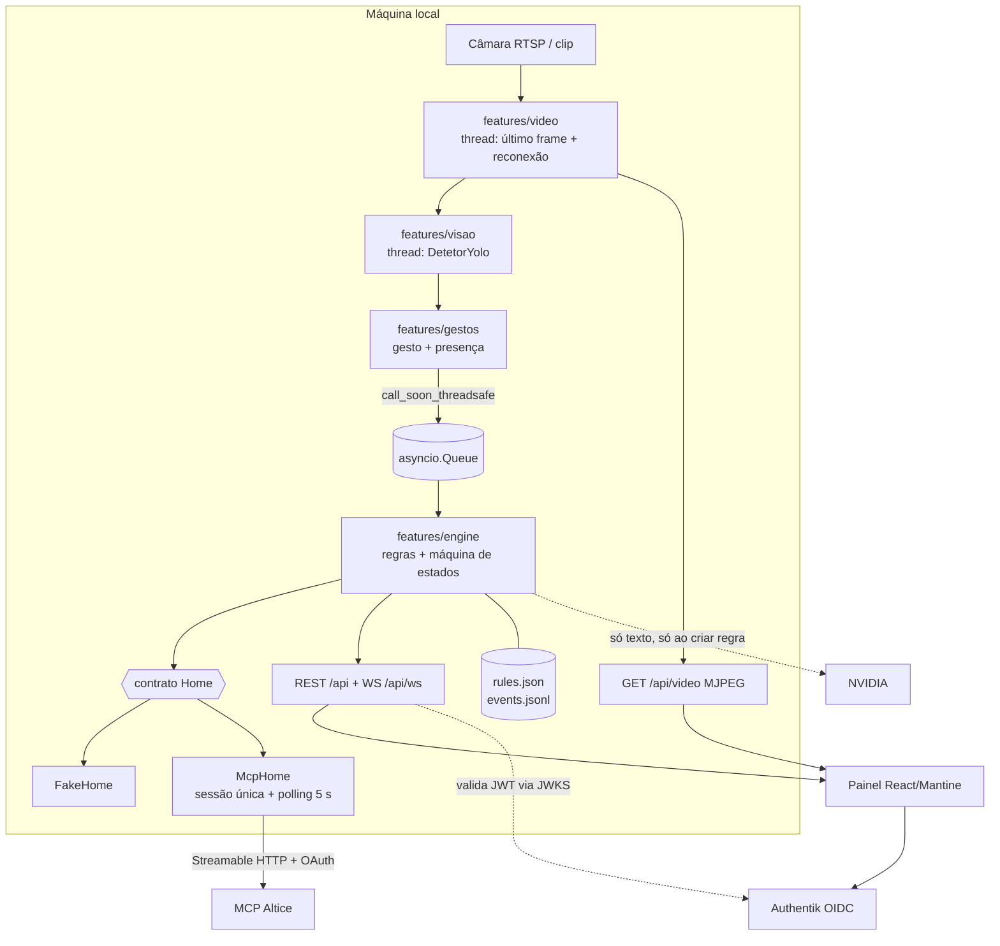
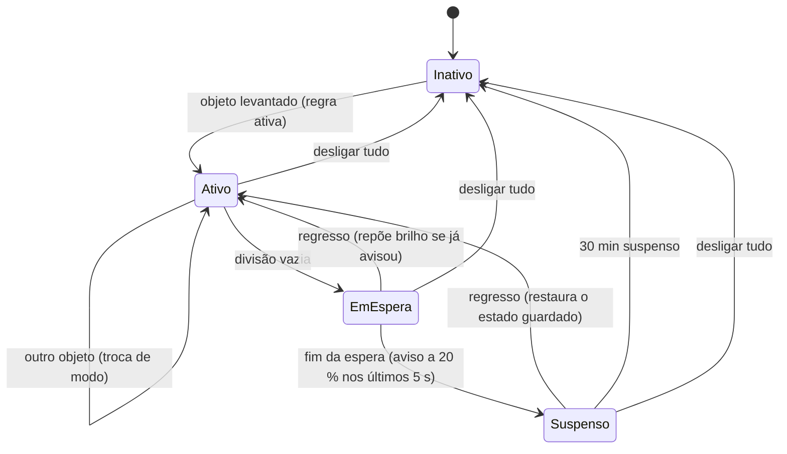
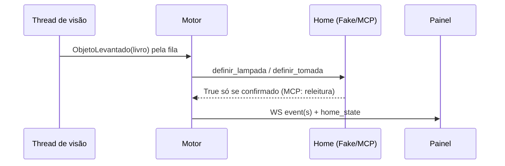

# Arquitetura

Um processo FastAPI (monólito modular, organizado por features), um painel React e, opcionalmente, o MCP Altice. Sem base de dados, filas externas ou microserviços.

## Componentes

O vídeo nunca sai da máquina local. Para fora só saem: chamadas MCP (lâmpada e tomada) e o texto de uma regra para a NVIDIA.

## Máquina de estados do motor

Espera: 180 s (`PROFILE=normal`) ou 10 s (`PROFILE=demo`). Todas as transições passam por um `asyncio.Lock`; os temporizadores são uma única tarefa cancelável. A poupança (Wh, €) só conta com a tomada confirmadamente desligada e consumo conhecido.

## Fluxo de um gesto

## Concorrência e ciclo de vida

| Unidade | Onde corre | Arranque / paragem |
|---|---|---|
| Fonte de vídeo | thread própria | criada no 1.º uso; parada no `lifespan` de `video` |
| Visão | thread `visao` | `lifespan` de `visao`, só com `VIDEO_SOURCE` + `VISAO_DETETOR` |
| Consumo da fila, vigia da câmara | tarefas asyncio | `lifespan` de `engine` |
| Temporizador de espera/suspensão | 1 tarefa asyncio | criada/cancelada pelo motor |
| Sessão MCP | 1 tarefa dona da sessão | aberta a pedido; fechada em erro ou no encerramento |
| Polling MCP | 1 tarefa asyncio | `McpHome.iniciar()` / `parar()` |

Os `lifespan` dos routers correm por ordem alfabética da pasta (`engine` → `video` → `visao`) e param pela ordem inversa. A ordem é intencional: a visão precisa do motor.

## MCP Altice

- **Sessão única e persistente** (`_Conexao`): uma tarefa abre a sessão e executa os pedidos em série. Qualquer erro fecha-a e o pedido seguinte abre uma nova. Um pedido cujo chamador já desistiu nunca é executado mais tarde.
- **Leituras:** polling de 5 s; `estado()` e `ler_consumo()` só leem a cache. Falha de leitura → `mcp_ok=false` e estados `null` (desconhecido), nunca valores inventados.
- **Escritas:** whitelist de ferramentas e capabilities, flag `ENABLE_PHYSICAL_WRITES`, grant temporário em ficheiro, releitura na mesma sessão até confirmar. Sem confirmação = falha. Uma escrita de resultado incerto nunca é repetida.
- **OAuth:** Authorization Code + PKCE, login interativo só no host (`make mcp-login`); tokens em `app/.mcp-auth/` (0700/0600) com escrita atómica e `flock`. O backend renova o access token sozinho e nunca abre browser.

## Autenticação do painel

Authentik (OIDC, cliente público com PKCE). O backend valida o JWT RS256 pelo JWKS (emissor, audiência e expiração obrigatórios). REST usa `Authorization: Bearer`; o WebSocket envia o token na primeira mensagem; o MJPEG é lido com `fetch` + Bearer. Nunca há tokens em URLs.

## Decisões

| Decisão | Porquê | Alternativa rejeitada |
|---|---|---|
| Monólito modular num processo | 5 dias, 5 pessoas; latência baixa entre visão e motor | microserviços, Redis, filas externas |
| Feature-first com descoberta de routers | trabalho paralelo sem conflitos em ficheiros centrais | registo manual em `main.py` |
| Contrato front↔back = OpenAPI → tipos TS gerados (não versionados) | uma só fonte de verdade, sem conflitos de merge | tipos escritos à mão |
| Ficheiros `rules.json` / `events.jsonl` | basta para o MVP; nada de imagens | base de dados |
| `Home` como protocolo com `FakeHome` e `McpHome` | motor testável sem hardware; demo com plano B | motor a falar MCP diretamente |
| Escrita só confirmada por releitura | o MCP responde «device updated» mesmo sem efeito físico (observado) | confiar na resposta da escrita |
| NVIDIA só na criação de regras | sem dependência de rede na execução; privacidade | LLM por frame ou por evento |
| YOLO como extra opcional fora do Docker | torch pesa centenas de MB; CI e Quick Start rápidos | imagem única com GPU |
| `Makefile` como interface única | mesmos comandos para pessoas, agentes e CI | scripts dispersos |
