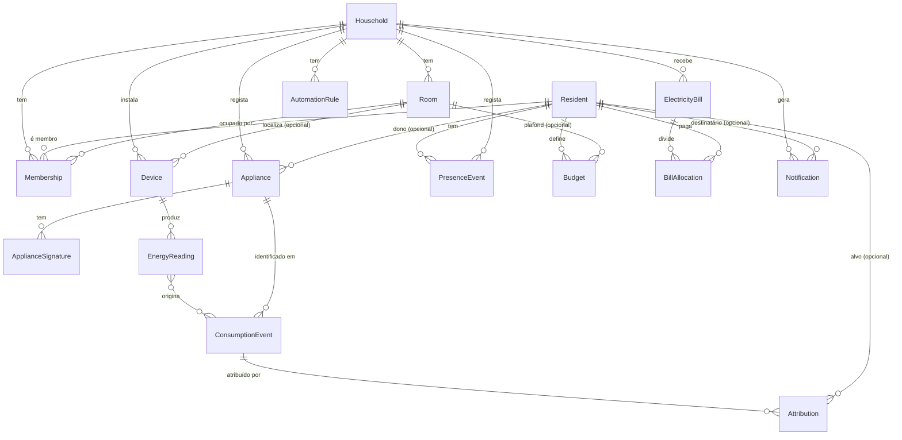

# Modelo de dados

> **HOUSE-03 #86 (IMPLEMENTADO, PR #142):** acrescenta `device`, `appliance`, `appliance_state`, `appliance_meter_link` e `appliance_signature` na migração `0101_house_appliance_catalog.sql`, com intervalos históricos. Detalhes em [house-03-appliance-catalog.md](house-03-appliance-catalog.md).

**Estado.** IMPLEMENTADAS em SQLite: `household`, `room`, `resident`, `membership`, `membership_invitation` (HOUSE-02), `domain_event`, `processed_event`, `event_failure`, `schema_migration`, `appliance*`/`device` (HOUSE-03) (`core/migrations/`). As restantes entidades têm **modelo Pydantic implementado** (`contracts/`) e tabelas **PLANEADAS**, criadas pelo dono de cada módulo (§Persistência). Convenções (IMPLEMENTADAS): IDs UUID (texto); instantes UTC com fuso; **dinheiro em cêntimos inteiros** (`*_cents`); **energia em Wh inteiros** (`energy_wh`); **potência em W** (`float`); preço em **milicêntimos/kWh**; ausência de medição = `NULL`/`None`, nunca 0; nomes em inglês `snake_case`; texto de UI em PT-PT.

## Proveniência (transversal) — IMPLEMENTADA

Duas dimensões independentes (decisão A em [contracts.md](contracts.md) §2):

```python
class Origin(StrEnum):    real = "real"; simulated = "simulated"          # de onde vem o dado
class ValueKind(StrEnum): measured; estimated; inferred                    # que tipo de valor é
class Provenance(ContractModel): origin: Origin; kind: ValueKind
```

`measured` = lido de um sensor com unidade confirmada (ou declarado pelo utilizador); `estimated` = calculado de dados (ex.: lâmpada 9 W × tempo × brilho); `inferred` = decidido por modelo/regra com incerteza (assinatura, atribuição automática). Uma assinatura reconhecida sobre dados do FakeHome é `simulated/inferred`. Agregados: simulada se algum componente o for; natureza menos fiável presente (`Provenance.combine`); `BillAllocation` guarda também os Wh por proveniência (`attributed_wh`). `confidence` (0–1) só existe quando a natureza é `inferred` (`Attribution`). Na base de dados: colunas `origin` e `kind` (`domain_event`).

## Diagrama



## Entidades

### Household
Casa gerida por um senhorio. **IMPLEMENTADA.** `id`, `name`, `settings` (`timezone`, `energy_price_millicents_per_kwh?` — preço de referência para estimativas, nunca para a fatura —, `source_kind` `demo` \| `real`) e `policy` (`common_area_rule` `equal` \| `ask` \| `presence`, omissão `ask`; `ask_threshold_cents` 50; `ask_timeout_hours` 24) — a política **inicial**; as mudanças posteriores são versões datadas em `billing_policy_version` (HOUSE-04, [billing.md](../modules/billing.md#regras-da-casa-versionadas-house-04)). Uma casa `real` **recusa eventos simulados**; a `demo` aceita ambos (o MVP mistura tomada real e quartos simulados). **Responsável:** P5.

### Room
`id`, `household_id`, `name`, `kind` (`bedroom` \| `common`), `included_wh` (plafond solidário de aquecimento por mês, só em quartos; BILL-03, ver [billing.md](../modules/billing.md)). A zona comum (sala, cozinha) é uma `Room` com `kind=common`. **P5.**

### Resident
Pessoa. `id`, `display_name`, `auth_subject` (o `sub` do Authentik, distinto de `id`, único, vazio até aceitar o convite; nunca em DTOs). Sem dados biométricos nem fotos. **P5.**

### Membership
Liga `Resident` ↔ `Household` ↔ `Room` com papel e datas do contrato. `role` (`landlord` \| `tenant` \| `operator`), `room_id` (inquilino), `starts_on`, `ends_on`, `status` (`invited` \| `active` \| `ended`), `presence_opt_in` (bool, omissão `false`). **P5.** Uma saída a meio do mês fecha a membership; o cálculo da fatura usa as datas (PDF §10.3).

### MembershipInvitation (HOUSE-02)

Convite de inquilino emitido por um senhorio efetivo. Tabela aditiva `0003_core_membership_invitations.sql`: id, membership_id (único), token_sha256 (único, não se guarda token em claro), target_email, created_by_membership_id, created_at UTC, expires_at UTC, redeemed_at?, redeemed_by_resident_id?, revoked_at?. A membership começa `invited`, passa a `active` numa transação de aceitação, ou a `ended` na revogação. A casa e o papel derivam da membership, nunca do pedido do utilizador. Nenhuma conta adquire acesso até o token ser apresentado por utilizador autenticado com email verificado correspondente. Consulte [HOUSE-02](house-02-memberships.md).

### Device
Dispositivo físico (ou simulado). `id`, `household_id`, `room_id?`, `kind` (`plug` \| `bulb` \| `camera` \| `sensor`), `role` (`main_meter` \| `room_meter` \| `actuator` \| `none`), `external_ref` (id MCP, **nunca** em logs/docs), `source` (`mcp` \| `fake` \| `replay`), `power_unit` (`W` \| `dW` \| `mW` \| `unknown`; `unknown` ⇒ leituras sem `power_w`), `last_seen_at`, `online`. **P1.** `power_unit = unknown` impede `measured` (ver [integrations/mcp-capabilities.md](../integrations/mcp-capabilities.md)).

### Appliance
Aparelho registado. `id`, `household_id`, `name`, `kind`, `owner_resident_id?`, `scope` (`personal` \| `shared` \| `common`), `home_room_id?`, `typical_watts?`, `status` (`active` \| `retired`), `registered_by`. **P1.**

### ApplianceSignature
Assinatura elétrica. `id`, `appliance_id`, `watts_mean`, `watts_tolerance`, `duration_typical_s?`, `pattern` (`continuous` \| `cyclic` \| `short` \| `decaying`), `typical_hours?`, `samples`, `origin` (`registered` \| `learned` \| `simulated`), `updated_at`. **P1.** Vários por aparelho (aprendizagem com confirmações).

### EnergyReading
Leitura pontual. `id`, `device_id`, `ts`, `power_w`, `provenance`, `raw_value?`, `raw_unit?`, `source`. Retenção curta (política por decidir, P-08). **P1.**

### ConsumptionEvent
Episódio de consumo detetado (aparelho ligou, durou, desligou). `id`, `household_id`, `device_id`, `appliance_id?`, `candidate_appliance_ids`, `confidence`, `started_at`, `ended_at?`, `peak_w`, `energy_wh` (acumulado enquanto `ongoing`; final em `closed`; `NULL` sem leituras utilizáveis), `location` (`room` \| `common` \| `unknown`), `room_id?`, `cost_estimate` (`{cents, price_millicents_per_kwh}` ou `NULL`; coerente com `energy_wh`), `provenance`, `status` (ver abaixo). **P1 (cria e é dono do estado) / P4 (consome).**

Estados (**IMPLEMENTADOS**, P1): `ongoing` → `closed` \| `discarded`. A identificação é o `ApplianceMatch` (`identified` \| `ambiguous` \| `unknown`). Quem paga e o estado de confirmação/contestação **não** são do consumo: vivem em `Attribution` (P4) e na `Notification` (P3); os estados `pending_confirmation`/`attributed`/`expired`/`contested` do fluxo de [event-flow.md](event-flow.md) §2 descrevem esse conjunto, não um campo do consumo.

### Attribution
Quem paga um `ConsumptionEvent`. `id`, `consumption_event_id`, `target_type` (`resident` \| `common`), `target_resident_id?`, `method` (`room_rule` \| `confirmation` \| `presence_rule` \| `equal_fallback` \| `manual`), `provenance`, `confidence`, `decided_by_resident_id?`, `decided_at`, `status` (`active` \| `superseded`). **P4.** Nunca se apaga: uma mudança cria nova `Attribution` e marca a anterior `superseded` (auditável, contestável).

### PresenceEvent
`id`, `household_id`, `ts`, `kind` (`door_in` \| `door_out` \| `person_state`), `resident_id?` (só `person_state`), `state?` (`in` \| `out` \| `uncertain`), `count_delta?`, `source` (`camera` \| `manual` \| `wifi` \| `simulated`), `provenance`, `confidence?`. **P2.** `door_*` **não tem identidade**. Sem imagem, sem `track_id` persistido.

### Budget
`id`, `resident_id?`, `room_id?`, `kind` (`personal` \| `room_allowance`), `period` (`YYYY-MM`), `limit_cents` ou `limit_kwh`, `thresholds` (omissão `[50, 80, 100]`), `last_threshold_notified`. **P4.**

### Notification
`id`, `household_id`, `scope` (`personal` \| `household`), `recipient_resident_id?`, `responder_ids` (snapshot de quem pode responder; nunca o senhorio), `kind` (`confirmation_request` \| `budget_alert` \| `peak_alert` \| `forgotten_appliance` \| `security_alert` \| `saving_tip` \| `automation_proposal` \| `agent_action` \| `info`), `severity` (`info` \| `warning` \| `critical`), `title`, `body`, `actions` (`[{id, label, style}]`), `status` (`unread` \| `read` \| `actioned` \| `expired` \| `dismissed`), `expires_at?`, `ref_type`, `ref_id` (ex.: `consumption_event`), `response` (`{action_id, by_resident_id, at, target_resident_id?}`: a resposta que fechou), `responses` (votos, só em `confirmation_request`, D-32), `correlation_id`, `created_at`. **P3 — IMPLEMENTADA** (`0300_notifications_core.sql`: `notification`, `notification_read` (recibo por residente), `notification_preferences` (por residente e casa)). Cada resposta/voto é persistido com *compare-and-set* (estado aberto e versão/n.º de votos lido) e emite `notification.responded` (com `outcome` nas confirmações); a API devolve `NotificationView` (`can_respond`, sem ids de terceiros).

### ElectricityBill
`id`, `household_id`, `period_start`, `period_end`, `total_cents`, `fixed_cents`, `total_wh` (da fatura real, **não** o medido pela tomada), `source` (`manual` \| `llm_extracted`), `status` (`draft` → `finalized` → `superseded`), `provenance`, `created_by`, `revision`, `supersedes_id?` (uma fatura finalizada nunca se edita: a correção é uma revisão nova). **P4.** `energy_cents = total_cents − fixed_cents`.

### BillAllocation
Parte de cada morador. `id`, `bill_id`, `resident_id`, `room_id?`, `fixed_share_cents`, `residual_share_cents`, `attributed_wh` (lista por proveniência), `individual_cents`, `amount_cents`, `breakdown` (lista de linhas explicáveis), `status` (`draft` \| `published` \| `contested` \| `resolved`). **P4.** Invariante: `Σ amount_cents = bill.total_cents`.

### AutomationRule
`id`, `household_id`, `name`, `source` (`natural_language` \| `manual` \| `suggested`), `nl_text?`, `trigger` (tipo + parâmetros), `condition?`, `actions` (`[{device_role, capability, value}]`), `requires_confirmation` (bool), `status` (`draft` \| `proposed` \| `active` \| `disabled`), `created_by`, `approved_by?`. **P3 (modelo e UI) / P1 (execução via `Home`).** As ações limitam-se ao que o MCP permite hoje (lâmpada e tomada: `power`, `brightness`, `color_rgb`).

## Estados e responsabilidades — resumo

| Entidade | Cria | Altera | Lê |
|---|---|---|---|
| Household, Room, Resident, Membership | P5 | P5 | todos (por papel) |
| Device, EnergyReading | P1 | P1 | P4, P3, P2 (diagnóstico) |
| Appliance, ApplianceSignature | P1 (e inquilino na UI) | P1 | P4 |
| ConsumptionEvent | P1 | P1 (identificação), P4 (estado de atribuição) | P3, P4 |
| Attribution | P4 | P4 | P3, agente |
| PresenceEvent | P2 | — | P4 (regra C, esquecidos), P3 |
| Budget | P4 | P4 | P3 |
| Notification | P3 (a pedido de P4/P1/P2) | P3 | UI |
| ElectricityBill, BillAllocation | P4 | P4 | UI, agente |
| AutomationRule | P3 | P3 | P1 |

Quem altera um estado de outro módulo fá-lo **por evento**, não por escrita direta (ver [event-flow.md](event-flow.md)).

## Persistência

**IMPLEMENTADO** (`core/db.py`, `core/migrations/`): SQLite da biblioteca standard; **uma** ligação partilhada com `threading.RLock`; `isolation_level=None` com `BEGIN IMMEDIATE`/`COMMIT`/`ROLLBACK` explícitos (`db.transaction()`, `db.run_sync(fn)`, `await db.run(fn)` numa thread: o event loop nunca bloqueia); `PRAGMA foreign_keys=ON`, `busy_timeout` (`DB_BUSY_TIMEOUT_MS`, 5000), WAL e `synchronous=NORMAL` em ficheiro. Caminho em `DB_PATH` (omissão `data/homemind.sqlite3`; `:memory:` nos testes). Encerra no shutdown (espera por uma transação em curso).

**Migrações** `core/migrations/NNNN_<modulo>_<descrição>.sql`, aplicadas **por nome**, por ordem, cada uma numa transação com o seu registo em `schema_migration(name, checksum, applied_at)`. Idempotente; um ficheiro já aplicado e alterado é erro; nunca destrutivo (sem `DROP` de dados). Dois ramos que acrescentem `0030_energy_x.sql` e `0040_billing_y.sql` não colidem; convenção: `0001–0099` core, `0100…` por módulo (P1 `01xx`, P2 `02xx`, P3 `03xx`, P4 `04xx`).

| Tabela | Estado | Notas |
|---|---|---|
| `schema_migration` | IMPLEMENTADA | criada pelo *runner* |
| `household`, `room`, `resident`, `membership` | IMPLEMENTADAS | FK composta `membership(household_id, room_id) → room`; um índice único parcial por pessoa+casa aberta e por inquilino ativo por quarto; `CHECK`s de papel/quarto/datas |
| `domain_event` | IMPLEMENTADA | `seq AUTOINCREMENT` (único, global), `id` único, `origin`+`kind`, `payload_json` = só `data`; **imutável** (triggers): nunca UPDATE; DELETE só da telemetria em bruto (`energy.reading_recorded`, `sensor.reading_recorded`) pelo expurgo de retenção (PRIV-04, migração `0004`) |
| `processed_event(consumer, event_id)` | IMPLEMENTADA | PK composta; guarda **todos** os ids processados, na transação do efeito |
| `event_failure(consumer, event_id)` | IMPLEMENTADA | tentativas, tipo do erro (nunca a mensagem), `dead` |
| `presence_device`, `presence_confirmation`, `presence_state` | IMPLEMENTADAS (`0200_presence_tables.sql`) | `presence_device.match_key` = HMAC do MAC com sal (revogar substitui-o por `revoked:<id>`); `presence_confirmation` só aceita 1 resposta; `presence_state` = último estado fundido por morador (PRES-04: `since`, deteção de mudança). As pistas (`presence.cue_recorded`) ficam em `domain_event` |
| `notification`, `notification_read`, `notification_preferences` | IMPLEMENTADAS | `0300_notifications_core.sql`; `notification.json` validado + colunas escalares; índice único parcial de pedido aberto; *compare-and-set* no estado |
| `agent_action`, `agent_action_log` | IMPLEMENTADAS (`0310_agent_actions.sql`) | `agent_action.json` = `ProposedAction` validada; `status` é a fonte de verdade (CAS por transição; `expired` derivado na leitura); `CHECK`s impõem `executed ⇔ execution_json` e confirmação gravada fora de `proposed/rejected/expired`; um gatilho só deixa `proposed→confirmed\|rejected` e `confirmed→executed`; `agent_action_log` tem uma linha por transição e **gatilhos recusam UPDATE/DELETE**; `agent_action.source` distingue chat de `safety` (AGENT-03b) |
| `agent_message` | IMPLEMENTADA (`0311_agent_messages.sql`) | histórico da conversa por residente (`role` `user`/`assistant`); só o próprio o lê; retenção curta cortada ao gravar (50 mensagens e 30 dias por residente, P-25, `features/agent/history.py`); nunca enviado ao LLM (P-06) |
| devices, appliances, readings, consumption, billing | PLANEADAS | cada dono cria a sua migração; ver «Persistência dos contratos» abaixo |

Persistência dos contratos (PLANEADO, estratégia): uma tabela por entidade com colunas escalares para o que se consulta (ids, `ts`, estado, `origin`/`kind`) e `*_cents`/`*_wh` inteiros; entidades de histórico nunca se atualizam no sítio (`Attribution` → índice único parcial `(consumption_event_id) WHERE status='active'`; `ElectricityBill` → revisão nova; `Notification` → *compare-and-set* no estado). `external_ref` só na tabela `device`.

Limitações de SQLite assumidas: um escritor de cada vez (todos os acessos serializam no lock; suficiente para um processo FastAPI numa hackathon); **um só processo** (vários *workers* exigiriam outra solução); leituras sem lock extra não existem (a mesma ligação).

Dados de demonstração: `features/households/repo.seed_demo` (casa Ana/Bruno/Carla/Diogo + senhorio e operador, `source_kind=demo`, idempotente) e `contracts/fixtures.py` (todos os contratos e uma amostra de cada evento). Privacidade: sem frames, sem imagens, sem identificação biométrica, `external_ref` nunca exposto.
