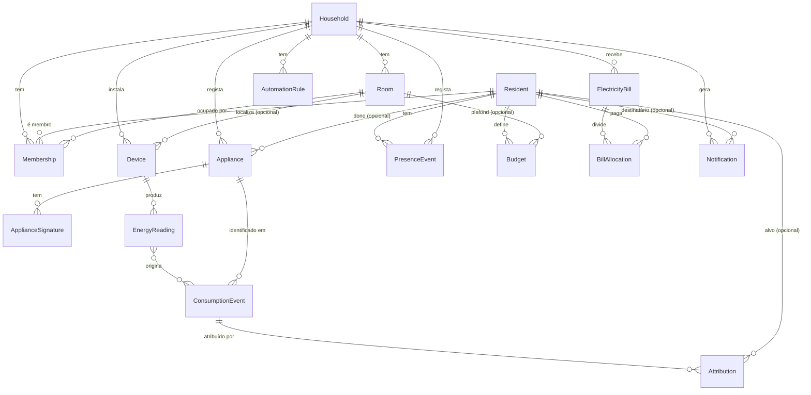

# Modelo de dados

**PLANEADO.** Nenhuma destas entidades existe no código. Persistência: SQLite. Convenções: IDs UUID (texto); instantes em UTC ISO 8601; **dinheiro em cêntimos inteiros** (`*_cents`); energia em kWh (`float`) e potência em W; nomes de campos em inglês `snake_case`; texto de UI em PT-PT.

## Proveniência (transversal)

```python
class Provenance(StrEnum):
    measured  = "measured"   # leitura real de hardware (MCP) com unidade confirmada
    estimated = "estimated"  # calculado a partir de dados reais (ex.: lâmpada 9 W × tempo × brilho; potência nominal × estado)
    inferred  = "inferred"   # decidido por modelo/regra com incerteza (assinatura, atribuição automática)
    simulated = "simulated"  # FakeHome, replay, dados de demonstração
```

Aplica-se a `EnergyReading`, `ConsumptionEvent`, `Attribution`, `PresenceEvent` e aos totais de `BillAllocation` (discriminados por proveniência). Regra de combinação: o valor agregado herda a proveniência **menos fiável** presente (`simulated` > `inferred` > `estimated` > `measured` em «menos fiável»), e `BillAllocation` guarda também o desdobramento em kWh por proveniência. Entidades com `confidence` (0–1) só em `inferred`.

## Diagrama



## Entidades

### Household
Casa gerida por um senhorio. Campos: `id`, `name`, `timezone`, `common_area_rule` (`equal` \| `ask` \| `presence`; omissão `ask`), `ask_threshold_cents` (omissão 50), `ask_timeout_hours` (omissão 24), `energy_price_cents_per_kwh` (referência para estimativas), `source_kind` (`demo` \| `real`). **Responsável:** P5.

### Room
`id`, `household_id`, `name`, `kind` (`bedroom` \| `common`), `included_kwh` (plafond do senhorio, opcional). A zona comum (sala, cozinha) é uma `Room` com `kind=common`. **P5.**

### Resident
Pessoa. `id`, `display_name`, `auth_subject` (o `sub` do Authentik, opcional até aceitar convite). Sem dados biométricos nem fotos. **P5.**

### Membership
Liga `Resident` ↔ `Household` ↔ `Room` com papel e datas do contrato. `role` (`landlord` \| `tenant` \| `operator`), `room_id` (inquilino), `starts_on`, `ends_on`, `status` (`invited` \| `active` \| `ended`), `presence_opt_in` (bool, omissão `false`). **P5.** Uma saída a meio do mês fecha a membership; o cálculo da fatura usa as datas (PDF §10.3).

### Device
Dispositivo físico (ou simulado). `id`, `household_id`, `room_id?`, `kind` (`plug` \| `bulb` \| `camera` \| `sensor`), `role` (`main_meter` \| `room_meter` \| `actuator` \| `none`), `external_ref` (id MCP, **nunca** em logs/docs), `source` (`mcp` \| `fake` \| `replay`), `power_unit` (`W` \| `dW` \| `mW` \| `unknown`), `last_seen_at`, `online`. **P1.** `power_unit = unknown` impede `measured` (ver [integrations/mcp-capabilities.md](../integrations/mcp-capabilities.md)).

### Appliance
Aparelho registado. `id`, `household_id`, `name`, `kind`, `owner_resident_id?`, `scope` (`personal` \| `shared` \| `common`), `home_room_id?`, `typical_watts?`, `status` (`active` \| `retired`), `registered_by`. **P1.**

### ApplianceSignature
Assinatura elétrica. `id`, `appliance_id`, `watts_mean`, `watts_tolerance`, `duration_typical_s?`, `pattern` (`continuous` \| `cyclic` \| `short` \| `decaying`), `typical_hours?`, `samples`, `origin` (`registered` \| `learned` \| `simulated`), `updated_at`. **P1.** Vários por aparelho (aprendizagem com confirmações).

### EnergyReading
Leitura pontual. `id`, `device_id`, `ts`, `power_w`, `provenance`, `raw_value?`, `raw_unit?`, `source`. Retenção curta (política por decidir, P-08). **P1.**

### ConsumptionEvent
Episódio de consumo detetado (aparelho ligou, durou, desligou). `id`, `household_id`, `device_id`, `appliance_id?`, `candidate_appliance_ids`, `confidence`, `started_at`, `ended_at?`, `peak_w`, `energy_kwh` (final ou estimada), `location` (`room` \| `common` \| `unknown`), `room_id?`, `cost_estimate_cents`, `provenance`, `status` (ver abaixo). **P1 (cria) / P4 (consome).**

Estados: `detected` → `identified` \| `unknown` → `pending_confirmation` → `attributed` \| `expired` (→ regra da casa) \| `contested`.

### Attribution
Quem paga um `ConsumptionEvent`. `id`, `consumption_event_id`, `target_type` (`resident` \| `common`), `target_resident_id?`, `method` (`room_rule` \| `confirmation` \| `presence_rule` \| `equal_fallback` \| `manual`), `provenance`, `confidence`, `decided_by_resident_id?`, `decided_at`, `status` (`active` \| `superseded`). **P4.** Nunca se apaga: uma mudança cria nova `Attribution` e marca a anterior `superseded` (auditável, contestável).

### PresenceEvent
`id`, `household_id`, `ts`, `kind` (`door_in` \| `door_out` \| `person_state`), `resident_id?` (só `person_state`), `state?` (`in` \| `out` \| `uncertain`), `count_delta?`, `source` (`camera` \| `manual` \| `wifi` \| `simulated`), `provenance`, `confidence?`. **P2.** `door_*` **não tem identidade**. Sem imagem, sem `track_id` persistido.

### Budget
`id`, `resident_id?`, `room_id?`, `kind` (`personal` \| `room_allowance`), `period` (`YYYY-MM`), `limit_cents` ou `limit_kwh`, `thresholds` (omissão `[50, 80, 100]`), `last_threshold_notified`. **P4.**

### Notification
`id`, `household_id`, `scope` (`personal` \| `household`), `recipient_resident_id?`, `kind` (`confirmation_request` \| `budget_alert` \| `peak_alert` \| `forgotten_appliance` \| `security_alert` \| `saving_tip` \| `automation_proposal` \| `agent_action` \| `info`), `severity` (`info` \| `warning` \| `critical`), `title`, `body`, `actions` (`[{id, label, style}]`), `status` (`unread` \| `read` \| `actioned` \| `expired` \| `dismissed`), `expires_at?`, `ref_type`, `ref_id` (ex.: `consumption_event`), `response` (`{action_id, by_resident_id, at}`), `correlation_id`, `created_at`. **P3.** A resposta é persistida e emite `notification.responded`.

### ElectricityBill
`id`, `household_id`, `period_start`, `period_end`, `total_cents`, `fixed_cents`, `total_kwh`, `source` (`manual` \| `llm_extracted`), `status` (`draft` \| `finalized`), `provenance`, `created_by`. **P4.** `energy_cents = total_cents − fixed_cents`.

### BillAllocation
Parte de cada morador. `id`, `bill_id`, `resident_id`, `room_id?`, `fixed_share_cents`, `residual_share_cents`, `attributed_kwh_by_provenance`, `attributed_kwh`, `individual_cents`, `amount_cents`, `breakdown` (lista de linhas explicáveis), `status` (`draft` \| `published` \| `contested` \| `resolved`). **P4.** Invariante: `Σ amount_cents = bill.total_cents`.

### AutomationRule
`id`, `household_id`, `name`, `source` (`natural_language` \| `manual` \| `suggested`), `nl_text?`, `trigger` (tipo + parâmetros), `condition?`, `actions` (`[{device_role, capability, value}]`), `requires_confirmation` (bool), `status` (`draft` \| `proposed` \| `active` \| `disabled`), `created_by`, `approved_by?`. **P3 (modelo e UI) / P1 (execução via `Home`).** As ações limitam-se ao que o MCP permite hoje (lâmpada e tomada: `power`, `brightness`, `color_rgb`).

## Estados e responsabilidades — resumo

| Entidade | Cria | Altera | Lê |
|---|---|---|---|
| Household, Room, Resident, Membership | P5 | P5 | todos (por papel) |
| Device, EnergyReading | P1 | P1 | P4, P3, P2 (diagnóstico) |
| Appliance, ApplianceSignature | P1 (e inquilino na UI) | P1 | P4 |
| ConsumptionEvent | P1 | P1 (identificação), P4 (estado de atribuição) | P3, P4 |
| Attribution | P4 | P4 | P3, agente |
| PresenceEvent | P2 | — | P4 (regra C, esquecidos), P3 |
| Budget | P4 | P4 | P3 |
| Notification | P3 (a pedido de P4/P1/P2) | P3 | UI |
| ElectricityBill, BillAllocation | P4 | P4 | UI, agente |
| AutomationRule | P3 | P3 | P1 |

Quem altera um estado de outro módulo fá-lo **por evento**, não por escrita direta (ver [event-flow.md](event-flow.md)).

## Persistência

- Um ficheiro SQLite; chaves estrangeiras ativas; `domain_event(id, ts, type, household_id, provenance, correlation_id, payload_json)` guarda todos os eventos de domínio.
- Migrações: ficheiros SQL numerados em `app/backend/src/homemind/core/migrations/` (**PLANEADO**, P5).
- Dados de demonstração: ficheiro de *seed* determinístico + um mês simulado, todos com `provenance=simulated` e `Household.source_kind=demo`.
- Privacidade: sem frames, sem imagens, sem identificação biométrica, `external_ref` nunca exposto pela API.
