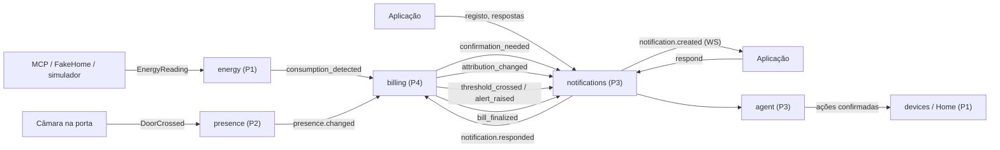
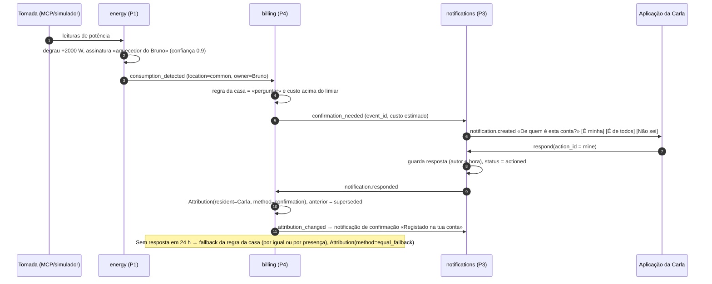
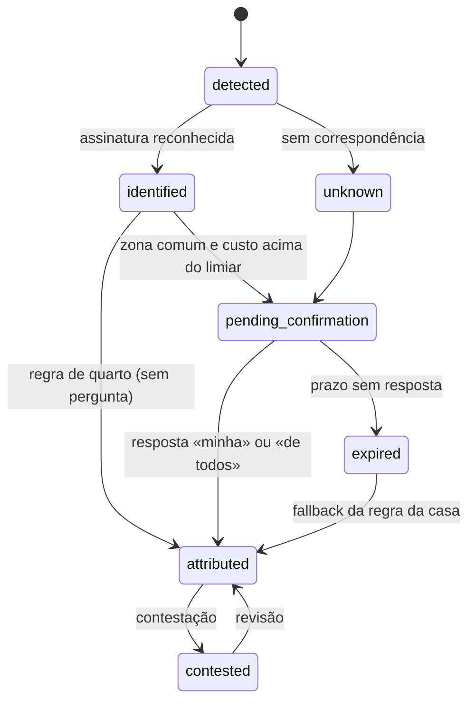
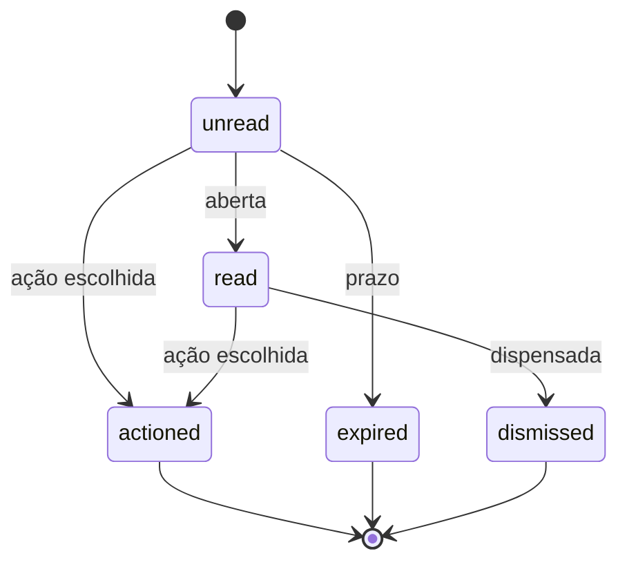
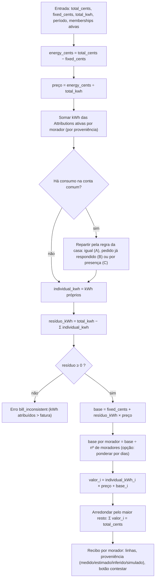

# Fluxo de eventos

**PLANEADO.** Eventos e payloads em [contracts.md](contracts.md); entidades em [data-model.md](data-model.md).

## 1. Fluxo geral

Cada seta é um evento do barramento em processo, gravado em `domain_event`. Os módulos só se conhecem pelos contratos.

## 2. Confirmação de um consumo

Exemplo do PDF §6.5, agora na aplicação (D-01): o aquecedor do Bruno liga-se na sala e a Carla usa-o.

Regras:

- Pode responder qualquer **inquilino ativo da casa**; a primeira resposta válida fixa a atribuição; uma resposta posterior em sentido contrário **não** a altera: cria um pedido de contestação visível para a casa (**PROPOSTA**, P-03).
- «Não sei» mantém o pedido aberto até ao fim do prazo; depois aplica-se o fallback.
- «É minha» é limitado: o morador só pode atribuir a si ou à conta comum, nunca a um terceiro.
- Em `HOME_BACKEND=fake` ou com leituras `simulated`, a atribuição resultante é `simulated` e a notificação diz-o.

### Estados do consumo e da notificação

## 3. Cálculo da fatura

Algoritmo determinístico e testável (sem LLM). Todos os valores em cêntimos inteiros; kWh em `float`.

Notas:

- **Arredondamento:** método do maior resto sobre `valor_i` em cêntimos; o resto distribui-se, um cêntimo de cada vez, pelas maiores partes fracionárias; empates resolvem-se por `resident_id` (determinístico). `Σ amount_cents = total_cents` é invariante testada.
- **Plafond solidário** (prioridade P1): os primeiros `N` kWh de aquecimento básico de cada quarto saem de `individual_kwh` e entram no resíduo.
- **Bi-horário** (P2): o preço passa a depender da hora de cada `ConsumptionEvent`.
- Exemplos numéricos de teste (ambos de 120 €) em [modules/billing.md](../modules/billing.md).

## 4. Garantias dos consumidores de eventos

| Garantia | Como |
|---|---|
| Idempotência | Cada consumidor regista **todos** os `event.id` processados na mesma transação do efeito (tabela `processed_event(consumer, event_id)`, chave única); um id já visto é ignorado. Guardar só o último id **não** chega: um replay ou entrega fora de ordem repetiria efeitos |
| Ordem | `correlation_id` **só agrupa** eventos do mesmo fluxo, não os ordena. A ordem vem de `seq`, número crescente atribuído pelo barramento ao gravar em `domain_event` (único, global), usado para ordenar replays e consultas. Em entrega, a ordem só é garantida entre eventos do mesmo tipo e produtor; os consumidores têm de tolerar chegadas fora de ordem (comparar `seq` ou `ts` do estado que alteram e ignorar o mais antigo) |
| Falha | Um handler que falha é registado (tipo de erro, sem dados pessoais) e não afeta os outros |
| Replay | Para a demo e para testes, **sempre numa base de dados isolada ou com o estado dos consumidores reposto** (limpar `processed_event` e as tabelas derivadas); reproduzir sobre a base real seria ignorado pela idempotência ou duplicaria efeitos. Os eventos reproduzidos levam `provenance=simulated` e novo `correlation_id` |
