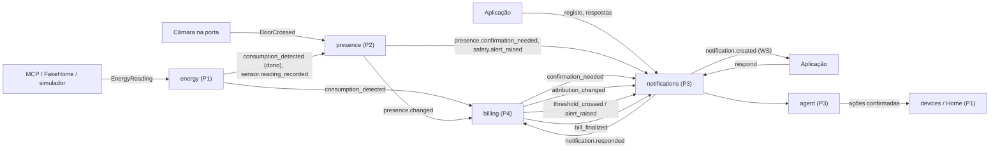
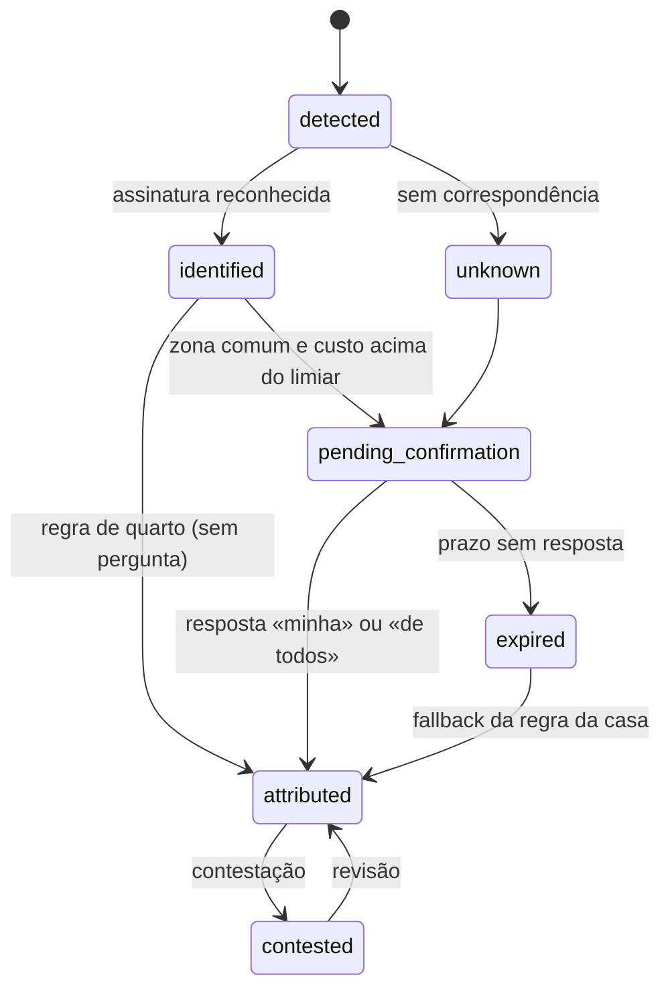
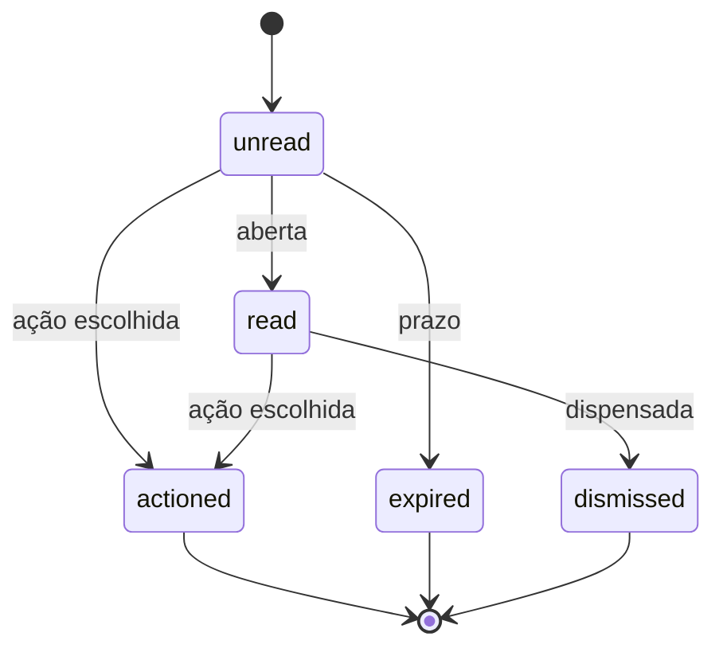
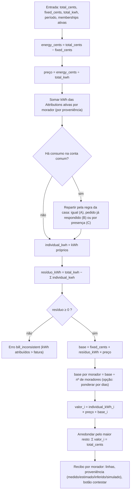

# Fluxo de eventos

**IMPLEMENTADO**: barramento persistente, idempotência e replay (§4–§5; `core/events.py`). **PLANEADO**: os produtores e consumidores de cada módulo (§1–§3). Eventos e payloads em [contracts.md](contracts.md); entidades em [data-model.md](data-model.md).

## 1. Fluxo geral



Cada seta é um evento do barramento em processo, gravado em `domain_event`. Os módulos só se conhecem pelos contratos.

## 2. Confirmação de um consumo

Exemplo do PDF §6.5, agora na aplicação (D-01): o aquecedor do Bruno liga-se na sala e a Carla usa-o.

```mermaid
sequenceDiagram
  autonumber
  participant T as Tomada (MCP/simulador)
  participant E as energy (P1)
  participant B as billing (P4)
  participant N as notifications (P3)
  participant U as Aplicação da Carla
  T->>E: leituras de potência
  E->>E: degrau +2000 W, assinatura «aquecedor do Bruno» (confiança 0,9)
  E->>B: consumption_detected (location=common, owner=Bruno)
  B->>B: regra da casa = «perguntar» e custo acima do limiar
  B->>N: confirmation_needed (event_id, custo estimado)
  N->>U: notification.created «De quem é esta conta?» [É minha] [Escolher responsável(eis)] [Não sei]
  U->>N: respond(action_id = mine)
  N->>N: guarda o voto; confirmation_outcome = self_claimed → status = actioned
  N->>B: notification.responded (outcome decidido)
  B->>B: Attribution(resident=Carla, method=confirmation), anterior = superseded
  B->>N: attribution_changed → notificação de confirmação «Registado na tua conta»
  Note over B: Sem resposta em 24 h → fallback da regra da casa (por igual ou por presença), Attribution(method=equal_fallback)
```

Regras:

- **Votação (D-32, prevalece sobre a regra antiga «primeira resposta vence»):** vota qualquer **inquilino ativo da casa**, uma vez. Um «É minha» fecha (paga quem assumiu). «Escolher responsável(eis)» (`other` + grupo, D-38) só decide quando **pelo menos metade** dos elegíveis (arredondado para cima) escolheu exatamente o mesmo grupo, que divide o consumo por igual; se o próprio assumir antes, fecha com ele. Todos votaram sem decisão, ou 24 h sem decisão → **por todos**. Fonte única: `confirmation_outcome`.
- Cada voto emite `notification.responded` com `outcome`; billing só cria a `Attribution` quando `outcome.decided`. Sem decisão até `expires_at`, billing aplica a divisão por todos pelo seu próprio prazo.
- «Não sei» (e «É de todos», só em votações antigas) contam como votos (para «votaram todos»), mas não decidem sozinhos.
- Em `HOME_BACKEND=fake` ou com leituras `simulated`, a atribuição resultante é `simulated` e a notificação diz-o.

### Estados do consumo e da notificação





## 3. Cálculo da fatura

Algoritmo determinístico e testável (sem LLM). Todos os valores em cêntimos inteiros; kWh em `float`.



Notas:

- **Arredondamento:** método do maior resto sobre `valor_i` em cêntimos; o resto distribui-se, um cêntimo de cada vez, pelas maiores partes fracionárias; empates resolvem-se por sorteio reproduzível (D-34: hash da casa, do mês da fatura e do morador; o mesmo mês dá sempre o mesmo resultado). `Σ amount_cents = total_cents` é invariante testada.
- **Plafond solidário** (prioridade P1): os primeiros `N` kWh de aquecimento básico de cada quarto saem de `individual_kwh` e entram no resíduo.
- **Bi-horário** (P2): o preço passa a depender da hora de cada `ConsumptionEvent`.
- Exemplos numéricos de teste (ambos de 120 €) em [modules/billing.md](../modules/billing.md).

## 4. Semântica do barramento — IMPLEMENTADA (`core/events.py`)

**Entrega pelo menos uma vez, com efeitos idempotentes.** Nunca «exactly once» de ponta a ponta.

```text
produtor → EventBus.publish → INSERT domain_event (seq) → COMMIT → acorda os consumidores
consumidor: loop próprio lê o que ainda não processou (por seq)
   BEGIN IMMEDIATE
     INSERT processed_event(consumer, event_id)   -- PK: duplicado ⇒ ignora (efeito não repete)
     handler(conn, evento)  → efeito + eventos de seguimento (gravados na mesma transação)
   COMMIT                                          -- se o handler levantar: ROLLBACK de tudo
```

| Garantia | Como |
|---|---|
| Persistir antes de entregar | O evento só existe após o COMMIT; um consumidor lê-o da base, não de uma fila em memória |
| Idempotência | `processed_event(consumer, event_id)` com chave única guarda **todos** os ids (não só o último). O efeito e o registo estão **na mesma transação**: não há «efeito feito mas não registado» nem o contrário. Reentregar (`bus.deliver`) devolve `False` sem repetir o efeito. Republicar um evento com o mesmo `id` e conteúdo devolve o gravado; com conteúdo diferente é `EventConflictError` |
| Atomicidade dos seguimentos | Os eventos que o handler devolve gravam-se na mesma transação (padrão *outbox*) e só se entregam depois do COMMIT |
| Handlers | **Síncronos**, rápidos, `(conn, StoredEvent) -> eventos | None`, a correr numa thread com o lock da base. Sem I/O externo dentro do handler (WS, HTTP, MCP): usar eventos de seguimento e um consumidor próprio |
| Falha | Tentativas limitadas (`max_attempts`=5) com *backoff* linear; `event_failure` regista tentativas e **só o tipo** do erro; ao esgotar fica `dead` para esse consumidor e deixa de o bloquear. Uma linha guardada que já não valida (contrato apertado, base de dev antiga) falha **por evento** e vai para `dead`; o consumidor nunca morre em silêncio (erro de ciclo ⇒ log do tipo + espera + continua). Um consumidor nunca afeta outro nem o produtor |
| Reinício | Nada a recuperar: o que não está em `processed_event` continua pendente. Reinício entre a gravação e a entrega, ou a meio do handler, é seguro |
| Ordem | `seq` global e único (atribuído pela base). Cada consumidor recebe por `seq`, mas um evento em *retry* pode ser ultrapassado: os handlers têm de tolerar chegadas fora de ordem (comparar `seq`/`ts` do estado que alteram). `correlation_id` agrupa um fluxo e **não ordena** |
| Dois produtores | `publish` serializa no lock; `publish_threadsafe` serve produtores fora do loop (visão). `seq` único e crescente (testado com 4 threads) |
| Shutdown | `stop()` cancela os consumidores; uma transação em curso termina ou faz ROLLBACK; a base fecha depois. Eventos pendentes ficam para o arranque seguinte |
| Consumidor novo | Um nome nunca visto processa **todo** o histórico dos seus tipos (ou desde `since_seq`). Renomear um consumidor reprocessa tudo: o nome é a chave de idempotência |
| Privacidade | Só `data` tipado (`extra=forbid`); sem frames, imagens, tokens nem ids externos; `event_failure` nunca guarda mensagens |
| Simulado vs real | `provenance.origin` em cada evento (`domain_event.origin`); uma casa `real` recusa eventos simulados |

Como um módulo subscreve (no `lifespan` do seu router, depois de o core arrancar): `app.state.bus.subscribe("billing.attributor", handler, ["notification.responded"])`. O barramento está em `app.state.bus`; a base de dados em `app.state.db`.

## 5. Replay e verificação de idempotência

`load_events(conn)` lê `StoredEvent` por `seq`; `replay(events, bus)` republica-os (mesmos ids) **numa base isolada** (`Database(":memory:")` ou ficheiro temporário + `migrate` + a casa `demo`). Repetir o replay não duplica nada (testado). Eventos simulados nunca entram numa casa `real`. Para repetir um cenário: criar base nova, `seed_demo`, subscrever os consumidores, `replay`; para provar idempotência, repetir o `replay` e comparar `processed_event`. **Nunca** reproduzir sobre a base real de uma casa `demo` em uso sem limpar `processed_event` e as tabelas derivadas.
