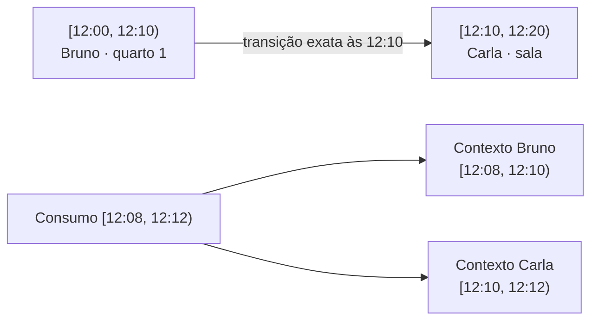

# HOUSE-03 — Catálogo de aparelhos e medidores (issue #86)

**Estado:** implementado na branch do PR #142, ainda não integrado na `main`. O catálogo não
implementa NILM (P1), ingestão de consumo (P1) nem atribuição financeira (P4). F0 permanece como
fonte de verdade para os tipos `Device`, `Appliance`, `ApplianceSignature`, `ConsumptionEvent` e
autorização.

## Investigação das três alternativas

| Critério | A — relacional simples | B — relacional temporal | C — orientado a assinatura |
|---|---|---|---|
| Simplicidade | Alta | **Média** | Baixa |
| Integridade referencial | Alta com FKs | **Alta com FKs e índices** | Depende da estrutura |
| Histórico de dono/local/medidor | Não, exige auditoria externa | **Sim, intervalos imutáveis** | Parcial, requer versões |
| Compatibilidade NILM | Só com extensões | **Boa, assinatura independente** | Ótima |
| Consulta REST/SQLite | Muito fácil | **Fácil, JOIN + janela temporal** | Mais joins e consultas especializadas |
| Dois aparelhos na mesma tomada | Sim com N:1 | **Sim com N:1 histórica** | Sim |
| Várias tomadas por quarto | Sim | **Sim; sem restrição device/room** | Sim |
| Impacto na fatura | Risco de reescrever passado | **Snapshot por instante do evento** | Exige separar classificação/cobrança |
| Trabalho adicional P1/P4 | Alto para histórico | **Moderado, contrato claro** | Alto para uma hackathon |

**Escolha: B mínima, com separação de sensores/ativos inspirada em C.** `Appliance` é o
ativo consumidor, `Device` é o medidor/atuador; `ApplianceSignature` pertence ao algoritmo P1.
Só as três relações relevantes para auditoria são temporais: propriedade/âmbito,
divisão habitual e medidor associado. Não introduzimos um grafo RDF, event sourcing novo
ou biblioteca extra. Um único `main_meter` pode ser ligado a muitos aparelhos.

**Fontes verificáveis:**
- [Brick Ontology — relações entre equipamento, espaços e pontos](https://docs.brickschema.org/brick/relationships.html):
  separa ativos físicos de pontos de telemetria e localização.
- [Project Haystack — Equipment](https://project-haystack.org/doc/docHaystack/Equips) e
  [Points](https://project-haystack.org/doc/docHaystack/Points):
  referências distintas a equipamento, local e sensores.
- [NILM: challenges of overlapping loads](https://www.mdpi.com/1996-1073/19/8/1883):
  assinaturas de aparelhos podem sobrepor-se e a identificação é probabilística.
- [SQLite foreign keys](https://www.sqlite.org/foreignkeys.html) e
  [partial indexes](https://www.sqlite.org/partialindex.html):
  FKs compostas e unicidade parcial para a relação atual.

## SQLite implementado (`0101_house_appliance_catalog.sql` + `0102_house_appliance_temporal_guards.sql`)

| Tabela | Chaves e invariantes |
|---|---|
| `device` | UUID interno, FK casa, FK composta casa/quarto, `source`, `external_ref` **interno**, `kind`, `role`, `power_unit`; unicidade de identidade externa dentro da casa |
| `appliance` | UUID interno, FK casa e registante, nome, categoria, potência opcional, `created_at`, `retired_at`, estado; unicidade de registo ativo com mesmo registante/nome/categoria |
| `appliance_state` | FK composta aparelho/casa + quarto/casa, `scope`, proprietário opcional, `home_room_id`, `valid_from`, `valid_to`; um único estado atual e intervalos sem sobreposição por aparelho |
| `appliance_meter_link` | FK composta aparelho/casa e medidor/casa; N aparelhos → 1 medidor; um único medidor habitual ativo e intervalos sem sobreposição por aparelho; links históricos preservados |
| `appliance_signature` | Dados opcionais de `ApplianceSignature`, FK aparelho; P1 escreve e classifica, sem garantir identidade |

O período é semiaberto `[valid_from, valid_to)`; timestamps persistidos usam UTC no formato fixo
`YYYY-MM-DDTHH:MM:SS.ffffff+00:00`, necessário para comparação lexical correta no SQLite.
Mudança de contexto encerra a versão anterior e cria outra na **mesma transação**
(`BEGIN IMMEDIATE`). Índices únicos parciais impedem duas versões atuais; triggers impedem
sobreposições mesmo por SQL direto, apagar ou modificar versões encerradas. A aplicação impede
backdating e instantes não crescentes (`409 catalog_time_conflict`); duas alterações concorrentes no
mesmo instante serializam e só uma pode efetivar-se. Proprietários novos têm de ser **inquilinos
ativos no fuso da casa**; triggers verificam que proprietário, autor e registante têm membership
histórica na mesma casa, sem exigir que ela continue ativa. Uma pessoa que abandone a casa não
elimina nem invalida história. Retirar um aparelho fecha, na mesma transação, a associação a medidor
e o estado atual; o aparelho e as versões antigas continuam consultáveis como registo retirado.

A coluna `home_room_id` é **divisão habitual**, não a prova de onde o aparelho foi
utilizado. O `device.room_id` indica a localização configurada do medidor. Num
`ConsumptionEvent`, `location`/`room_id` são a observação de P1, potencialmente
desconhecida. Nenhuma das três dimensões implica o pagador.

## Rotas (prefixo `/api/households/{household_id}`)

| Método | Rota | Autorização |
|---|---|---|
| GET | `/appliances` | Tenant: próprios + comuns; operador: diagnóstico sem pessoas; senhorio: 403 |
| POST | `/appliances` | Tenant: registo pessoal/partilhado para si, ou comum |
| GET | `/appliances/{id}` | Tenant: próprios + comuns; operador: diagnóstico |
| PATCH | `/appliances/{id}` | Proprietário atual; ou autor de aparelho comum |
| DELETE | `/appliances/{id}` | Mesma regra; apenas soft-retire |
| GET | `/appliances/{id}/history` | Mesma leitura, proprietários de terceiros ocultados |
| GET | `/devices` | Operador, `DeviceView` sem `external_ref` |
| POST | `/devices/demo` | Operador; **só fake/replay**, nunca provisiona hardware |
| PUT | `/appliances/{id}/meter` | Operador; associa ou desassocia medidor existente |

Todos os endpoints usam `require_access` do F0: utilizador não-membro da casa ⇒ 404;
papel não autorizado ⇒ 403. Um tenant não pode ver aparelhos pessoais de outro
tenant. O operador não recebe nomes de aparelhos, proprietários ou autores.
Sem `sub` do Authentik, `external_ref` MCP, chaves ou telemetria privada nos DTOs.

**Exemplo de criação (inquilino autenticado):**
```json
{
  "name": "Aquecedor",
  "category": "heating",
  "scope": "personal",
  "home_room_id": "00000000-0000-0000-0000-000000000002",
  "typical_watts": 2000
}
```
`owner_resident_id` NÃO é aceite no registo: é obtido da membership autenticada.
Ao transferir o aparelho, o proprietário atual pode fazer
`PATCH {"owner_resident_id":"<uuid de outro inquilino ativo>","home_room_id":"<uuid sala>"}`;
o servidor nunca altera versões anteriores. Para `scope=common` o proprietário é
obrigatoriamente `null`. O operador pode associar:
```json
{"device_id": "00000000-0000-0000-0000-000000000003"}
```
ou desligar a associação com `{"device_id":null}`. Estes UUIDs são ilustrativos.

## Port partilhado para P1 e P4

O limite entre features está em `contracts.appliance_catalog.ApplianceCatalog`, com os tipos
`MeterContextSegment` e `ApplianceContextSegment`. P1/P4 recebem o port por injeção e importam
apenas `contracts/`; não importam `features.appliances`. `features.appliances.repo.appliance_catalog()`
fornece a implementação SQLite ao composition root. Cada operação recebe a conexão da transação
atual. A composição no runtime P1/P4 permanece por validar quando esses handlers forem ligados.

```python
from homemind.contracts.appliance_catalog import ApplianceCatalog

def handle_consumption(conn, event, catalog: ApplianceCatalog):
    context = catalog.context_for_consumption(conn, event)
```

## Contratos de domínio para P1 e P4

**P1 (energia/assinaturas), operações implementadas no adapter:**
- Pode provisionar um dispositivo descoberto pelo MCP com
-  `catalog.register_device(conn, Device(...))`, dentro de `db.run`/`run_sync`; replay da mesma identidade
  MCP é idempotente e preserva o UUID interno já referenciado pelos links; descobertas com
  `last_seen_at` mais antigo não regridem o nome/estado atual. A chave `external_ref`
  permanece privada. A API `/devices/demo` não serve de integração MCP.
- Grava e lê assinaturas com `catalog.save_appliance_signature(conn, household_id, ApplianceSignature)` e
  `catalog.signatures_for_household(conn, household_id)`. A leitura é uma consulta por casa, sem N+1, e só
  devolve assinaturas dos aparelhos ativos dessa casa. Replays de `updated_at` antigo não substituem
  assinaturas mais recentes; aparelhos retirados não aceitam novas assinaturas. P1 gere
  aprendizagem/classificação; HOUSE-03 não fornece classificador, treino nem ingestão de potência.
- `catalog.meter_at(conn, household_id, appliance_id, ts)` e
  `catalog.meters_for_period(conn, household_id, appliance_id, start, end)` devolvem a associação
  configurada, com períodos sem associação representados por `device_id=None`. Uma associação não é
  prova de utilização. Vários aparelhos podem partilhar o mesmo medidor.
- Preserva `ApplianceMatch` probabilístico. `unknown`, candidatos empatados e cargas simultâneas não
  recebem aparelho por inferência forçada.

**P4 (faturação), operações implementadas no adapter:**
- `catalog.ownership_at(conn, household_id, appliance_id, ts)` consulta a versão válida no instante, sem
  consultar membership atual.
- `catalog.context_segments_for_consumption(conn, event)` devolve segmentos `[start, end)` com o contexto
  histórico em cada segmento. `catalog.context_for_consumption(conn, event)` devolve um único
  `ApplianceOwnership` apenas se todo o evento tiver um único contexto; devolve `None` para match
  desconhecido, aparelho ausente/retirado nesse período ou evento que cruza uma alteração temporal.
  Tem em conta `started_at` e `ended_at`; a leitura de estado dos episódios fechados usa uma única
  consulta. Para eventos a decorrer, o contexto no início é provisório.
- O histórico preserva proprietário e divisão no passado; a **localização do
  evento**, o utilizador real e a regra de atribuição vêm de evidências separadas.
  **Proprietário ≠ utilizador ≠ pagador**. A `confidence` da classificação
  não é uma decisão financeira nem prova de identidade.
- Segmentos são apenas contexto temporal: não incluem energia repartida por segmento. Se P1 não
  conseguir fechar episódios/medir energia por segmento, P4 trata o consumo atravessado como
  ambíguo e aplica o seu processo de revisão/resíduo. Não repartir energia proporcionalmente ao
  tempo nem escolher o proprietário do início/fim.
- Nunca consultar o proprietário **atual** para reprocessar faturas antigas. `Attribution` e
  `BillAllocation` continuam exclusivamente em P4, com revisão explícita se existir contestação.

Exemplo de transferência e evento que atravessa a fronteira:



Um `ConsumptionEvent` `[12:08, 12:12)` produz dois segmentos de contexto. A função singular devolve
`None`; P4 não atribui os kWh todos a Bruno nem todos a Carla.

## Ensaios e limitações

`features/appliances/tests/test_catalog.py` cobre registos pessoais/comuns,
isolamento multi-casa e por papel, mudança de quarto/proprietário, consulta por
`ConsumptionEvent.started_at`, dois aparelhos com assinaturas próximas,
uma tomada para dois aparelhos, ausência de assinatura, soft-retire e saída
de um inquilino sem eliminar história, rollback, fronteiras exatas, concorrência,
replay de assinatura/dispositivo, intervalos SQL sobrepostos e persistência após
reabrir SQLite. Testes com DB `:memory:`/temporário, clock fixo e source `fake`;
nenhum ensaio prova identificação real numa tomada Altice.

**Limites assumidos:** um aparelho tem no máximo um **medidor habitual** em cada
instante, mas o mesmo medidor pode agregar vários aparelhos; isto não impede que P1
reconheça a assinatura noutro medidor. Um histórico com alterações retroativas
(backdating) não é aceite pelo CRUD: exige revisão explícita, para impedir que se
reinterpretem silenciosamente períodos faturados. Alterações a uma divisão ou
proprietário fora da casa são rejeitadas pela aplicação e por triggers SQL. Os
segmentos não substituem leituras de energia por segmento nem decidem uma divisão.

## Estado de integração (17/11/2026)

- **Consumidores na `main`:** nenhum. O BILL-02 (`features/billing/attribution.py`) ainda não importa `ApplianceCatalog`; a ligação catálogo → atribuição é um follow-up de P1/P4 e **não** é feita aqui (sem segundo motor de atribuição). Revisão formal de P1/P4 ao PR #142: não existia à data do merge.
- Teste cruzado HOUSE-02 × HOUSE-03 (`features/appliances/tests/test_house02_integration.py`): convite real → membership → aparelho pessoal → revogação → histórico preservado.
