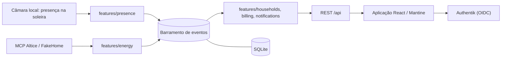
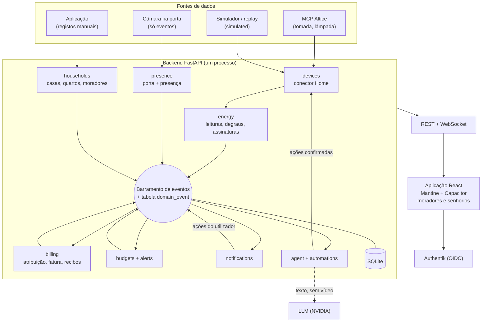

# Arquitetura

Dois estados, sempre separados:

- **IMPLEMENTADO** — o que existe hoje no backend da Conta Certa.
- **PLANEADO** — a arquitetura alvo da Conta Certa.
- A fundação e vários módulos de produto P1–P4 estão implementados; cada documento de módulo distingue o que está **IMPLEMENTADO** do que está **PLANEADO**.

Detalhes: entidades em [data-model.md](data-model.md), contratos em [contracts.md](contracts.md), eventos em [event-flow.md](event-flow.md), caminho do atual ao alvo em [migration.md](migration.md).

## 1. Implementado hoje (Conta Certa)

Um processo FastAPI com SQLite, barramento de eventos em processo e routers descobertos por feature.
O motor ObjectOS, a cadeia de gestos/visão para regras e o respetivo WebSocket foram removidos em
BASE-04 (#74). A visão que permanece serve a presença na soleira; não deteta objetos nem pose.

Referência histórica do ObjectOS: [archive/objectos/architecture.md](../archive/objectos/architecture.md). API ativa: [api-implementada.md](api-implementada.md).

## 2. Planeada (Conta Certa)

Mantém-se: um processo FastAPI, React/TypeScript/Mantine/Capacitor, Authentik, MCP Altice, OpenAPI → tipos TS, Docker Compose. Acrescenta-se **SQLite** para o domínio novo e um **barramento de eventos em processo**. Sem microserviços, filas externas ou Redis.

### Módulos

| Módulo (`features/…`) | Dono | Recebe | Produz | Documento |
|---|---|---|---|---|
| `households` | P5 | Pedidos da UI (casas, quartos, convites) | `Household`, `Room`, `Resident`, `Membership`; eventos de membership | [households.md](../modules/households.md) |
| `devices` (+ `connectors/`) | P1 | MCP real ou FakeHome ou simulador | Estado de dispositivos; `EnergyReading` | [energy.md](../modules/energy.md) |
| `energy` | P1 | `EnergyReading` | `PowerStep`, `ConsumptionEvent`, aparelhos identificados | [energy.md](../modules/energy.md) |
| `presence` | P2 | Eventos da porta; registo manual; (futuro) Wi-Fi | `PresenceEvent`; estado por pessoa | [presence.md](../modules/presence.md) |
| `billing` | P4 | `ConsumptionEvent`, respostas, fatura | `Attribution`, `ElectricityBill`, `BillAllocation`, recibos | [billing.md](../modules/billing.md) |
| `budgets` + `alerts` | P4 | Consumo atribuído, picos, presença | `Budget`, `alert.raised` | [billing.md](../modules/billing.md) |
| `notifications` | P3 | Eventos de alerta e de confirmação | `Notification`, respostas | [notifications.md](../modules/notifications.md) |
| `agent` + `automations` | P3 (execução física: P1) | Perguntas do utilizador; eventos | Respostas, ações propostas, `AutomationRule` | [agent.md](../modules/agent.md) |
| Frontend (`app/frontend`) | P5 | REST/WS | Ecrãs por papel | [team.md](../development/team.md) |

Os nomes de módulos novos são em inglês (como as entidades do pedido); as pastas existentes (`video`, `visao`, `gestos`, `engine`) mantêm os nomes até serem removidas ou adaptadas.

### Como os módulos comunicam

1. **Contratos partilhados** em `contracts/` (Pydantic) são a única dependência entre features. Uma feature **não importa** outra feature.
2. **Barramento de eventos** persistente em processo (`core/events.py`, dono P5, **IMPLEMENTADO**): `await bus.publish(evento)` e `bus.subscribe(consumidor, handler, tipos)`. O evento é gravado em `domain_event` e só depois entregue (pelo menos uma vez; efeitos idempotentes por `processed_event`); dá histórico, replay numa base isolada e testes por módulo com eventos falsos. Semântica completa: [event-flow.md](event-flow.md) §4.
3. **Leituras por REST**: a aplicação nunca fala com o MCP nem com o barramento; só com as rotas `/api/*`. Não há WebSocket ativo após BASE-04.
4. **Escritas físicas** passam sempre pelo contrato `Home` (`FakeHome` | `McpHome`) com a whitelist e o grant já implementados ([integrations/altice-mcp.md](../integrations/altice-mcp.md)).

### Arranque e dependências entre features — IMPLEMENTADO (D-06)

`FastAPI(lifespan=core_lifespan)` (`core/lifespan.py`, passado em `main.py`): abre SQLite, aplica as migrações, cria o `EventBus` e põe-nos em `app.state.db` / `app.state.bus`; **só depois** correm os `lifespan` dos routers (o FastAPI aninha-os dentro do da app), e o core termina por último (cancela o barramento, fecha a base). Se o arranque do core falhar, nenhuma feature arranca. Os `lifespan` das features (`engine` → `video` → `visao`) continuam como estavam; nenhuma feature nova depende da ordem alfabética para ter a base pronta. Um módulo regista os seus consumidores no seu `lifespan` com `app.state.bus.subscribe(...)`.

### Persistência — IMPLEMENTADA

SQLite da biblioteca standard (sem SQLAlchemy/aiosqlite/Alembic, **sem dependências novas**): uma ligação, lock, transações explícitas, WAL, `foreign_keys`. Migrações SQL por nome. Pormenores e limitações em [data-model.md](data-model.md#persistência). A persistência atual é SQLite; `rules.json` e `events.jsonl` pertenciam ao motor removido na BASE-04.

### MVP com uma única tomada, expansível

O modelo já separa **o papel do dispositivo** do aparelho:

| Papel (`Device.role`) | MVP | Depois |
|---|---|---|
| `main_meter` | A única tomada com medição, à entrada da extensão: faz de «contador da casa» | Sem equivalente em produção (D-16: sem HAN nem contador geral); a fatura mensal fecha o total |
| `room_meter` | Não existe; consumos de quartos simulados (`simulated`) | Uma tomada por quarto: localização exata |
| `actuator` | Lâmpada (feedback) e a mesma tomada (corte) | Mais tomadas |

Com um único medidor, **a identificação do aparelho é provável, não garantida**: o contrato guarda `confidence` e o estado `unknown`; o resíduo é dividido por igual (princípio «o pior caso é o de hoje»). Ver [development/mvp.md](../development/mvp.md).

### Medições, estimativas, inferências e simulações

Todos os contratos de energia, atribuição e fatura carregam `provenance = {origin: real|simulated, kind: measured|estimated|inferred}` ([data-model.md](data-model.md)); `simulated/inferred` é uma inferência sobre dados simulados. A aplicação mostra a proveniência de cada valor; um recibo com `simulated` nunca se apresenta como real.

## 3. Segurança e privacidade (inalteradas)

Vídeo só local, nunca gravado nem enviado; só eventos de texto. Sem reconhecimento facial. Segredos só em `app/.env` e `app/.mcp-auth/`. MCP limitado a `get_home_devices`, `get_device_details`, `update_device_capabilities` e a lâmpada/tomada. Escritas físicas: flag + grant temporário + autorização explícita. Regras completas em [CLAUDE.md](../../CLAUDE.md).
