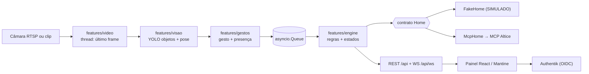
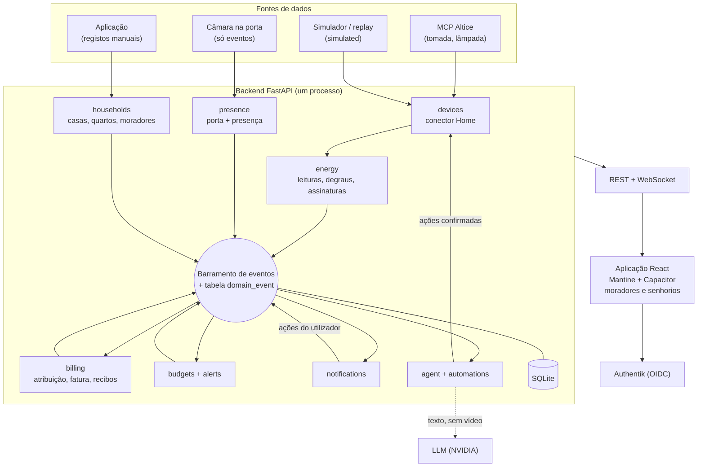

# Arquitetura

Dois estados, sempre separados:

- **IMPLEMENTADO** — o que está hoje na `main` (herança do ObjectOS).
- **PLANEADO** — a arquitetura alvo da Conta Certa. Nada daqui existe ainda.

Detalhes: entidades em [data-model.md](data-model.md), contratos em [contracts.md](contracts.md), eventos em [event-flow.md](event-flow.md), caminho do atual ao alvo em [migration.md](migration.md).

## 1. Implementado hoje (ObjectOS)

Um processo FastAPI (monólito modular por features), painel React e MCP Altice opcional. Sem base de dados: `rules.json` e `events.jsonl`.

Referência histórica: [archive/objectos/architecture.md](../archive/objectos/architecture.md). API real: [api-implementada.md](api-implementada.md).

## 2. Planeada (Conta Certa)

Mantém-se: um processo FastAPI, React/TypeScript/Mantine/Capacitor, Authentik, MCP Altice, OpenAPI → tipos TS, Docker Compose. Acrescenta-se **SQLite** para o domínio novo e um **barramento de eventos em processo**. Sem microserviços, filas externas ou Redis.

### Módulos

| Módulo (`features/…`) | Dono | Recebe | Produz | Documento |
|---|---|---|---|---|
| `households` | P5 | Pedidos da UI (casas, quartos, convites) | `Household`, `Room`, `Resident`, `Membership`; eventos de membership | [households.md](../modules/households.md) |
| `devices` (+ `connectors/`) | P1 | MCP real ou FakeHome ou simulador | Estado de dispositivos; `EnergyReading` | [energy.md](../modules/energy.md) |
| `energy` | P1 | `EnergyReading` | `PowerStep`, `ConsumptionEvent`, aparelhos identificados | [energy.md](../modules/energy.md) |
| `presence` | P2 | Eventos da porta; registo manual; (futuro) Wi-Fi | `PresenceEvent`; estado por pessoa | [presence.md](../modules/presence.md) |
| `billing` | P4 | `ConsumptionEvent`, respostas, fatura | `Attribution`, `ElectricityBill`, `BillAllocation`, recibos | [billing.md](../modules/billing.md) |
| `budgets` + `alerts` | P4 | Consumo atribuído, picos, presença | `Budget`, `alert.raised` | [billing.md](../modules/billing.md) |
| `notifications` | P3 | Eventos de alerta e de confirmação | `Notification`, respostas | [notifications.md](../modules/notifications.md) |
| `agent` + `automations` | P3 (execução física: P1) | Perguntas do utilizador; eventos | Respostas, ações propostas, `AutomationRule` | [agent.md](../modules/agent.md) |
| Frontend (`app/frontend`) | P5 | REST/WS | Ecrãs por papel | [team.md](../development/team.md) |

Os nomes de módulos novos são em inglês (como as entidades do pedido); as pastas existentes (`video`, `visao`, `gestos`, `engine`) mantêm os nomes até serem removidas ou adaptadas.

### Como os módulos comunicam

1. **Contratos partilhados** em `contracts/` (Pydantic) são a única dependência entre features. Uma feature **não importa** outra feature.
2. **Barramento de eventos** em processo (`core/events.py`, dono P5): `publish(evento)` e `subscribe(tipo, handler)`. Todos os eventos de domínio são também gravados em SQLite (`domain_event`), o que dá histórico, replay para a demo e testes por módulo com eventos falsos (a ideia do PDF §17.2, sem tabela única de «tudo»).
3. **Leituras por REST**: a aplicação nunca fala com o MCP nem com o barramento; só com `/api/*` e `WS /api/ws`.
4. **Escritas físicas** passam sempre pelo contrato `Home` (`FakeHome` | `McpHome`) com a whitelist e o grant já implementados ([integrations/altice-mcp.md](../integrations/altice-mcp.md)).

### Decisão: arranque e dependências entre features

Hoje os `lifespan` das features correm por ordem alfabética (`engine` → `video` → `visao`) e `app/backend/AGENTS.md` usa isso de propósito. As features novas (`agent`, `alerts`, `billing`, `budgets`…) ordenam-se **antes** de `engine`, e várias dependem de recursos partilhados. Por isso (D-06 em [decisions.md](../decisions.md)):

- a base de dados e o barramento são criados em `core/` (lifespan central, antes de qualquer feature), não por uma feature;
- nenhuma feature nova depende da ordem de arranque de outra: comunica por barramento ou base de dados;
- a regra «`engine` → `video` → `visao`» mantém-se só enquanto essas features existirem.

### Persistência

SQLite (ficheiro no volume de dados do backend), modo WAL, esquema versionado por ficheiros SQL numerados. Pormenores em [data-model.md](data-model.md). Escolha da biblioteca de acesso: decisão pendente P-05. `rules.json` e `events.jsonl` do ObjectOS deixam de ser usados quando o motor antigo for removido.

### MVP com uma única tomada, expansível

O modelo já separa **o papel do dispositivo** do aparelho:

| Papel (`Device.role`) | MVP | Depois |
|---|---|---|
| `main_meter` | A única tomada com medição, à entrada da extensão: faz de «contador da casa» | Módulo HAN no contador |
| `room_meter` | Não existe; consumos de quartos simulados (`simulated`) | Uma tomada por quarto: localização exata |
| `actuator` | Lâmpada (feedback) e a mesma tomada (corte) | Mais tomadas |

Com um único medidor, **a identificação do aparelho é provável, não garantida**: o contrato guarda `confidence` e o estado `unknown`; o resíduo é dividido por igual (princípio «o pior caso é o de hoje»). Ver [development/mvp.md](../development/mvp.md).

### Medições, estimativas, inferências e simulações

Todos os contratos de energia, atribuição e fatura carregam `provenance ∈ {measured, estimated, inferred, simulated}` ([data-model.md](data-model.md)). A aplicação mostra a proveniência de cada valor; um recibo com `simulated` nunca se apresenta como real.

## 3. Segurança e privacidade (inalteradas)

Vídeo só local, nunca gravado nem enviado; só eventos de texto. Sem reconhecimento facial. Segredos só em `app/.env` e `app/.mcp-auth/`. MCP limitado a `get_home_devices`, `get_device_details`, `update_device_capabilities` e a lâmpada/tomada. Escritas físicas: flag + grant temporário + autorização explícita. Regras completas em [CLAUDE.md](../../CLAUDE.md).
