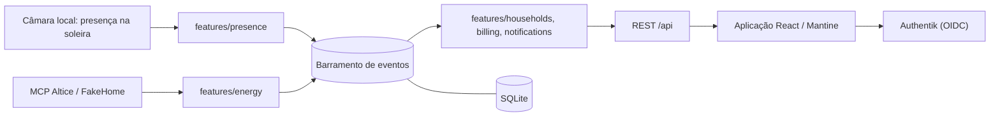

# Arquitetura

Só o que existe na `main` está marcado <span class="estado estado--ok">IMPLEMENTADO</span>. O que é desenho ou proposta está marcado <span class="estado estado--plan">PLANEADO</span>.

Um processo FastAPI com SQLite, barramento de eventos em processo e routers descobertos por feature. Sem microserviços, filas externas nem Redis.



Fluxo de dados da vertical principal:

```text
FakeHome (SIMULADO) ou McpHome (MCP Altice) → energia: degraus, sessões, assinaturas
  → eventos de domínio persistentes (SQLite, idempotentes por id)
  → billing: atribuição (quarto / pergunta / igual) → notificação «De quem é esta conta?» → voto
  → fatura do senhorio → repartição quarto/comum/resíduo → recibos → orçamento 50/80/100 %
  → REST (/api/*, FastAPI) → aplicação React por papel (morador · senhorio · operador)
```

## Regras de arquitetura

- **Uma feature não importa outra.** Comunica por `contracts/` e eventos de domínio. Recursos partilhados (SQLite, barramento) vivem em `core/`.
- **Contratos mudam juntos**, com acordo da equipa; o frontend usa os tipos gerados do OpenAPI e nunca os redefine.
- **Permissões no servidor** por papel, com DTOs distintos; cada rota nova leva um teste papel × rota.
- **Dinheiro em cêntimos, energia em Wh**, ausência = `None`; proveniência `measured | estimated | inferred | simulated` em tudo o que é medido ou calculado.
- **O SDK `mcp` só é importado em `connectors/`**; o resto conhece o protocolo `Home`.
- **Eventos imutáveis**, consumidores idempotentes, sem imagens nem identificadores externos no payload.

| Página | Conteúdo |
|---|---|
| [Stack tecnológico](stack.md) | Linguagens, frameworks e serviços |
| [Backend e frontend](backend-frontend.md) | Módulos e páginas |
| [Autenticação e autorização](autenticacao.md) | Authentik, papéis e privacidade |
| [Modelos e contratos](contratos.md) | Contratos, eventos e API |
| [Integrações com dispositivos](integracoes.md) | MCP Altice, FakeHome, câmara |

*Fonte canónica: `docs/architecture.md` e `docs/architecture/` no repositório.*
