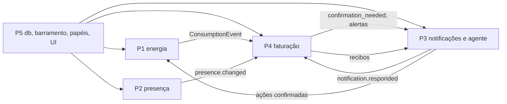

# Equipa e divisão do trabalho

Cinco pessoas, cinco áreas com o mínimo de sobreposição. **PLANEADO.** Prioridades: P0 = essencial, P1 = aprofundamento, P2 = extensão; fases F0–F3 ([roadmap.md](roadmap.md)). As tabelas de entregas por pessoa abaixo são o resumo; a lista autoritativa é o GitHub Project e o [backlog.md](backlog.md). Requisitos em [product/requirements.md](../product/requirements.md).

| Pessoa | GitHub | Área |
|---|---|---|
| P1 | `brunovieira88` | MCP, dispositivos, energia e assinaturas elétricas |
| P2 | `1Mii` | Visão computacional e presença |
| P3 | `RafaelMat0s-Dev` | Agente de IA, notificações inteligentes e interação na aplicação |
| P4 | `Amorim3000` | Faturação, repartição, orçamentos e alertas |
| P5 | `souofrancisco` | Arquitetura, integração, frontend e demonstração |

> O pedido original escrevia `brunoviera88`; o utilizador real nas issues e no `CODEOWNERS` é `brunovieira88`.

**Transferências de conhecimento** (herdadas do ObjectOS, ver [archive/objectos/parallel-work.md](../archive/objectos/parallel-work.md)): o **MCP** passa da P3 antiga (RafaelMat0s-Dev) para P1 — ler [integrations/mcp-p3-relatorio.md](../integrations/mcp-p3-relatorio.md); o **YOLO/visão** passa da P1 antiga para P2 — ler `features/visao/README.md`; o motor e o NVIDIA (`llm.py`) passam da P4 antiga para P3.

## Regras de colaboração (resumo; texto completo em [CLAUDE.md](../../CLAUDE.md))

- Cada pessoa trabalha na sua pasta `features/<módulo>/` e nos seus ficheiros de contrato. Uma feature **não importa** outra: comunica por eventos e contratos.
- **Contratos primeiro:** ninguém implementa antes de os contratos do seu módulo estarem acordados ([architecture/contracts.md](../architecture/contracts.md) e [roadmap.md](roadmap.md) «Definição de pronto dos contratos»).
- Ficheiros partilhados (revisão obrigatória de P5): `core/`, `contracts/` (mudanças), `Makefile`, Compose, `pyproject.toml`/lockfiles, `.github/`, `docs/architecture/contracts.md`.
- Uma issue → um branch → um worktree (`make worktree b=feat/<n>-<nome>`); `make check` verde; PR pequeno; sem push direto para `main`.
- Escritas físicas no kit: uma pessoa de cada vez, com autorização explícita e `make mcp-writes-off` no fim.

## Issues por pessoa, carga e ficheiros preferenciais

Contagem das issues `[CC · …]` abertas (17/11/2026), por prioridade/fase: ver [backlog.md](backlog.md) para os códigos.

| Pessoa | P0·F0 | P0·F1 | P0·F2 | P1 | P2 | Total |
|---|---:|---:|---:|---:|---:|---:|
| P1 `brunovieira88` | 1 | 9 | 0 | 1 | 1 | 12 |
| P2 `1Mii` | 0 | 5 | 0 | 2 | 3 | 10 |
| P3 `RafaelMat0s-Dev` | 0 | 4 | 0 | 1 | 1 | 6 |
| P4 `Amorim3000` | 0 | 7 | 0 | 5 | 1 | 13 |
| P5 `souofrancisco` | 8 | 9 | 3 | 4 | 3 | 27 |

**Sobrecarga:** P5 concentra 27 issues e é o primeiro bloqueio (BASE/HOUSE/PRIV em F0). **Não se redistribuiu** nesta fase, porque os contratos e a persistência têm de ter um único guardião (D-17). Mitigações: P3 (6 issues) assume o backend de notificações e as confirmações (APP-02/03), tirando-o de P5; se P5 se atrasar em F0, **P3 pode pegar em BASE-02 (barramento/idempotência)** e P4 em PRIV-01 (matriz RBAC dos recibos), por acordo e registo em [decisions.md](../decisions.md). Rever no fim da F0.

| Pessoa | Ficheiros/pastas preferenciais (evitar tocar nos de outros) |
|---|---|
| P1 | `connectors/*`, `features/mcp`, `features/devices`, `features/energy`, `contracts/energy.py` |
| P2 | `features/video`, `features/visao`, `features/presence`, `contracts/presence.py` |
| P3 | `features/notifications`, `features/agent`, `features/automations`, `contracts/notification.py`, `contracts/agent.py`; UI só em colaboração com P5 |
| P4 | `features/billing`, `features/budgets`, `features/alerts`, `contracts/billing.py` |
| P5 | `core/*`, `features/households`, `features/auth`, `app/frontend/*` (páginas e componentes, incl. a UI das notificações), `app/compose*.yaml`, `Makefile`, `.github/`, `docs/architecture/contracts.md` |

**Notificações (D-17):** P3 = backend (API, persistência, WS, ações autorizadas, respostas idempotentes) e confirmações do utilizador; P5 = implementação visual. O contrato `Notification` (BASE-03) é o ponto de encontro: ambos aprovam-no antes de implementar.

---

## P1 — brunovieira88 · MCP, dispositivos, energia e assinaturas

**Objetivo.** Transformar o kit (ou o simulador) em `EnergyReading` fiáveis e em `ConsumptionEvent` com aparelho provável.

**Responsabilidades.** Conector MCP e OAuth; polling; unidade de `instantPower`; papéis de dispositivo; simulador/replay; deteção de degraus; assinaturas; ações físicas autorizadas. Documentos: [modules/energy.md](../modules/energy.md), [integrations/altice-mcp.md](../integrations/altice-mcp.md).

**Módulos.** `connectors/*`, `features/mcp`, novos `features/devices`, `features/energy`.

**Reutilizável.** `connectors/{mcp_home,altice_auth,altice,write_grant,mcp_verify,fake_home}.py`, `contracts/{home,simulacao}.py`, `features/mcp/router.py`, Makefile `mcp-*`, `integrations/*`.

**Novos.** `features/energy/{steps,signatures,locate,simulation}.py`, `contracts/energy.py`.

**Depende de.** P5 (db, barramento, `Appliance.owner`); P3/P4 consomem o que produz. Mentores Altice (unidade, escrita) — [integrations/mentor-questions.md](../integrations/mentor-questions.md).

**Contratos necessários.** `Provenance`, `EnergyReading`, `ConsumptionEvent`, `ApplianceMatch`, papel de `Device`, `Home.ler_leituras()` (acordar com P5).

| Prio | Entrega |
|---|---|
| P0 | Simulador/replay de leituras (RD-01) e `EnergyReading` pelo `FakeHome`; deteção de degraus; assinaturas por vizinho mais próximo com `confidence`; `ConsumptionEvent`; registo de aparelhos (API) |
| P0 | Resolver, na hora zero, a unidade de `instantPower` com carga conhecida e documentar em [mcp-capabilities.md](../integrations/mcp-capabilities.md) |
| P1 | Aprendizagem com confirmações; papel `room_meter`; verificação física MCP-05 (tomada) e MCP-04 (lâmpada) com resultado registado |
| P2 | Clustering de desconhecidos; estimativa da lâmpada; automações físicas (janela → corte) se houver leitura de contacto |

**Aceitação.** Ver [modules/energy.md](../modules/energy.md). **Testes.** Degraus e identificação com `FakeHome` e relógio simulado; `McpHome` com `FakeMcp` (já existe); hardware pelo guia (MCP-03/05/06).

## P2 — 1Mii · Visão computacional e presença

**Objetivo.** Saber quando alguém entra ou sai e quem está em casa, sem identificar pessoas pela imagem. Documento: [modules/presence.md](../modules/presence.md).

**Módulos.** `features/video`, `features/visao`, `features/gestos` (parcial), novo `features/presence`.

**Reutilizável.** `video/*`, `visao/{detetor,thread,dispositivo,pesos,anotar}.py`, `gestos/{ponte,presenca}.py`, `contracts/{video,visao,base}.py`, `visao/README.md`.

**Novos.** `features/presence/{door,fusion,router,service}.py`, `contracts/presence.py`.

**Depende de.** P5 (membership, barramento); P3 (UI «estás em casa?»); P1 (YOLO: conhecimento herdado).

**Contratos.** `DoorCrossed`, `PersonPresence`, `PresenceEvent`.

| Prio | Entrega |
|---|---|
| P0 | `PUT /api/presence/me` (registo manual) e eventos de porta simulados (RD-01), para destravar P4/P3 |
| P1 | `DetetorYolo` só com «pessoa»; linha na soleira; máscara a preto; `DoorCrossed`; fusão em casa/fora/incerto; estado da casa |
| P2 | Casa vazia, alerta de entrada com casa vazia, Wi-Fi com opt-in; **provar o acesso à imagem da câmara do kit** |

**Aceitação.** Ver [modules/presence.md](../modules/presence.md) (zero imagens persistidas; tolerância de 20–30 min; senhorio `403`). **Testes.** Detetor falso + relógio simulado; câmara real só pelo guia (VID/YOLO).

## P3 — RafaelMat0s-Dev · Agente de IA, notificações e interação

**Objetivo.** O canal único com o utilizador: pedidos, alertas, confirmações, histórico, assistente e automações. Documentos: [modules/notifications.md](../modules/notifications.md), [modules/agent.md](../modules/agent.md).

**Módulos.** Novos `features/notifications`, `features/agent`, `features/automations`; UI com P5.

**Reutilizável.** `features/engine/{llm,router}.py` (cliente NVIDIA, WS, `parse`), `frontend/src/components/events/*`, `HomeProvider.tsx`, `NewAutomationPage`, `useNewRule.ts`.

**Novos.** `contracts/{notification,agent}.py`, `features/notifications/*`, `features/agent/*`.

**Depende de.** P5 (barramento, papéis, WS), P4 (pedidos, alertas, recibos), P1 (ações), P2 (presença).

**Contratos.** `Notification`, `NotificationAction`, eventos `notification.*`, `agent.*`.

| Prio | Entrega |
|---|---|
| P0 | Centro de notificações (API + WS + lista); notificação interativa «De quem é esta conta?» com resposta persistida e evento `notification.responded` |
| P1 | Histórico e filtros; preferências (limiares, silêncio); assistente que explica recibos (ferramentas de P4); contestação |
| P2 | Ações sugeridas com confirmação; regras em português → automações; aprovação da casa; push (Capacitor); leitura de fatura por LLM multimodal |

**Aceitação.** Ver [notifications.md](../modules/notifications.md) e [agent.md](../modules/agent.md). **Testes.** Serviço com relógio e barramento falsos; LLM falso; permissões; idempotência.

## P4 — Amorim3000 · Faturação, repartição, orçamentos e alertas

**Objetivo.** Calcular quanto paga cada um, de forma explicável, e avisar antes do limite. Documento: [modules/billing.md](../modules/billing.md).

**Módulos.** Novos `features/billing`, `features/budgets`, `features/alerts`.

**Reutilizável.** Padrão de testes do motor antigo (`features/engine/tests/`, relógio injetado), `TARIFA_EUR_KWH`, `core/errors.py`. O resto é novo.

**Novos.** `contracts/billing.py`, `features/billing/{attribution,allocation,receipt}.py`, `features/budgets/*`, `features/alerts/*`.

**Depende de.** P1 (`ConsumptionEvent`), P3 (confirmações e entrega), P5 (casas, db), P2 (presença para regra C).

**Contratos.** `Attribution`, `ElectricityBill`, `BillAllocation`, `Budget`, `billing.*`, `alerts.*`.

| Prio | Entrega |
|---|---|
| P0 | Algoritmo de atribuição (A, B) e de fatura com fixtures A/B/C; entrada manual da fatura; recibo explicado; orçamento pessoal com avisos 50/80/100 % |
| P1 | Regra C; limiar de pergunta; previsão linear; plafond por quarto e plafond solidário; picos; contestação |
| P2 | Aparelho esquecido; «não bate certo»; bi-horário; anomalias |

**Aceitação.** Fixtures, soma ao cêntimo, nada apagado, permissões por papel ([billing.md](../modules/billing.md)). **Testes.** Puros, parametrizados e baseados em propriedades; relógio simulado.

## P5 — souofrancisco · Arquitetura, integração, frontend e demonstração

**Objetivo.** Garantir que as peças encaixam: base de dados, barramento, autenticação por papel, interface e demo. Documentos: [architecture/*](../architecture/overview.md), [modules/households.md](../modules/households.md), [mvp.md](mvp.md).

**Módulos.** `core/*`, `features/households`, `features/auth`, `app/frontend`, infraestrutura, CI.

**Reutilizável.** Shell, rotas, providers, cliente HTTP, OIDC, Capacitor, Authentik, Compose, Makefile.

**Novos.** `core/{db,events}.py` e migrações; `features/households/*`; páginas Consumo, Notificações, Faturas e recibos, Orçamento, Casa, Assistente; simulador de demo.

**Depende de.** Todos (integração). É o **primeiro bloqueio da equipa**: sem `core/db`, `core/events` e `require_role`, os outros não integram.

**Contratos.** `Household`, `Room`, `Resident`, `Membership`, envelope `DomainEvent`; guardião do documento [contracts.md](../architecture/contracts.md).

| Prio | Entrega |
|---|---|
| P0 | Contratos acordados e publicados; `core/db`, `core/events`; papéis e DTOs por papel; seed da casa de demo (4 moradores); navegação por papel; centro de notificações (UI); recibos (UI); rótulos REAL/SIMULADO; reset da demo; `make check` verde |
| P1 | Páginas de consumo, orçamento e casa; exportação de dados do morador (RP-03); diagnóstico do operador |
| P2 | Remoção do código ObjectOS ([migration.md](../architecture/migration.md) M4); push; aplicação Android |

**Aceitação.** Demo ponta a ponta com simulador duas vezes seguidas sem intervenção; senhorio sem acesso a dados pessoais; `make check` e `make smoke` verdes. **Testes.** Autorização por papel; migrações; barramento; build do frontend.

## Dependências entre pessoas (visão geral)

Para desbloquear cedo: P1 e P2 entregam **simuladores** (leituras e passagens) antes do hardware; P3 e P4 desenvolvem contra esses simuladores e contra eventos falsos.
