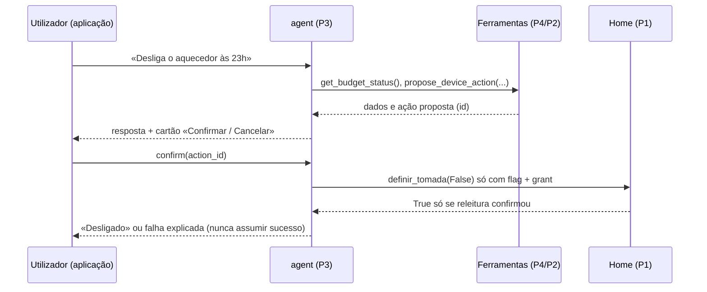

# Módulos `agent` e `automations` — assistente de IA e automações

**Dono: P3 (RafaelMat0s-Dev); execução física: P1.** **IMPLEMENTADO:** ferramentas de leitura, tradutor opcional, respostas por moldes determinísticos, transparência do intérprete, histórico e ações propostas com confirmação. Aditivos de contrato desta tarefa são **PROPOSTA**, a aprovar pela P5. AGENT-04 continua **PLANEADO**. O assistente está **dentro da aplicação** (D-01).

## Responsabilidade

1. **Assistente conversacional** que explica consumo, recibos e orçamentos («porque pago mais 5 € que a Carla?»), em português.
2. **Ações sugeridas** (ex.: «desligar o aquecedor às 23 h»), sempre com **confirmação do utilizador** antes de executar.
3. **Automações** escritas em português e convertidas em `AutomationRule`, com pré-visualização e ativação explícita.

## Guarda-corpos (obrigatórios; PDF §9)

| Regra | Como se cumpre |
|---|---|
| **O modelo nunca inventa números** | O LLM só traduz a pergunta em ferramentas; o servidor executa e escreve a resposta com moldes. Contas feitas em código ([billing.md](billing.md)) |
| Respeita o papel | As ferramentas executam com as permissões do utilizador autenticado; o senhorio não usa o assistente de consumo individual (**PROPOSTA**) |
| Confirmação humana | Uma ação sugerida cria `agent_action` e só se executa em `POST /api/households/{id}/agent/actions/{aid}/confirm` (**IMPLEMENTADO**; só o próprio residente; o LLM nunca propõe: o pedido é interpretado em código). Sensíveis (segurança, cortes fora de regras aprovadas) pedem sempre confirmação |
| Sem vídeo | O LLM nunca recebe imagens, frames nem URLs de câmara; só texto |
| Dados mínimos | Enviar ao modelo apenas o necessário e sem identificadores externos de dispositivos. Qual o fornecedor de LLM e que dados podem sair: decisão P-06 |
| Sem escritas físicas sem autorização | A execução é uma porta injetada (`ActionExecutor`, P1) que aplica flag + grant + whitelist e relê; esta feature não importa conectores nem o motor. Casa demo: só executor SIMULADO |
| Proveniência | As respostas indicam se um valor é medido, estimado, inferido ou simulado |

## Ferramentas (funções) implementadas

`consumption_summary`, `budget_status`, `receipt`, `top_appliances`, `consumption_change`, `explain_attribution` e `pending_confirmations` (**IMPLEMENTADO**). O detalhamento soma ao total de `month_spend`, incluindo conta comum, plafond solidário e parte fixa/base; em meses fechados usa a evidência e as parcelas do recibo. A explicação expõe apenas a parte do próprio morador, sem presenças, horas ou votos. Pedidos pendentes são lidos das notificações e filtrados por elegibilidade e voto do próprio. Sem dados de billing, a explicação devolve `None`.

| Ferramenta | Devolve | Dono do dado |
|---|---|---|
| `get_my_consumption(period)` | kWh e custo individuais, por proveniência | P4 |
| `get_receipt(bill_id)` / `explain_difference(resident_a, resident_b)` | Linhas do recibo | P4 |
| `get_budget_status()` | Gasto, limiares, previsão | P4 |
| `list_pending_confirmations()` | Pedidos abertos | P3 |
| `who_is_home()` | Só para o próprio e com opt-in; nunca para senhorio | P2 |
| `propose_device_action(role, capability, value)` | Cria ação a confirmar | P1/P3 |
| `propose_automation(nl_text)` | `AutomationRule` em `proposed` | P3 |

Fora das ferramentas, o modelo não responde com números; em dúvida diz que não sabe.

## Fluxo de uma ação sugerida

## Automações

- Modelo `AutomationRule` ([data-model.md](../architecture/data-model.md)): gatilho, condição, ações, confirmação, estado `draft → proposed → active`.
- O assistente atual usa `features/agent/llm.py` e ferramentas tipadas próprias. O cliente NVIDIA e a rota de propostas de regras do motor foram removidos em BASE-04; automações futuras precisam de contrato próprio.
- **Âmbito do MCP:** só lâmpada (`power`, `brightness`, `color_rgb`) e tomada (`power`). Gatilhos por sensores de contacto/clima exigem **leitura** de dispositivos hoje fora da seleção do `McpHome` — **PROPOSTA** de extensão só de leitura (P-01). **Cenários** do Connected Home (`post_new_scenario`), alarme e segurança **continuam proibidos** até decisão explícita da equipa.
- A votação da casa (PDF §12: 👍/👎) passa a ser aprovação na aplicação (**PROPOSTA**, P2).
- Prioridade: P2. Nada disto bloqueia o MVP.

## Ficheiros existentes reutilizáveis

`features/agent/llm.py` e `features/agent/config.py` (cliente NVIDIA do assistente, separado do motor removido), mais as ferramentas tipadas existentes. As páginas antigas do frontend foram removidas na BASE-04; a interface atual está na aplicação Conta Certa.

## Ficheiros novos previstos (restantes)

`features/automations/{router,service,tests}`; ferramentas adicionais exigem contrato revisto.

## Dependências

P4 (dados de consumo, recibos), P1 (ações), P2 (presença), P5 (papéis, UI).

## Critérios de aceitação

- Em testes com um LLM falso, o assistente responde só com valores devolvidos pelas ferramentas; uma pergunta sem dados devolve «não sei», nunca um valor.
- Uma ação sugerida nunca chama `Home` sem `confirm`; com grant inexistente a ação falha com mensagem clara.
- Um senhorio recebe `403` ao pedir dados individuais ao assistente.
- Sem `NVIDIA_API_KEY` o resto da aplicação funciona (comportamento atual) e o assistente indica que está indisponível.

## Estado de implementação (na `main`, refs #110, #111 e #112)

Tipos reais de `contracts/agent.py` e `contracts/common.py` (já não há `_provisional.py`). Leitura: sem eventos; o histórico (#111) e as ações propostas (AGENT-03, abaixo) têm tabelas; as ações têm o evento `agent.action_proposed` e rotas próprias.

### IMPLEMENTADO

| O quê | Onde |
|---|---|
| Registo de sete ferramentas de leitura; período validado (2000-01 até ao mês atual), residente do contexto, só inquilinos, sem dados → `no_data`. `explain_attribution` usa a explicação do recibo ou os componentes de `month_spend`; `pending_confirmations` mostra até três de todos os pedidos elegíveis por responder | `features/agent/tools.py` |
| Modo tradutor: uma chamada ao LLM e uma repetição apenas para JSON inválido; recebe a pergunta atual e instruções, nunca resultados; resposta final montada pelo servidor | `assistant.py`, `answers.py`, `prompt.py` |
| Recurso por palavras-chave quando o LLM está desligado ou fora do âmbito; erro/prazo do LLM apresenta indisponibilidade; JSON inválido duas vezes ou `tools: []` apresenta resposta fixa útil | `assistant.py`, `intents.py` |
| Endpoint `POST /api/households/{household_id}/agent/messages` (corpo `AgentMessageIn`, resposta `AgentResponse`; `proposed_actions` só tem a proposta de um pedido de ação, ver abaixo). `require_access(Resource.agent, write)`: só inquilino; senhorio e operador 403 `forbidden_role`; não-membro e membership terminada 404 `household_not_found`; corpo inválido 400 `invalid_request` | `router.py` |
| Providers reais de consumo, orçamento, recibo, aparelhos, comparação e explicação da atribuição; provider de notificações pendentes. Registo imutável `ProviderSet` composto com `dataclasses.replace`, sem dependência da ordem de lifespans. Casa real descarta proveniência simulada | `features/billing/agent_providers.py`, `features/notifications/agent_providers.py`, `features/agent/sources.py` |
| LLM **desligado por omissão**: só há chamada com `AGENT_LLM_ENABLED=true` **e** `NVIDIA_API_KEY`; `get_complete` é uma dependência substituível (testes) | `config.py`, `router.py` |
| `AGENT_LLM_SCOPE=demo` (omissão) limita o LLM a casas demo; `all` permite todas. Só a pergunta sai para a NVIDIA. `AgentResponse.interpreter` marca `llm` ou `rules`; histórico antigo fica sem selo | `config.py`, `router.py`, `MessageBubble.tsx` |

Quando não há registos de billing, os números da casa de demonstração vêm das fixtures (alocação da Ana na fatura A, orçamento e gasto da Carla, total do recibo) e são mostrados como **SIMULADO**. Havendo billing persistido, o provider de billing responde primeiro.

**Limite dos dados SIMULADOS:** as fixtures só cobrem o período `2026-11`. Sem dados de billing nesse período, a resposta por omissão noutros meses é «Não tenho dados».

Prazo do LLM: `AGENT_LLM_TIMEOUT_S` (20 s), limitado por `AGENT_TOTAL_TIMEOUT_S` (30 s). Ao esgotar ou falhar, usa-se o router de palavras-chave com aviso de indisponibilidade (log só com o tipo da exceção). Com LLM desligado por configuração, o router funciona diretamente sem aviso.

### IMPLEMENTADO — AGENT-03 (ações propostas com confirmação, refs #112)

Uma ação só se executa depois de `confirm` humano; o assistente **propõe**, nunca executa.

| O quê | Onde |
|---|---|
| Parser PT determinístico (sem LLM): desligar/ligar a lâmpada, brilho 1–100, cor de `contracts.home.CORES`, **desligar** a tomada. Recusas com código: `forbidden_kind` (alarme, cenário, segurança, temporizador), `plug_turn_on_not_allowed` (o agente nunca liga uma tomada), `ambiguous_device`, `no_device`, `unsupported` (agendar, valores inválidos, mais de um comando). Só imperativo/infinitivo (nunca particípios como «desligada»); perguntas («?», «quanto/qual/está…», salvo «podes…?») e frases com negação nunca são ação; «mudar/pôr/colocar» exigem um dispositivo. A justificação (≤300) nomeia o dispositivo, avisa quando a tomada é a extensão agregada e diz «SIMULADO» | `intents.py` |
| `ActuatorDevice` e porta `DeviceDirectory`; `DemoDevices` (**SIMULADO**: «Tomada da extensão» e «Lâmpada da sala» só na casa `fixtures.HOUSEHOLD` com `source_kind='demo'`); `NoDevices` nas outras | `devices.py` |
| Porta `ActionExecutor`, `SimulatedExecutor` (estado em memória, relê-o), `select_executor` (demo → sempre simulado, **nunca** o registado; casa real → o registado ou `None`) e `run_execution`: prazo `AGENT_ACTION_TIMEOUT_S`; exceção, prazo ou resultado inválido → `uncertain` (**nunca repete**); sem executor → `blocked` `executor_unavailable` | `execution.py` |
| Serviço sobre SQLite: `propose` (linha + log + `agent.action_proposed` no outbox, mesma transação), `confirm` (CAS `proposed→confirmed`, COMMIT **antes** de executar), `record_execution` (CAS `confirmed→executed`), `reject`; `expired` derivado na leitura; vista local `AgentActionView` com `message` honesta por estado | `actions.py` |
| Rotas `GET …/agent/actions[?status]`, `GET …/agent/actions/{id}`, `POST …/{id}/confirm`, `POST …/{id}/reject`; `Resource.agent` (só inquilino); a ação de outro residente é `404 action_not_found`; `409 action_not_pending` / `409 action_expired` | `actions_router.py` |
| Tabelas `agent_action` e `agent_action_log` (só a acrescentar: gatilhos) | `core/migrations/0310_agent_actions.sql` |

Limites (por dispositivo, espelham `connectors/write_policy.py` sem o importar; `config.py`): validade da proposta 600 s, no máximo 3 abertas por residente, *cooldown* 60 s, 6 por hora, bloqueio de 300 s após um resultado `uncertain`. Um limite violado grava a ação como `executed` com `blocked` (`cooldown`, `hourly_limit`, `uncertain_lockout`) e **não chama o executor**; só contam tentativas (confirmadas, falhadas, incertas e em curso), não as bloqueadas.

Honestidade: `confirmed` exige releitura (o contrato recusa o contrário); `uncertain` diz «Não repito a ação»; **SIMULADO** aparece em todas as mensagens da casa demo. Casas reais: sem diretório ficam sem dispositivos (recusa `no_device`); com diretório mas sem executor, `blocked` `executor_unavailable`.

**Ligação com a P1 — IMPLEMENTADA para a lâmpada (`features/energy/kit_actuators.py`, registada no arranque do engine só com `HOME_BACKEND=mcp` e `ENERGY_HOUSEHOLD_ID`):** `KitLampDirectory` (a lâmpada do kit, id interno derivado do id MCP, divisão de `MCP_LAMP_ROOM_ID`) e `KitLampExecutor` (`McpHome.definir_lampada`: flag + grant + whitelist + releitura; guardas → `blocked`; erro MCP → `failed`; resto → `uncertain`; cores só do vocabulário `CORES`). Texto original da proposta: registar em `app.state.agent_action_executor` um `ActionExecutor` (`async execute(action, confirmation) -> ActionExecutionResult`: aplica flag + grant + whitelist e `RuleWritePolicy` se quiser, escreve **uma vez**, relê, e devolve `confirmed` só com releitura) e em `app.state.agent_device_directory` um `DeviceDirectory` (`actuators(household_id) -> list[ActuatorDevice]`, ids internos; o id do MCP resolve-se no executor). Enquanto não existirem, uma casa real nunca executa.

Não há ainda os eventos `agent.action_confirmed`/`agent.action_executed` (só `agent.action_proposed`): o rasto completo está em `agent_action_log`. Uma execução interrompida (cancelamento do pedido) grava logo `executed/uncertain` com código `interrupted`; uma ação `confirmed` há mais de prazo do executor + 30 s (crash entre o COMMIT e o desfecho) é resolvida da mesma forma, de forma preguiçosa, na leitura e antes de verificar os limites (linha de log em `agent_action_log`). Nunca se reexecuta e o dispositivo fica bloqueado 300 s. A coluna `executed_at` (usada pelos limites) é sempre a hora do servidor; a do executor fica só em `execution_json` e, se fora de [confirmação − 5 s, agora + 5 s], o resultado é `uncertain/invalid_result`.

### IMPLEMENTADO — cor do orçamento na lâmpada (ALERT-06, refs #104)

Consumidor `agent.budget_light` (nome permanente) de `alerts.threshold_crossed` (`budget_light_consumer.py`, subscrito no mesmo `lifespan`). Segue o caminho seguro do AGENT-03b: **só propõe**; executa `POST …/confirm` depois da confirmação humana.

- **Cor:** `contracts.billing.budget_light(pct)`, a mesma da página Orçamento: 80 % → âmbar `(255, 200, 0)`, 100 % → vermelho. Abaixo de 80 % (verde) não se propõe nada. Comando `color_rgb`.
- **Destinatário:** só o dono do orçamento, se for inquilino ativo hoje. Senhorio e operador nunca.
- **Privacidade (que lâmpada):** `ActuatorDevice.room_id` (novo, opcional). Primeiro uma lâmpada no quarto do morador; senão uma de zona comum, e a `rationale` avisa que a cor fica à vista de quem lá estiver (o morador decide); nunca a lâmpada de outro quarto nem uma de divisão desconhecida (`choose_bulb`, puro). A lâmpada da casa demo é a da sala (`room_id = ROOM_SALA`).
- **Idempotente:** id `stable_id("agent.budget_light", evento, residente)`. Um limiar novo retira a proposta anterior ainda por confirmar (`system_reject`, `code="superseded"`). Evento com mais de `AGENT_ACTION_TTL_S` (600 s) ignorado. Uma casa real ignora eventos e dispositivos simulados.
- **App:** a página Orçamento mostra a proposta aberta com «Mudar a cor» / «Agora não» e, depois, a `message` do servidor (SIMULADO etiquetado; sucesso só com releitura).
- **Ressalva (runtime real):** o diretório e o executor da lâmpada do kit existem (testados só com o FakeMcp). Sem `HOME_BACKEND=mcp` + `ENERGY_HOUSEHOLD_ID` não se registam e uma casa real fica `blocked` (`executor_unavailable`); sem `MCP_LAMP_ROOM_ID` a lâmpada não tem divisão e nunca recebe a cor do orçamento. **A lâmpada física ainda não foi validada à mão** (guia: ALR-06).

### IMPLEMENTADO — AGENT-03b (propostas a partir de alertas de conforto, refs #112)

Consumidor `agent.safety_suggestion` (nome permanente) de `safety.alert_raised`, subscrito no `lifespan` de `features/agent/router.py` (`safety_consumer.py`). Um alerta `active` `window_open_heating` com `suggested_command` («desligar a tomada») e quarto gera **uma proposta por inquilino ativo** (`source="safety"`, justificação «Janela aberta com o aquecimento ligado. Queres desligar a tomada do aquecedor?») e o evento `agent.action_proposed`. Nunca executa: o consumidor só propõe, não chama o executor; só `POST …/confirm` executa, depois da confirmação humana.

- **Destinatários:** os inquilinos ativos do quarto (quarto) ou todos os inquilinos ativos (zona comum). Senhorio e operador nunca recebem propostas. Consulta própria sobre `membership` (cópia da lógica de `notifications/directory.py`; uma feature não importa outra, D-06).
- **Só com dispositivo conhecido:** o alvo tem de estar em `DeviceDirectory.actuators()` (`select_directory`) e ser uma **tomada**; senão nada (log sem ids do MCP). Casa demo: os dispositivos **SIMULADOS** e proposta `origin=simulated` (executor simulado, nunca hardware). Casa real: só o diretório registado pela P1 em `app.state.agent_device_directory`, só dispositivos não simulados e nunca a partir de um alerta simulado; sem diretório, não há propostas.
- **Idempotente:** o id da proposta é `stable_id("agent.safety", alerta, residente)` (`propose(…, action_id=…)`); reprocessar o alerta não duplica. Um alerta com mais de `AGENT_ACTION_TTL_S` (600 s) é ignorado (reprocessamento tardio).
- **Alerta resolvido** (`status=resolved`, mesmo `id`): as propostas ainda **por confirmar e dentro do prazo** passam a `rejected` pelo sistema (`actions.system_reject`: CAS, linha em `agent_action_log` com `by_resident_id` nulo e `code="alert_resolved"`); uma confirmação seguinte dá `409 action_not_pending`. Uma já confirmada, decidida ou expirada fica como está.
- **Ressalva (runtime real):** em produção o alerta de janela só existe quando a feature `safety` tiver o resolvedor de aquecedores (ENERGY-03, ver `features/safety/router.py`: hoje só as regras de fumo estão ativas) e a P1 registar o diretório e o executor. Até lá o caminho só se exerce na casa de demonstração (SIMULADO) e nos testes.
- Pendente (contrato, fora desta feature): o evento `agent.action_proposed` não distingue a origem da proposta (chat ou `safety`); só a coluna `agent_action.source` o faz.

### IMPLEMENTADO — histórico da conversa (#111)

Cada `POST …/agent/messages` grava a **troca** (a pergunta e a resposta) no histórico do próprio residente, nos dois caminhos (pergunta normal e pedido de ação). `GET /api/households/{household_id}/agent/messages?limit=1..100` (omissão 50) devolve `list[AgentMessage]` do **próprio**, do mais antigo para o mais recente: nunca o de outro residente nem o de outra casa; `require_access(Resource.agent, read)` (senhorio e operador 403 `forbidden_role`; não-membro 404 `household_not_found`; `limit` fora de 1..100 → 400 `invalid_request`).

- **Dados pessoais, retenção curta (P-25):** ao gravar, cortam-se as mensagens acima de `AGENT_HISTORY_KEEP` (50) por residente e casa e as com mais de `AGENT_HISTORY_DAYS` (30) dias. Tabela `agent_message` em `core/migrations/0311_agent_messages.sql`; lógica em `features/agent/history.py`.
- **Nunca vai para o LLM (P-06):** o histórico serve só para a app o mostrar. O assistente e o LLM recebem apenas a pergunta atual (teste dedicado).
- O histórico guarda o texto da resposta tal como foi mostrado (inclui o rótulo **SIMULADO** e o rodapé `Fonte:`); não guarda números à parte.

### IMPLEMENTADO — providers reais e conversa na app

`BillingAgentProviders` reutiliza `closing.period_inputs`, `tariff`, `budgets.status` e as alocações finalizadas. O recibo mais recente considera apenas a revisão corrente (`status='finalized'`). Os Protocols síncronos usam a ligação SQLite partilhada sob o lock de `Database`, com consultas curtas só de leitura; não abrem transação `BEGIN IMMEDIATE`. A composição regista o `ProviderSet` em `app.state.agent_providers` no lifespan de billing. O residente continua a vir exclusivamente da membership/token. O contrato partilhado novo `contracts/agent_providers.py` é **PROPOSTA** aditiva a aprovar pela P5 (#157, item 15); `features/agent/providers.py` reexporta os nomes antigos.

`pages/AssistantPage.tsx` apresenta o histórico ao abrir, envia mensagens e carrega ações propostas pendentes. Respostas recentes mostram «interpretado por IA» ou «interpretado por regras»; mensagens históricas podem não ter selo. As respostas mantêm proveniência e rótulo REAL/SIMULADO.

### PLANEADO

- AGENT-04 (automações), `who_is_home`, `explain_difference`, `list_pending_confirmations`.
- **P-06:** **PROPOSTA** — em modo tradutor apenas a pergunta sai para a NVIDIA; nunca dados da casa, resultados ou histórico. `AGENT_LLM_SCOPE=demo` por omissão; aprovação da equipa continua pendente.

### Pedidos pendentes (para a revisão do contrato e do `core/`)

1. Aditivo **PROPOSTA P5**: `AgentTool` acrescenta `top_appliances` e `consumption_change`; `AgentToolResult` acrescenta linhas por aparelho, totais e diferença mensal; `AgentResponse.interpreter` marca `llm`/`rules`.
2. `AgentTool` não inclui explicação da atribuição nem notificações pendentes; continuam planeadas.
3. **`receipt` exige `bill_id`:** hoje o `ReceiptProvider.latest_bill` resolve «o último recibo» (PROPOSTA a rever).
4. **Interface dos *providers*:** agora em `contracts/agent_providers.py` (**PROPOSTA #157, item 15**, aprovação P5); a feature agente mantém reexport compatível.
5. **`AgentMessage` sem `resident_id`:** o histórico é por residente (a tabela guarda-o; o contrato não o expõe, o que é o desejado: só o próprio lê as suas). A linha `GET …/agent/messages` já consta de `contracts.md` (estado IMPLEMENTADO; falta a revisão da P5).
6. **`AgentResponse` sem `used_llm`/`degraded`:** a app não distingue resposta do LLM de recurso determinístico.
7. **Definições do LLM** em `features/agent/config.py`; o assistente continua a ler `NVIDIA_API_KEY` e `NVIDIA_MODEL`.
8. **OpenAPI:** o FastAPI anuncia 422 `HTTPValidationError` para corpos inválidos, mas `core/errors.py` responde 400 `invalid_request` (vale para todas as rotas).
9. **Rota por casa:** o caminho de `contracts.md` era `POST /api/agent/messages`; a rota é por casa, como as outras (D1).
10. **AGENT-03 (contrato):** falta `ErrorCode` para `action_not_found`, `action_not_pending` e `action_expired` (hoje strings); `AgentActionView` é local a `features/agent/actions.py` e devia estar em `contracts/agent.py`; faltam os eventos `agent.action_confirmed` e `agent.action_executed` e o *schema* da proveniência (`origin`) em `ProposedAction`.

O senhorio não usa o assistente (matriz `PERMISSIONS[agent]`); uma versão futura só com totais fica por decidir.

## Testes

`cd app/backend && python -m pytest -q src/homemind/features/agent`. `FakeLLM` com guião e *providers* falsos em `tests/_fakes.py`; `tests/conftest.py` substitui **sempre** `get_complete`, por isso uma `NVIDIA_API_KEY` do ambiente nunca chega à rede.
