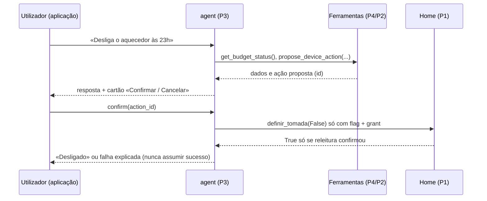

# Módulos `agent` e `automations` — assistente de IA e automações

**Dono: P3 (RafaelMat0s-Dev); execução física: P1.** **IMPLEMENTADO (backend parcial: leitura, com dados SIMULADOS); o resto PLANEADO** (ver «Estado de implementação» no fim). Substitui o agente que vivia no Telegram: o assistente está **dentro da aplicação** (D-01).

## Responsabilidade

1. **Assistente conversacional** que explica consumo, recibos e orçamentos («porque pago mais 5 € que a Carla?»), em português.
2. **Ações sugeridas** (ex.: «desligar o aquecedor às 23 h»), sempre com **confirmação do utilizador** antes de executar.
3. **Automações** escritas em português e convertidas em `AutomationRule`, com pré-visualização e ativação explícita.

## Guarda-corpos (obrigatórios; PDF §9)

| Regra | Como se cumpre |
|---|---|
| **O modelo nunca inventa números** | Todos os valores vêm de funções (ferramentas) do backend; o LLM só redige; as contas são feitas em código ([billing.md](billing.md)) |
| Respeita o papel | As ferramentas executam com as permissões do utilizador autenticado; o senhorio não usa o assistente de consumo individual (**PROPOSTA**) |
| Confirmação humana | Uma ação sugerida cria `agent_action` e só se executa em `POST /api/agent/actions/{id}/confirm`. Sensíveis (segurança, cortes fora de regras aprovadas) pedem sempre confirmação |
| Sem vídeo | O LLM nunca recebe imagens, frames nem URLs de câmara; só texto |
| Dados mínimos | Enviar ao modelo apenas o necessário e sem identificadores externos de dispositivos. Qual o fornecedor de LLM e que dados podem sair: decisão P-06 |
| Sem escritas físicas sem autorização | As ações passam pelo contrato `Home` com flag + grant + whitelist (lâmpada e tomada) |
| Proveniência | As respostas indicam se um valor é medido, estimado, inferido ou simulado |

## Ferramentas (funções) propostas

| Ferramenta | Devolve | Dono do dado |
|---|---|---|
| `get_my_consumption(period)` | kWh e custo individuais, por proveniência | P4 |
| `get_receipt(bill_id)` / `explain_difference(resident_a, resident_b)` | Linhas do recibo | P4 |
| `get_budget_status()` | Gasto, limiares, previsão | P4 |
| `list_pending_confirmations()` | Pedidos abertos | P3 |
| `who_is_home()` | Só para o próprio e com opt-in; nunca para senhorio | P2 |
| `propose_device_action(role, capability, value)` | Cria ação a confirmar | P1/P3 |
| `propose_automation(nl_text)` | `AutomationRule` em `proposed` | P3 |

Fora das ferramentas, o modelo não responde com números; em dúvida diz que não sabe.

## Fluxo de uma ação sugerida

## Automações

- Modelo `AutomationRule` ([data-model.md](../architecture/data-model.md)): gatilho, condição, ações, confirmação, estado `draft → proposed → active`.
- Reaproveita o fluxo atual **texto → proposta validada → confirmação explícita** (`features/engine/llm.py`, `POST /api/rules/parse`) com um schema novo; `ParseResponse` não grava nem executa.
- **Âmbito do MCP:** só lâmpada (`power`, `brightness`, `color_rgb`) e tomada (`power`). Gatilhos por sensores de contacto/clima exigem **leitura** de dispositivos hoje fora da seleção do `McpHome` — **PROPOSTA** de extensão só de leitura (P-01). **Cenários** do Connected Home (`post_new_scenario`), alarme e segurança **continuam proibidos** até decisão explícita da equipa.
- A votação da casa (PDF §12: 👍/👎) passa a ser aprovação na aplicação (**PROPOSTA**, P2).
- Prioridade: P2. Nada disto bloqueia o MVP.

## Ficheiros existentes reutilizáveis

`features/engine/llm.py` (cliente NVIDIA, retry, schema), `features/engine/router.py` (`/api/rules/parse`), `core/config.py` (`NVIDIA_API_KEY`), frontend `NewAutomationPage`, `hooks/useNewRule.ts`.

## Ficheiros novos previstos

`features/agent/{tools,router,service,tests}`, `features/automations/{router,service,tests}`, `contracts/agent.py` (existe na `main`), frontend `pages/AssistantPage.tsx`.

## Dependências

P4 (dados de consumo, recibos), P1 (ações), P2 (presença), P5 (papéis, UI).

## Critérios de aceitação

- Em testes com um LLM falso, o assistente responde só com valores devolvidos pelas ferramentas; uma pergunta sem dados devolve «não sei», nunca um valor.
- Uma ação sugerida nunca chama `Home` sem `confirm`; com grant inexistente a ação falha com mensagem clara.
- Um senhorio recebe `403` ao pedir dados individuais ao assistente.
- Sem `NVIDIA_API_KEY` o resto da aplicação funciona (comportamento atual) e o assistente indica que está indisponível.

## Estado de implementação (branch `feat/110-agent-assistant`, refs #110 e #111)

Tipos reais de `contracts/agent.py` e `contracts/common.py` (já não há `_provisional.py`). Sem tabelas, sem eventos de domínio e sem lifespan.

### IMPLEMENTADO

| O quê | Onde |
|---|---|
| Registo de ferramentas só de leitura (`consumption_summary`, `budget_status`, `receipt`); o residente vem do contexto, nunca dos argumentos; só inquilinos; sem dados → `no_data` (nunca zero) | `features/agent/tools.py` |
| Ciclo do assistente: pedido de ação e senhorio → resposta fixa; senão JSON `{"tool"}`/`{"answer"}` com `max_steps`, timeout, 1 correção de JSON, 1 de números, rodapé `Fonte:` | `assistant.py`, `guardrails.py`, `formatting.py`, `prompt.py` |
| **Recurso determinístico** sem LLM (indisponível, JSON inválido, números não suportados, passos esgotados): mostra os factos das ferramentas formatados em código | `assistant.py::fallback_reply` |
| Endpoint `POST /api/households/{household_id}/agent/messages` (corpo `AgentMessageIn`, resposta `AgentResponse`; `proposed_actions` sempre vazio). `require_access(Resource.agent, write)`: só inquilino; senhorio e operador 403 `forbidden_role`; não-membro e membership terminada 404 `household_not_found`; corpo inválido 400 `invalid_request` | `router.py` |
| Providers **SIMULADOS** derivados de `contracts/fixtures.py`, só para a casa `fixtures.HOUSEHOLD` com `source_kind='demo'`; qualquer outra casa, período ou residente → «Não tenho dados» | `simulated.py` (`SimulatedProviders`, `EmptyProviders`) |
| LLM **desligado por omissão**: só há chamada com `AGENT_LLM_ENABLED=true` **e** `NVIDIA_API_KEY`; `get_complete` é uma dependência substituível (testes) | `config.py`, `router.py` |

Os números da casa de demonstração vêm todos das fixtures (alocação da Ana na fatura A, orçamento e gasto da Carla, total do recibo) e são mostrados como **SIMULADO**. O gasto do orçamento é o `spent_cents` da amostra do evento `alerts.threshold_crossed` das fixtures (o `Budget` só tem o limite).

**Limite dos dados SIMULADOS:** só cobrem o período `2026-11`. O período por omissão é o mês corrente, por isso a partir de 1 de dezembro de 2026 a resposta por omissão é «Não tenho dados» até existirem os *providers* reais de P4.

Prazo total da resposta: `AGENT_TOTAL_TIMEOUT_S` (30 s; efetivo = mínimo entre este e `AGENT_LLM_TIMEOUT_S` × `AGENT_MAX_STEPS`). Ao esgotar, ou com qualquer erro inesperado do LLM, usa-se o recurso determinístico (log só com o tipo da exceção).

### PLANEADO

- *Providers* reais de P4 (consumo, orçamento, recibos) e P1 (energia), registados no arranque sem a feature importar outra; trocar `simulated.py`.
- Histórico de conversa (`AgentMessage`) e a sua persistência por residente.
- AGENT-03 (ações propostas e confirmação), AGENT-04 (automações), `who_is_home`, `explain_difference`, `list_pending_confirmations`.
- **P-06** (que dados de consumo podem sair para o fornecedor de LLM): decidir antes de ligar `AGENT_LLM_ENABLED` em qualquer ambiente.
- Frontend `AssistantPage`.

### Pedidos pendentes (para a revisão do contrato e do `core/`)

1. **`AgentToolResult` pobre:** sem `period`, `confidence` nem linhas de detalhe; «porque pago mais?» precisa de linhas do recibo.
2. **Só três ferramentas** em `AgentTool`; AGENT-01 pede também aparelhos, explicação da atribuição e notificações pendentes.
3. **`receipt` exige `bill_id`:** hoje o `ReceiptProvider.latest_bill` resolve «o último recibo» (PROPOSTA a rever).
4. **Interface dos *providers*:** os `Protocol` vivem em `features/agent/providers.py`; propor movê-los para `contracts/agent.py` e registá-los em `app.state`.
5. **`AgentMessage` sem `resident_id`:** o histórico é por residente.
6. **`AgentResponse` sem `used_llm`/`degraded`:** a app não distingue resposta do LLM de recurso determinístico.
7. **Definições do LLM** em `features/agent/config.py` (`features/engine/config.py` é REMOVE): decidir se ficam aqui ou passam para `core/config`.
8. **OpenAPI:** o FastAPI anuncia 422 `HTTPValidationError` para corpos inválidos, mas `core/errors.py` responde 400 `invalid_request` (vale para todas as rotas).
9. **Rota por casa:** o caminho de `contracts.md` era `POST /api/agent/messages`; a rota é por casa, como as outras (D1).

O senhorio não usa o assistente (matriz `PERMISSIONS[agent]`); uma versão futura só com totais fica por decidir.

## Testes

`cd app/backend && python -m pytest -q src/homemind/features/agent`. `FakeLLM` com guião e *providers* falsos em `tests/_fakes.py`; `tests/conftest.py` substitui **sempre** `get_complete`, por isso uma `NVIDIA_API_KEY` do ambiente nunca chega à rede.
