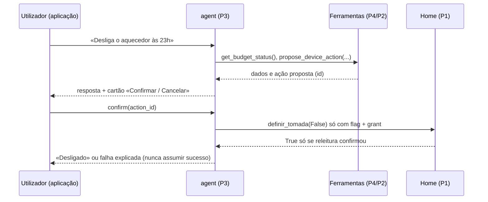

# Módulos `agent` e `automations` — assistente de IA e automações

**Dono: P3 (RafaelMat0s-Dev); execução física: P1.** **PLANEADO.** Substitui o agente que vivia no Telegram: o assistente está **dentro da aplicação** (D-01).

## Responsabilidade

1. **Assistente conversacional** que explica consumo, recibos e orçamentos («porque pago mais 5 € que a Carla?»), em português.
2. **Ações sugeridas** (ex.: «desligar o aquecedor às 23 h»), sempre com **confirmação do utilizador** antes de executar.
3. **Automações** escritas em português e convertidas em `AutomationRule`, com pré-visualização e ativação explícita.

## Guarda-corpos (obrigatórios; PDF §9)

| Regra | Como se cumpre |
|---|---|
| **O modelo nunca inventa números** | Todos os valores vêm de funções (ferramentas) do backend; o LLM só redige; as contas são feitas em código ([billing.md](billing.md)) |
| Respeita o papel | As ferramentas executam com as permissões do utilizador autenticado; o senhorio não usa o assistente de consumo individual (**PROPOSTA**) |
| Confirmação humana | Uma ação sugerida cria `agent_action` e só se executa em `POST /api/agent/actions/{id}/confirm`. Sensíveis (segurança, cortes fora de regras aprovadas) pedem sempre confirmação |
| Sem vídeo | O LLM nunca recebe imagens, frames nem URLs de câmara; só texto |
| Dados mínimos | Enviar ao modelo apenas o necessário e sem identificadores externos de dispositivos. Qual o fornecedor de LLM e que dados podem sair: decisão P-06 |
| Sem escritas físicas sem autorização | As ações passam pelo contrato `Home` com flag + grant + whitelist (lâmpada e tomada) |
| Proveniência | As respostas indicam se um valor é medido, estimado, inferido ou simulado |

## Ferramentas (funções) propostas

| Ferramenta | Devolve | Dono do dado |
|---|---|---|
| `get_my_consumption(period)` | kWh e custo individuais, por proveniência | P4 |
| `get_receipt(bill_id)` / `explain_difference(resident_a, resident_b)` | Linhas do recibo | P4 |
| `get_budget_status()` | Gasto, limiares, previsão | P4 |
| `list_pending_confirmations()` | Pedidos abertos | P3 |
| `who_is_home()` | Só para o próprio e com opt-in; nunca para senhorio | P2 |
| `propose_device_action(role, capability, value)` | Cria ação a confirmar | P1/P3 |
| `propose_automation(nl_text)` | `AutomationRule` em `proposed` | P3 |

Fora das ferramentas, o modelo não responde com números; em dúvida diz que não sabe.

## Fluxo de uma ação sugerida

## Automações

- Modelo `AutomationRule` ([data-model.md](../architecture/data-model.md)): gatilho, condição, ações, confirmação, estado `draft → proposed → active`.
- Reaproveita o fluxo atual **texto → proposta validada → confirmação explícita** (`features/engine/llm.py`, `POST /api/rules/parse`) com um schema novo; `ParseResponse` não grava nem executa.
- **Âmbito do MCP:** só lâmpada (`power`, `brightness`, `color_rgb`) e tomada (`power`). Gatilhos por sensores de contacto/clima exigem **leitura** de dispositivos hoje fora da seleção do `McpHome` — **PROPOSTA** de extensão só de leitura (P-01). **Cenários** do Connected Home (`post_new_scenario`), alarme e segurança **continuam proibidos** até decisão explícita da equipa.
- A votação da casa (PDF §12: 👍/👎) passa a ser aprovação na aplicação (**PROPOSTA**, P2).
- Prioridade: P2. Nada disto bloqueia o MVP.

## Ficheiros existentes reutilizáveis

`features/engine/llm.py` (cliente NVIDIA, retry, schema), `features/engine/router.py` (`/api/rules/parse`), `core/config.py` (`NVIDIA_API_KEY`), frontend `NewAutomationPage`, `hooks/useNewRule.ts`.

## Ficheiros novos previstos

`features/agent/{tools,router,service,tests}`, `features/automations/{router,service,tests}`, `contracts/agent.py` (**PLANEADO**), frontend `pages/AssistantPage.tsx`.

## Dependências

P4 (dados de consumo, recibos), P1 (ações), P2 (presença), P5 (papéis, UI).

## Critérios de aceitação

- Em testes com um LLM falso, o assistente responde só com valores devolvidos pelas ferramentas; uma pergunta sem dados devolve «não sei», nunca um valor.
- Uma ação sugerida nunca chama `Home` sem `confirm`; com grant inexistente a ação falha com mensagem clara.
- Um senhorio recebe `403` ao pedir dados individuais ao assistente.
- Sem `NVIDIA_API_KEY` o resto da aplicação funciona (comportamento atual) e o assistente indica que está indisponível.

## Testes

Cliente LLM falso; ferramentas com dados fixos; permissões; confirmação; rejeição; nada de rede nem chave real em `pytest`.
