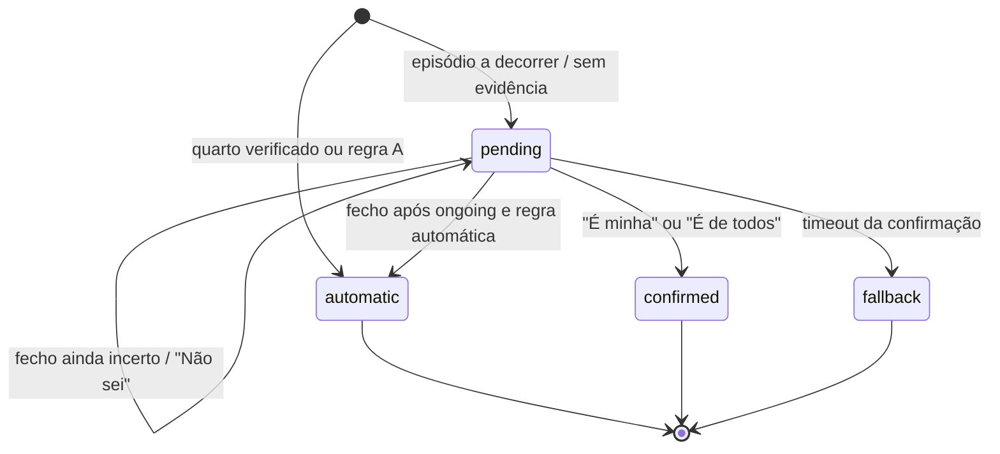

# Módulo `households` — casas, quartos, moradores e persistência

**Dono: P5 (souofrancisco).** **IMPLEMENTADO (F0 + HOUSE-02 nesta branch): leituras REST, persistência, guardas, criação de quartos, convites tenant e revogação.** Entidades: [data-model.md](../architecture/data-model.md). Contratos: [contracts.md](../architecture/contracts.md).

## Responsabilidade

Fonte de verdade de **quem vive onde e com que papel**: `Household`, `Room`, `Resident`, `Membership`, e das **permissões** que todos os outros módulos aplicam. Também é dono da persistência partilhada (`core/db.py`, migrações, `domain_event`) e do barramento (`core/events.py`).

## Recebe / produz

| Recebe | Produz |
|---|---|
| Pedidos REST da aplicação (criar casa, quartos, convites) | `Household`, `Room`, `Resident`, `Membership` |
| Identidade do Authentik (`sub`) | Resolução `utilizador → memberships → papel` (dependência FastAPI para todos os routers) |
| — | Eventos: `households.membership_changed` (entrada/saída de morador, mudança de quarto) |

## Regras

- O vínculo pessoa–quarto vem do contrato de arrendamento e é **introduzido pelo senhorio**; o sistema nunca o adivinha (PDF §10.3).
- Convite: senhorio cria uma membership `invited` para um quarto e email de destino; o token secreto é entregue uma única vez, expira em 72 h e só é aceite com OIDC e email realmente verificado. Ver [HOUSE-02](../architecture/house-02-memberships.md). A UI do link pertence a HOUSE-05.
- Papéis em `Membership.role`. Autorização: `require_access(Resource, Operation)` em `core/access.py` (matriz `PERMISSIONS`): `403 forbidden_role` para membros sem papel, `404 household_not_found` para não-membros. Decisão pendente P-02 (papéis na base de dados vs grupos do Authentik); recomendação: base de dados, para não depender da configuração do Authentik.
- DTOs por papel: o senhorio **nunca** recebe presença nem aparelhos individuais (RP-01).
- `presence_opt_in` é editado só pelo próprio inquilino.
- Saída a meio do mês: a membership fecha com `ends_on`; a fatura usa as datas.

## Persistência (SQLite)

Esquema versionado em ficheiros SQL numerados; chaves estrangeiras ligadas; modo WAL. Acesso e testes com base em memória. Biblioteca: `sqlite3` da stdlib (P-05 resolvido, D-25/D-29); `core/db.py`, `core/migrations/`. Dados de demonstração por *seed* determinístico, sempre `source_kind=demo`.

## Ficheiros previstos

`features/households/{router,repo,membership_flow,tests}`; `core/db.py`, `core/events.py`, `core/migrations/*.sql`; Authentik/JWT mantém-se em `features/auth/service.py`. O provisionamento do primeiro senhorio é administrativo, não é um endpoint público.

## Dependências

P1, P2, P3, P4 dependem das dependências de autorização e do barramento — **é o primeiro entregável da equipa** (ver [development/roadmap.md](../development/roadmap.md)).

## Critérios de aceitação

- Criar uma casa de demonstração com 4 quartos e 4 moradores por *seed* num único comando.
- Um inquilino não consegue obter dados de outro inquilino; um senhorio obtém `403 forbidden_role` em qualquer rota de presença ou aparelhos.
- `Σ` de moradores ativos numa data = membros no período (teste de saída a meio do mês).
- Barramento: `publish` e `subscribe` com handlers idempotentes e `domain_event` gravado.

## Testes

Autorização por papel (tabela de rotas × papéis); migrações aplicam-se do zero; barramento com handler que falha não afeta os outros; *seed* repetível.
## Matriz de propriedade HOUSE-04 / P3 / P4 (auditoria contra `origin/main`)

| Responsabilidade | Implementação atual | Dono | Duplicação em HOUSE-04? | Decisão |
|---|---|---|---|---|
| Escolha da política A/B/C | `PolicyVersion` e `resolve_policy` (branch HOUSE-04); `Household.common_area_rule` em F0 | HOUSE-04 | Não | HOUSE-04 mantém versões temporais; snapshot inicial lê F0 uma vez. C continua suspensa no MVP. |
| Regra por quarto | `resolve_policy` (branch); memberships temporais em HOUSE-02 | HOUSE-04 decide; P4 materializa | Parcial | Usar ocupação contratual integral do episódio; sem prova/localização, não atribuir. |
| Estado pendente | `household_policy_decision`; `Notification` em `features/notifications` | P3 é dono do estado da notificação; HOUSE-04 só do estado da política | Sim, no estado da votação | Não persistir votos nem resultado paralelo em HOUSE-04; manter apenas `pending` de política até P3 emitir outcome decisivo. |
| Limiar monetário | Política da casa e comparação do custo por utilização em `resolve_policy` | HOUSE-04 | Não | Comparar cêntimos por utilização completa; preço ausente permanece pendente. |
| Elegibilidade dos moradores | `ConfirmationRequest`; P3 filtra moradores ativos e fixa `Notification.responder_ids` | P3, usando contrato do pedido | Sim, parcialmente | O conjunto efetivo é o snapshot persistido em P3. HOUSE-04 valida o voto recebido contra o pedido e aceita os contadores/outcome de P3. |
| Votação | `Notification.responses`, `Notification.respond`, persistência CAS em P3 | P3 | Sim | Remover semântica de primeira resposta e não manter respostas no store HOUSE-04. |
| Resolução de votos | `contracts/notification.py::confirmation_outcome`, usado por serviço P3 e eventos `notification.responded` | Contrato partilhado/P3 | Sim | Fonte única. HOUSE-04 só mapeia `ConfirmationOutcome` tipado para resultado de política final. |
| Expiração | `Notification.outcome(now)` usa `confirmation_outcome(..., expired=True)`; P3 expira estado, sem evento de expiração | P3 resolve; P4 aplica fallback financeiro | Sim, como `expire_decision` paralelo | Adaptador de HOUSE-04 recebe outcome de P3 calculado no prazo; não inventa voto, não expira antes de `expires_at`. |
| Fallback | Política versionada fixa `equal`; D-32 dita `everyone` ao expirar/empatar; P4 transforma decisão em atribuição | HOUSE-04 configura; P3 resolve veredicto; P4 aplica | Sim | Separar veredicto `everyone` (resolução votada) de timeout `fallback/equal_fallback`; ambos só após outcome definitivo. |
| Atribuição financeira | `features/billing/attribution.py::decide` e contratos `Attribution` | P4 | Sim | Eliminar o segundo resolvedor HOUSE-04; expor apenas adaptador tipado se BILL-02 passar a usar políticas temporais. |
| Repartição da fatura | `features/billing/allocation.py::allocate`, reconciliação por cêntimos | P4 | Não | Reutilizar sem alteração. |
| Arredondamento | `largest_remainder` e `reproducible_tiebreak` conforme D-34 | P4 | Não | Reutilizar sem alteração. |
| Histórico/auditoria | P3 persiste notificação/votos; P4 persiste atribuições; HOUSE-04 mantém versões e decisões de política append-only | P3/P4/HOUSE-04, cada qual no seu domínio | Sobreposição parcial | HOUSE-04 audita decisão de política, não votos ou atribuições; garantir idempotência por `event.id` e decisão única por consumo. |

## HOUSE-04 — políticas de atribuição (branch de revisão)

Esta secção descreve o contrato técnico de HOUSE-04 #87. Não significa que a feature
esteja integrada na aplicação: HOUSE-03 #86 (prova de localização) e BILL-02 #90
(atribuições e faturas) continuam dependências independentes.

**Arquitetura selecionada: funções puras (A) + pequena máquina de estados persistida (B).**
Alternativas estudadas (são alternativas **técnicas**, não as políticas de produto A/B/C):

| Critério | Funções puras e estratégias | Estados/eventos | Motor declarativo (DMN/Drools) |
|---|---|---|---|
| Explicabilidade | Motivos explícitos e testes por entrada | Motivos + histórico de transições | Depende da configuração e rastreio |
| Determinismo/testes | Excelente: relógio e snapshot injetados | Bom com eventos imutáveis e transação | Necessita validar hit policies/conflitos |
| Idempotência/concorrência | Não fornece persistência | SQLite CAS + auditoria + processed_event | Requer infraestrutura adicional |
| Alterações retroativas | Seleção por versão temporal | Decisões históricas preservadas | Requer versionar regras e motor |
| Integração P3/P4 | Resultado tipado | Pedido/expiração/resposta auditáveis | Adaptador adicional |
| Custo/segurança/tempo de hackathon | Muito baixo | Baixo usando F0 | Alto, sem regras suficientes para compensar |
| Demonstração ao júri | Fácil explicar e repetir | Mostra «porquê» + transições auditáveis | Flexibilidade não justifica o risco |

Referências de investigação: [Fowler — Rules Engine](https://martinfowler.com/bliki/RulesEngine.html),
[OMG — DMN 1.5](https://www.omg.org/spec/DMN/1.5/PDF),
[Microsoft — Aggregate Invariants](https://learn.microsoft.com/dotnet/architecture/microservices/microservice-ddd-cqrs-patterns/domain-model-layer-validations)
e [Transactional Outbox](https://microservices.io/patterns/data/transactional-outbox.html).

### Regras e prova de localização

- `location_verified=True` só pode vir de evidência independente de
  localização observada no evento/medição. O port HOUSE-03 atual oferece
  ownership histórico e períodos de ligação do medidor, não uma prova de
  localização observada. `context_for_consumption` devolve ownership apenas
  quando todo o evento tem um snapshot inequívoco; isso é contexto e não prova
  uso nem lugar. A tomada agregada, `home_room_id`, proprietário e assinatura
  probabilística não bastam.
- Se o evento atravessa mudança de proprietário/localização habitual ou de
  medidor e P1 não fornece energia segmentada no limite temporal, não atribuir
  a uma pessoa. Manter pendente/sem atribuição pessoal. As listas de
  `context_segments_for_consumption` explicam o histórico, mas não segmentam
  energia por si.
- Consumo em aberto: `pending/consumption_ongoing`; descartado: não é atribuível.
  Só o episódio **fechado** é avaliado para cobrança/solicitação.
- Quarto verificado: exige exatamente um contrato que cubra **todo o episódio**,
  no fuso da casa, incluindo contratos atualmente terminados que eram válidos
  à data. Mudanças a meio do episódio ou contratos em falta ⇒ `pending`,
  nunca uma dívida inventada.
- Sala comum verificada: **A** ⇒ `automatic/common/equal_rule`; **B** ⇒
  abaixo de `ask_threshold_cents`, `automatic/common/equal_rule`; acima ou
  igual, `pending` com `ConfirmationRequest` tipado. Se falta preço estimado,
  `pending/cost_unknown`, sem inventar valores.
- **C** existe em `CommonAreaRule.presence`, mas devolve
  `pending/presence_deferred`: nenhum sinal de presença é convertido em
  responsabilidade no MVP. Apenas F2 pode ativar esse algoritmo.
- O fallback **configurado pela casa no MVP é explicitamente `equal`**,
  persistido por versão. Nunca herda implicitamente uma decisão C sem evidência.
- O limiar omisso é 50 cêntimos por utilização completa e o prazo é 24 h,
  conforme D-32. Ambos pertencem ao snapshot temporal da política da casa.

### Máquina de estados (não confundir com `ConsumptionStatus` ou `NotificationStatus`)

P3 mantém a notificação aberta para votos intermédios, inclusive `unknown`,
e fecha-a apenas quando `confirmation_outcome` decide. Um «É minha» decide
com um voto; atribuir a outro exige pelo menos metade dos elegíveis com o
mesmo alvo; todos votarem sem atingir limiar resulta em `everyone`. O store
HOUSE-04 não persiste respostas e não fecha a decisão com um voto intermédio.
P3 congela `responder_ids` ao criar a notificação; uma membership revogada
deixa de poder responder, mas continua no denominador dessa votação. HOUSE-04
preserva o snapshot de P3 e não recalcula votos/elegibilidade. D-32 não decide
explicitamente esta alteração durante uma votação, pelo que a regra de snapshot
fica registada para validação humana.
Ao expirar, P3 calcula `Notification.outcome(now)` como `everyone`; BILL-02
aplica o fallback comum igual através do adaptador HOUSE-04. Sem localização
ou contrato válido não existe fallback automático de **identidade**.
Revisões pós-confirmação são responsabilidade da contestação P4.

### Persistência e contratos

- `contracts/policy.py`: `PolicyVersion`, `PolicyDecision`,
  `PolicyStatus`, `PolicyReason` (tipos que P4 consome).
- `features/households/policies.py`: `resolve_policy`,
  `apply_confirmation_outcome`, `expire_decision`, `confirmation_intent`,
  `as_attribution` (puras; a resolução de votos permanece em P3).
- `features/households/policy_store.py`: `policy_at`,
  `ensure_initial_policy`, `append_policy`, `resolve_and_store`,
  `record_confirmation_outcome`, `expire_and_store` (na mesma `conn` do EventBus;
  o chamador passa o outcome produzido pela entidade P3 persistida).
- `0150_house_policies.sql`: snapshots de política com validade `[valid_from, valid_until)`,
  decisão atual única por `(household_id, consumption_event_id)`,
  revisões de auditoria **append-only** e `source_event_id` único.
- A primeira versão copia **uma vez** `household.common_area_rule`,
  `ask_threshold_cents`, `ask_timeout_hours` da fundação F0;
  `append_policy` exige `valid_from >= now` e versão sucessora.
  Consumos passados usam a versão efetiva no `started_at`.
- O módulo não persiste `Attribution`, não calcula euros da fatura, não
  cria notificações nem ativa hardware. P4 deve aplicar índice único parcial
  em `Attribution(consumption_event_id) WHERE status='active'`.

### Integração objetiva para P4/P3

1. P1 emite `energy.consumption_closed`; HOUSE-03 devolve evidência
   verificável da localização (ou `False`). No handler **de P4**, chamar
   `resolve_and_store(conn, event.data, now=clock(), location_verified=verified,
   source_event_id=event.id)`. O resultado é estável e auditável.
2. Se `confirmation_intent(decision, correlation_id=event.correlation_id)`
   devolver `BillingConfirmationNeeded`, o handler devolve o evento para
   publicação **na mesma transação**. P3 cria e envia a notificação da aplicação.
3. P3 publica um `notification.responded` por voto, com `outcome` cumulativo.
   O handler BILL-02 filtra `ref.type=consumption_event`, valida a casa e chama
   `record_confirmation_outcome`. Outcomes pendentes não mudam a política;
   um outcome decisivo fecha-a uma vez. Repetição e eventos intermédios
   atrasados são idempotentes.
4. No prazo, BILL-02 lê a notificação P3 persistida, calcula
   `Notification.outcome(now)` e chama `expire_and_store` somente quando
   `Notification.is_expired(now)` for verdadeiro. O fallback não ocorre antes
   do prazo. O varrimento/agendamento P3 ainda não é chamado na aplicação.
5. Só P4 cria/persiste `Attribution` e publica `billing.attribution_changed`
   depois do commit. P3 é dono do CAS, dos votos e da elegibilidade; HOUSE-04
   mantém apenas revisão de política/decisão; BILL-02 garante unicidade ativa.

**Exemplos tipados para BILL-02:** quarto Ana ⇒ `automatic, resident=ANA,
room_rule`; aquecedor Bruno usado pela Carla na sala ⇒
`pending(awaiting_confirmation)` e depois `confirmed, resident=CARLA,
confirmation`; ninguém responde ⇒ `fallback, common, equal_fallback`;
sala sob A ⇒ `automatic, common, equal_rule`; presença C sem F2 ⇒
`pending, presence_deferred`. Não há repartição de euros nesta camada.

Teste focal: `uv run pytest -q src/homemind/features/households/tests/test_policies.py`
a partir de `app/backend`. Os testes novos usam o serviço SQLite real de P3 e
os DTOs/algoritmos de atribuição e repartição de P4. **Integração de produção
continua PLANEADA:** BILL-02 ainda não subscreve os eventos de consumo/resposta
nem agenda a expiração; o port HOUSE-03 não fornece evidência observada de
localização.

## Interface HOUSE-02

O backend disponibiliza `POST /api/households/{household_id}/rooms`, `POST /api/households/{household_id}/invitations`, `POST /api/invitations/accept` e `POST /api/households/{household_id}/memberships/{membership_id}/revoke`. O contrato das respostas mantém `RoomView`, `MemberView` e `MembershipSelfView`. Email, `auth_subject` e hash do token não são publicados nos DTOs. [Estados, erros, matriz ponderada e integrações](../architecture/house-02-memberships.md).

**Pré-condição real:** Authentik tem de disponibilizar `email_verified=true` apenas após verificar efetivamente o endereço; o mapping padrão não basta. HOUSE-05 implementa a experiência visual. Os eventos de alteração de membership são trabalho de integração futura, não reivindicados por este PR.
