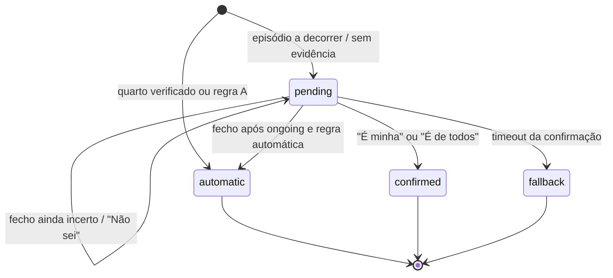

# Módulo `households` — casas, quartos, moradores e persistência

**Dono: P5 (souofrancisco).** **IMPLEMENTADO (F0): leituras por REST, persistência, guardas e barramento. PLANEADO: escrita por REST, convites.** Entidades: [data-model.md](../architecture/data-model.md). Contratos: [contracts.md](../architecture/contracts.md).

## Responsabilidade

Fonte de verdade de **quem vive onde e com que papel**: `Household`, `Room`, `Resident`, `Membership`, e das **permissões** que todos os outros módulos aplicam. Também é dono da persistência partilhada (`core/db.py`, migrações, `domain_event`) e do barramento (`core/events.py`).

## Recebe / produz

| Recebe | Produz |
|---|---|
| Pedidos REST da aplicação (criar casa, quartos, convites) | `Household`, `Room`, `Resident`, `Membership` |
| Identidade do Authentik (`sub`) | Resolução `utilizador → memberships → papel` (dependência FastAPI para todos os routers) |
| — | Eventos: `households.membership_changed` (entrada/saída de morador, mudança de quarto) |

## Regras

- O vínculo pessoa–quarto vem do contrato de arrendamento e é **introduzido pelo senhorio**; o sistema nunca o adivinha (PDF §10.3).
- Convite: senhorio cria `Membership(status=invited)`; o inquilino aceita ao iniciar sessão. O QR da porta do PDF §2.1 passa a ser um **link de convite** (**PROPOSTA**).
- Papéis em `Membership.role`. Autorização: `require_access(Resource, Operation)` em `core/access.py` (matriz `PERMISSIONS`): `403 forbidden_role` para membros sem papel, `404 household_not_found` para não-membros. Decisão pendente P-02 (papéis na base de dados vs grupos do Authentik); recomendação: base de dados, para não depender da configuração do Authentik.
- DTOs por papel: o senhorio **nunca** recebe presença nem aparelhos individuais (RP-01).
- `presence_opt_in` é editado só pelo próprio inquilino.
- Saída a meio do mês: a membership fecha com `ends_on`; a fatura usa as datas.

## Persistência (SQLite)

Esquema versionado em ficheiros SQL numerados; chaves estrangeiras ligadas; modo WAL. Acesso e testes com base em memória. Biblioteca: `sqlite3` da stdlib (P-05 resolvido, D-25/D-29); `core/db.py`, `core/migrations/`. Dados de demonstração por *seed* determinístico, sempre `source_kind=demo`.

## Ficheiros previstos

`features/households/{router,service,models,tests}`; `core/db.py`, `core/events.py`, `core/migrations/*.sql`; extensão de `features/auth/service.py` (papéis).

## Dependências

P1, P2, P3, P4 dependem das dependências de autorização e do barramento — **é o primeiro entregável da equipa** (ver [development/roadmap.md](../development/roadmap.md)).

## Critérios de aceitação

- Criar uma casa de demonstração com 4 quartos e 4 moradores por *seed* num único comando.
- Um inquilino não consegue obter dados de outro inquilino; um senhorio obtém `403 forbidden_role` em qualquer rota de presença ou aparelhos.
- `Σ` de moradores ativos numa data = membros no período (teste de saída a meio do mês).
- Barramento: `publish` e `subscribe` com handlers idempotentes e `domain_event` gravado.

## Testes

Autorização por papel (tabela de rotas × papéis); migrações aplicam-se do zero; barramento com handler que falha não afeta os outros; *seed* repetível.
## HOUSE-04 — políticas de atribuição (IMPLEMENTADO na branch de revisão)

Esta secção descreve o contrato técnico de HOUSE-04 #87. Não significa que a feature
esteja integrada na aplicação: HOUSE-03 #86 (prova de localização) e BILL-02 #90
(atribuições e faturas) continuam dependências independentes.

**Arquitetura selecionada: funções puras (A) + pequena máquina de estados persistida (B).**
Alternativas estudadas (são alternativas **técnicas**, não as políticas de produto A/B/C):

| Critério | Funções puras e estratégias | Estados/eventos | Motor declarativo (DMN/Drools) |
|---|---|---|---|
| Explicabilidade | Motivos explícitos e testes por entrada | Motivos + histórico de transições | Depende da configuração e rastreio |
| Determinismo/testes | Excelente: relógio e snapshot injetados | Bom com eventos imutáveis e transação | Necessita validar hit policies/conflitos |
| Idempotência/concorrência | Não fornece persistência | SQLite CAS + auditoria + processed_event | Requer infraestrutura adicional |
| Alterações retroativas | Seleção por versão temporal | Decisões históricas preservadas | Requer versionar regras e motor |
| Integração P3/P4 | Resultado tipado | Pedido/expiração/resposta auditáveis | Adaptador adicional |
| Custo/segurança/tempo de hackathon | Muito baixo | Baixo usando F0 | Alto, sem regras suficientes para compensar |
| Demonstração ao júri | Fácil explicar e repetir | Mostra «porquê» + primeira resposta | Flexibilidade não justifica o risco |

Referências de investigação: [Fowler — Rules Engine](https://martinfowler.com/bliki/RulesEngine.html),
[OMG — DMN 1.5](https://www.omg.org/spec/DMN/1.5/PDF),
[Microsoft — Aggregate Invariants](https://learn.microsoft.com/dotnet/architecture/microservices/microservice-ddd-cqrs-patterns/domain-model-layer-validations)
e [Transactional Outbox](https://microservices.io/patterns/data/transactional-outbox.html).

### Regras e prova de localização

- A **localização tem de ser atestada por HOUSE-03**, fornecendo
  `location_verified=True` à função `resolve_policy`. A tomada agregada
  `DeviceRole.main_meter`, a morada do dispositivo, o registo de propriedade
  e a assinatura probabilística **não provam onde ocorreu o consumo**.
- Consumo em aberto: `pending/consumption_ongoing`; descartado: não é atribuível.
  Só o episódio **fechado** é avaliado para cobrança/solicitação.
- Quarto verificado: exige exatamente um contrato que cubra **todo o episódio**,
  no fuso da casa, incluindo contratos atualmente terminados que eram válidos
  à data. Mudanças a meio do episódio ou contratos em falta ⇒ `pending`,
  nunca uma dívida inventada.
- Sala comum verificada: **A** ⇒ `automatic/common/equal_rule`; **B** ⇒
  abaixo de `ask_threshold_cents`, `automatic/common/equal_rule`; acima ou
  igual, `pending` com `ConfirmationRequest` tipado. Se falta preço estimado,
  `pending/cost_unknown`, sem inventar valores.
- **C** existe em `CommonAreaRule.presence`, mas devolve
  `pending/presence_deferred`: nenhum sinal de presença é convertido em
  responsabilidade no MVP. Apenas F2 pode ativar esse algoritmo.
- O fallback **configurado pela casa no MVP é explicitamente `equal`**,
  persistido por versão. Nunca herda implicitamente uma decisão C sem evidência.
- O limiar de 50 cêntimos e timeout 24 h são omissões **propostas** em P-03,
  não factos legais nem decisões comerciais irrevogáveis.

### Máquina de estados (não confundir com `ConsumptionStatus` ou `NotificationStatus`)

`mine`: só o respondente (não o proprietário do aparelho);
`everyone`: conta comum, confirmação humana;
`unknown`: a notificação de P3 já fica `actioned` (primeira resposta vence),
mas HOUSE-04 mantém a decisão pendente até ao timeout; não cria nova pergunta
nem permite outra resposta sobre o mesmo pedido. Timeout (>= `expires_at`)
leva a `fallback/common/equal_fallback`. Sem localização ou contrato válido,
não existe fallback automático de **identidade**. Revisões pós-confirmação
são responsabilidade da contestação P4, não de respostas repetidas.

### Persistência e contratos

- `contracts/policy.py`: `PolicyVersion`, `PolicyDecision`,
  `PolicyStatus`, `PolicyReason` (tipos que P4 consome).
- `features/households/policies.py`: `resolve_policy`, `apply_response`,
  `expire_decision`, `confirmation_intent`, `as_attribution` (puras).
- `features/households/policy_store.py`: `policy_at`,
  `ensure_initial_policy`, `append_policy`, `resolve_and_store`,
  `respond_and_store`, `expire_and_store` (na mesma `conn` do EventBus).
- `0150_house_policies.sql`: snapshots de política com validade `[valid_from, valid_until)`,
  decisão atual única por `(household_id, consumption_event_id)`,
  revisões de auditoria **append-only** e `source_event_id` único.
- A primeira versão copia **uma vez** `household.common_area_rule`,
  `ask_threshold_cents`, `ask_timeout_hours` da fundação F0;
  `append_policy` exige `valid_from >= now` e versão sucessora.
  Consumos passados usam a versão efetiva no `started_at`.
- O módulo não persiste `Attribution`, não calcula euros da fatura, não
  cria notificações nem ativa hardware. P4 deve aplicar índice único parcial
  em `Attribution(consumption_event_id) WHERE status='active'`.

### Integração objetiva para P4/P3

1. P1 emite `energy.consumption_closed`; HOUSE-03 devolve evidência
   verificável da localização (ou `False`). No handler **de P4**, chamar
   `resolve_and_store(conn, event.data, now=clock(), location_verified=verified,
   source_event_id=event.id)`. O resultado é estável e auditável.
2. Se `confirmation_intent(decision, correlation_id=event.correlation_id)`
   devolver `BillingConfirmationNeeded`, o handler devolve o evento para
   publicação **na mesma transação**. P3 cria e envia a notificação da aplicação.
3. P3 publica `notification.responded` com `ref` do consumo.
   P4 valida o household do envelope e chama `respond_and_store`.
   A verificação da elegibilidade é novamente feita sobre o snapshot do pedido.
4. P4 executa `expire_and_store` nas confirmações vencidas
   (varrimento periódico e/ou antes de finalizar a fatura).
   Em estados resolvidos, só P4 cria `Attribution` com `as_attribution`
   e publica `billing.attribution_changed` **depois do commit transacional**.
5. P3 é responsável por first-wins/CAS da notificação. HOUSE-04 acrescenta
   idempotência por decisão/revisão e rejeita segunda atribuição; BILL-02
   é responsável pelo índice único de atribuições **ativas** e revisões.

**Exemplos tipados para BILL-02:** quarto Ana ⇒ `automatic, resident=ANA,
room_rule`; aquecedor Bruno usado pela Carla na sala ⇒
`pending(awaiting_confirmation)` e depois `confirmed, resident=CARLA,
confirmation`; ninguém responde ⇒ `fallback, common, equal_fallback`;
sala sob A ⇒ `automatic, common, equal_rule`; presença C sem F2 ⇒
`pending, presence_deferred`. Não há repartição de euros nesta camada.

Teste focal: `uv run pytest -q src/homemind/features/households/tests/test_policies.py`
a partir de `app/backend`. Não existe integração de produção com P1/P3/P4
nesta branch; o teste do barramento usa um handler de P4 simulado,
sem fingir que as features dependentes já existem.
