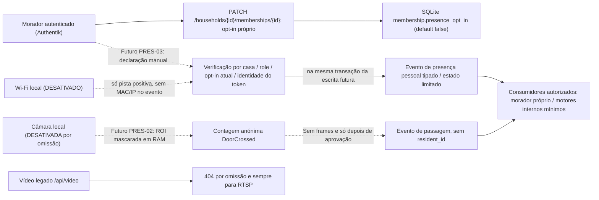

# Módulo `presence` — câmara na porta e presença

**Dono: P2 (1Mii).** **PLANEADO**, sobre `features/video` e `features/visao` existentes. Entidades: `PresenceEvent`, `PersonPresence` ([data-model.md](../architecture/data-model.md)).

## Responsabilidade

Saber **quando alguém entra ou sai** e, a partir daí, **quem está em casa** — sem reconhecer ninguém pela imagem. A identidade vem de fontes voluntárias (registo na aplicação; futuro: Wi-Fi com opt-in).

## Privacidade (inegociável, PDF §5.3 + [CLAUDE.md](../../CLAUDE.md))

- O vídeo é processado **localmente**; nunca se grava, regista ou envia um frame. Só saem eventos de texto.
- Sem reconhecimento facial nem identificação. `track_id` é efémero e nunca persistido.
- Só a soleira da porta é analisada; o resto da imagem é tapado a preto **antes** de qualquer inferência.
- O senhorio não tem acesso a imagens, entradas, saídas nem horários.
- A câmara só existe na casa se a casa decidir (votação: **PROPOSTA**, prioridade P2).
- Sem câmara, a presença funciona só com o registo manual e (futuro) Wi-Fi.

## Recebe / produz

| Recebe | Produz |
|---|---|
| Frames da câmara/clip (`features/video`, `FonteVideo`) | `DoorCrossed` (sentido, confiança), `presence.door_crossed` |
| Registo manual «cheguei / saí» (`PUT /api/presence/me`, `PresenceMeIn`) | `PresenceEvent(source=manual)` em `presence.cue_recorded` |
| Telemóveis registados no Wi-Fi com opt-in (`PresenceDevice.wifi_opt_in`) | idem, `source=wifi` (só `in`) |
| `energy.consumption_detected` com `appliance_owner_resident_id` (P1) | idem, `source=appliance` (só `in`) |
| Resposta a «estás em casa?» (`notification.responded`, `ref.type=presence_check`, P3) | pista manual |
| `sensor.reading_recorded` (contacto, fumo; P1) | `SafetyAlert` em `safety.alert_raised` (SAFE-01/03) |
| — | `presence.changed` por pessoa; `presence.confirmation_needed` (pistas em conflito); `presence.occupancy_changed` (anónimo; «casa possivelmente vazia» só na fase 2) |

Contratos novos (`PresenceMeIn`, `PresenceConfirmationRequest`, `HouseOccupancy`, `PresenceDevice`, `CameraStatus`, `SensorReading`, `SafetyAlert`): **PROPOSTA** (D-31), em `contracts/{presence,sensors,safety}.py`.

## Passos

| Passo | Descrição | Prioridade |
|---|---|---|
| 1 | Presença por registo manual na aplicação + eventos simulados de porta; permite à P4 testar a regra C e os esquecidos sem câmara | P0 (para destravar) |
| 2 | Detetor de pessoas na soleira (`DetetorYolo` só com a classe «pessoa» + ByteTrack) e linha virtual → `DoorCrossed` | P0 (PRES-02 #106) |
| 3 | Fusão de pistas por pessoa: em casa / fora / incerto, com tolerância de 20–30 min para ausências e confirmação pela porta (PDF §6.8) | P0 (PRES-04 #108) |
| 4 | Estado «casa vazia» e alerta de entrada com casa vazia — **fase 2** | P2 (F3: PRES-06 #131, SAFE-02 #115) |
| 5 | Sinal de presença por Wi-Fi (opt-in) e confirmação manual | P0 (PRES-03 #107) |

Regras de fusão (PDF §6.8): presença no Wi-Fi conta muito, ausência conta pouco; só se considera que alguém saiu se houver uma saída pela porta e passarem 20–30 min; um aparelho a continuar ligado não prova presença, só um a **ligar** prova; contradição (entrada + aparelho a ligar sem ninguém «em casa») → `uncertain` e pergunta na aplicação.

## Limites reais

- Acesso à imagem da câmara do kit (MEARI) **não está provado** para este caso de uso: só há leitura RTSP de 10 min via relay (medição herdada, ver [altice-mcp.md](../integrations/altice-mcp.md)) e a câmara do kit é fixa. Plano B: telemóvel como câmara IP ou clip gravado — dito sempre como tal.
- A deteção de objetos YOLO e o gesto não estão validados com a câmara real; **não são necessários** para a Conta Certa.
- A contagem na porta, a fusão e a precisão **não estão medidas**; nenhum valor de precisão pode aparecer em documentos ou pitch antes de medido.

## Ficheiros existentes reutilizáveis

`features/video/*`, `features/visao/{detetor,thread,dispositivo,pesos,anotar}.py`, `features/gestos/{ponte,presenca}.py`, `contracts/{video,visao,base}.py`, `connectors/…` (nenhum). Ver destinos em [migration.md](../architecture/migration.md).

## Ficheiros novos previstos

`features/presence/{door,fusion,router,service,tests}`, `contracts/presence.py`. Pesos YOLO e `torch` continuam fora do Docker e do CI (extra `visao`).

## Dependências

P5 (`households`, barramento), P3 (UI e notificações de «estás em casa?»). Alimenta P4 (regra C, esquecidos).

## Critérios de aceitação

- Com um clip ou um detetor falso, N passagens na linha produzem N `DoorCrossed` com o sentido certo e **zero** imagens persistidas (teste que varre o diretório de dados).
- Telemóvel «a dormir» 10 min sem passar a porta continua «em casa» (PDF §21).
- Sair pela porta e passar a tolerância → «fora»; contradição → «incerto».
- O senhorio recebe `403 forbidden_role` em todas as rotas de presença.

## Testes

Lógica pura com detetor falso e relógio simulado (como em `gestos/tests`); nunca YOLO real, rede ou câmara em `pytest`. Câmara real: [guia de validação](../development/guia-validacao-manual.md) (VID-01…03, YOLO-01/02).

## PRIV-02 #119 — Investigação e arquitetura de privacidade (17/11/2026)

**Estado:** RECOMENDAÇÃO técnica para MVP; controlos em código identificados como IMPLEMENTADOS abaixo. **Não é parecer jurídico nem declaração de conformidade com RGPD.** Consultar o documento Conta Certa v5.1 §§5, 6.8, 10 e 21; contratos F0 `contracts/presence.py`; matriz em `core/access.py`; fluxo real de vídeo em `features/video/{router,service,fonte}.py`.

### Avaliação comparada (A/B/C)

Pontuação qualitativa de **1 (inadequado) a 5 (favorável)**; pesos refletem proporcionalidade ao objetivo de atribuir consumos e explicar dúvidas na casa partilhada. **Não são medições de precisão nem validação de campo.** A questão jurídica é um critério de incerteza, não uma conclusão de legalidade.

| Critério (peso %) | A Manual | B Câmara efémera | C Câmara + Wi-Fi voluntário |
|---|---:|---:|---:|
| Baixa intrusividade (15) | 5 | 3 | 2 |
| Minimização de dados (10) | 4 | 4 | 2 |
| Baixo risco de reidentificação indireta (10) | 5 | 3 | 1 |
| Proteção de visitantes (10) | 5 | 3 | 2 |
| Segurança e superfície de ataque (10) | 5 | 3 | 2 |
| Robustez perante erros humanos/técnicos (8) | 3 | 3 | 3 |
| Independência de hardware (7) | 5 | 2 | 1 |
| Manutenção (5) | 5 | 2 | 1 |
| Precisão realista para a finalidade (5) | 2 | 3 | 4 |
| Desativação e revogação (5) | 5 | 4 | 2 |
| Adequação ao MVP (5) | 5 | 3 | 1 |
| Menor incerteza jurídica (10) | 4 | 2 | 1 |
| **Total ponderado (/5)** | **4,49** | **2,93** | **1,81** |

- **A — recomendada:** morador opta pela presença e declara «cheguei/saí» na aplicação. Falhas e esquecimentos tornam o estado **incerto**, nunca «fora» por omissão. Não há prova independente de quem atravessou a porta. Não é fonte obrigatória para faturação: as regras **igual** ou **perguntar** continuam a funcionar.
- **B — evolução experimental condicionada:** detetor local, apenas região da soleira mascarada *antes* da inferência, contagem anónima e passageira. Frames só em RAM e descartados; nenhuma imagem é enviada à API ou cliente. Sem identidade, sem armazenamento de `track_id`, sem rosto, pose identificadora ou embeddings. O timestamp e a correlação com outros dados podem ainda ser dados pessoais. A precisão não foi medida. Instalação, enquadramento legal, informação a moradores e visitantes, ameaça de exfiltração e retenção têm de ser revistos antes de captar pessoas reais.
- **C — não ativar no MVP/piloto sem revisão:** Wi-Fi voluntário fornece no máximo uma **pista positiva**, não prova de saída; falhas de cobertura, MAC aleatório, standby e telemóveis partilhados afetam inferência. Não ligar nomes, MAC, IP ou identificadores do AP a eventos publicados. Uma eventual tabela de correspondência fica separada, cifrada, com acesso próprio e eliminação imediata à revogação, após desenho e revisão próprios da PRES-03. Não existe coletor Wi-Fi implementado.

**Alternativa sem câmara:** A, com confirmação de consumos na app e fallback A (igual). Presença não é requisito para fechar a fatura; se a regra C da conta depender de informação insuficiente, nunca presumir quem estava em casa. Sem sensor: `uncertain`, não `out`. O senhorio não pode exigir opt-in como condição de acesso às funções base.

### Fluxo de dados e trust boundaries

**A fronteira do vídeo real hoje:** `features/video/fonte.py` mantém o último frame em memória e não o grava; porém o ObjectOS expunha `GET /api/video` em MJPEG com imagens cruas para qualquer utilizador autenticado. **IMPLEMENTADO neste PR:** `ENABLE_DEV_VIDEO_PREVIEW=false` impede a rota por omissão, incluindo fontes reais; mesmo com a flag ativa, uma fonte `rtsp://`/URL é sempre recusada. A flag só permite teste explícito de **clip local**, nunca autorizá-la num piloto. Esta alteração não implementa a máscara de soleira nem a contagem. `VIDEO_SOURCE` deve ficar vazio até revisão do piloto; o código de visão ObjectOS não é automaticamente seguro para presença.

**A fronteira das pistas pessoais hoje:** `features/presence/privacy.py::individual_cue_allowed` é um predicado **IMPLEMENTADO**, sem rede e sem persistência. Exige casa válida, membership tenant ativa, datas válidas no fuso da casa e opt-in **atual**. Manual exige identidade de sessão igual ao `resident_id`; Wi-Fi exige ainda ativação explícita (padrão off). Recusa evento simulado numa casa `real`. O produtor PRES-03 **terá de validar e gravar atomicamente na mesma transação**; uma validação isolada antes de escrever deixa corrida com revogação. A função não prova legitimidade de qualquer base legal. Hoje não existe produtor ligado, nem ingestão real; a flag não autoriza iniciar coletores.

### Modelo de privacidade e acessos

**Finalidades separadas:** (1) declaração voluntária para ajudar o morador a corrigir atribuição de consumo (MVP); (2) eventual contagem **não identificada** de entradas/saídas na soleira para contexto de uma casa (F2, sob revisão); (3) eventual pista positiva do telemóvel para presença própria (F2, sob revisão). Não reutilizar qualquer dado para vigilância laboral, cobrança punitiva, verificação disciplinar ou rastreio de rotinas.

**Dados mínimos:** para A: `household_id`, `resident_id`, `state`, `ts`, `source=manual`, proveniência e preferência; B (se aprovado): sentido e timestamp com resolução mínima necessária e proveniência, sem identidade; C (se aprovado): *cue* positivo por morador aderente, sem identificador de rede no evento. **Proibido:** vídeo/fotogramas em disco, armazenamento de imagem/áudio, reconhecimento facial, embeddings biométricos, persistência de `track_id`, serialização de `numpy.ndarray`, IP/MAC/SSID em eventos ou logs e perfis de visitas.

| Perfil | Preferência própria | Estado individual | Passagens anónimas | Imagens / logs brutos |
|---|---|---|---|---|
| Morador aderente | Ler/alterar só a sua | **Só o seu**, se ativo | Nenhum feed público; apenas agregado necessário sob decisão | Não |
| Morador não aderente | Ler/alterar só a sua | Não criar pistas pessoais | Não identificar; não reduzir direitos | Não |
| Outros moradores | Não | Não (regra `Resource.presence.read=own`) | Não expor horários de passagens | Não |
| Senhorio | Não pode editar preferências alheias | **Não**, mesmo da sua casa | Não | Não |
| Operador | Não | Não; só diagnóstico técnico não pessoal | Não | Não |
| Serviço interno P2/P4 | Apenas autorização mínima por finalidade, auditada | Só dados necessários e dentro da casa | Só quando habilitado | Nunca |

**IMPLEMENTADO no F0:** `membership.presence_opt_in` com default `false` e PATCH pelo próprio tenant; `Resource.presence` nega senhorio e operador; isolamento por casa. **Endurecido nesta issue:** leitura `presence` do tenant passa de `household` para **`own`**; nenhuma rota nova de leitura permite contornar isto. Sem qualquer opt-in, não publicar pista individual. A revogação é eficaz para **novas** pistas no predicado, mas não apaga automaticamente histórico antigo. Alterar preferência não é ainda um registo de consentimento juridicamente suficiente.

**Visitantes e não aderentes:** nunca são associados a moradores nem sequer quando a câmara indica entrada simultânea com um telemóvel. Podem originar só contagem anónima após autorização do módulo B. Um visitante pode permitir reidentificação por contexto; por isso não expor série temporal de passagens à casa e definir granularidade/retention. Sem opt-in, nenhuma pista pessoal e nenhuma penalização financeira por não adesão; aplicar confirmação ou divisão igual. Nunca inferir `out` apenas por ausência de rede.

**Falhas:** câmara desligada/sem frames ou Wi-Fi indisponível = `unknown/uncertain` na inferência automática. Não reutilizar cegamente o último estado como medição atual. UI deve informar «presença indisponível/incerta» sem atribuir uma saída. A app e o cálculo base funcionam com `VIDEO_SOURCE` vazio e sem Wi-Fi. A demonstração deve identificar `origin=simulated` e não apresentar contagens reais.

### Transparência, retenção e auditoria — PROPOSTA, não implementada

| Categoria | Prazo inicial **a validar** | Nota |
|---|---|---|
| Frames de B | **0 segundos de persistência** | Apenas RAM; libertação após inferência; sem dump/capture/debug em disco |
| Contagens por passagem B | 24 horas no máximo | Preferir agregado sem horários; evitar individualização |
| Pistas de presença pessoal A/C | Até 7 dias após deixar de ser necessárias para confirmação | Se influenciar fatura/contestação, justificar e separar o histórico imprescindível |
| Estado atual | Até substituição ou expiração do sinal | Incerto se não houver evidência recente |
| Auditoria de opt-in/revogação | 30 dias propostos | Apenas membership, ação booleana, UTC, propósito e ator autenticado, sem IP/MAC/frame |
| Totais financeiros/decisões | Prazo próprio da faturação sujeito a revisão | Não reter presença crua para explicar dinheiro se bastar registar razão e proveniência |

**Bloqueio real:** `domain_event` é imutável e **não tem expurgo**; a tabela atual não implementa estes prazos. Antes de qualquer piloto com pessoas reais: desenhar retenção por categoria, limite para backups, expiração/eliminação, fluxo de direitos e trilhos de auditoria mínimos; usar apenas dados sintéticos enquanto isso estiver pendente. Uma revogação desativa novas recolhas, mas histórico e dados de correspondência Wi-Fi exigirão política de apagamento e revisão próprios. A eventual evidência de consentimento não deve ter presença/horário.

**Informação na aplicação:** antes de ativar, explicar por finalidade e por fonte o que é/ não é recolhido, quem vê, se influencia divisão, como optar/revogar, retenção efetiva, contacto do responsável (por confirmar), direitos e política de visitas; consentimento, quando escolhido como fundamento, deve ser granular e livre. Mostrar estado da câmara e opção de desativação; nunca substituir transparência por uma flag técnica.

**Aviso à entrada (RASCUNHO, não afixar sem revisão):**

> Projeto experimental Conta Certa. A deteção de passagens por câmara está atualmente **desativada**. Se algum dia for ativada, será anunciado previamente: processamento local da soleira para contagem de entradas/saídas, sem gravação e sem identificação por imagem, sujeito a informação completa e aprovação. Para questões sobre privacidade, contacte o responsável identificado no aviso final a disponibilizar antes do piloto.

### Questões jurídicas e bloqueios antes de piloto real

- **Responsável pelo tratamento e subcontratantes:** distinguir equipa demonstradora, prestador, senhorio, administração do imóvel e eventual router/operador; decidir quem define finalidades e meios. Não afirmar que o senhorio é automaticamente o responsável nem pressupor a exceção doméstica.
- **Bases legais:** separar declaração manual, tratamento do contrato/atribuição, contagem por câmara e pista Wi-Fi. Consentimento não é a única base legal possível; quando usado, avaliar liberdade real em relação de arrendamento, informação, prova e retirada sem consequências. O documento v5.1 menciona «interesse legítimo» para câmara, mas **não existe teste de ponderação ou validação jurídica**. Não o tratar como conclusão.
- **AIPD e transparência:** realizar triagem documentada pela aplicação do artigo 35.º, avaliar a lista nacional da CNPD (Regulamento 798/2018), necessidade/proporcionalidade, alternativas menos invasivas, visitantes, captação de áreas comuns e riscos de correlação. Se exigida, finalizar a AIPD **antes** de recolher dados reais; se risco residual elevado, avaliar consulta prévia (art. 36.º). Rever sinalização/aviso com jurista.
- **Câmara:** confirmar ângulo só para **interior da habitação**, sem rua, patamar, servidões nem entradas de terceiros; máscara ANTES da inferência, sem áudio; segurança local, updates, isolamento de rede e ausência de encaminhamento para cloud. O simples descarte de frames não garante anonimato jurídico.
- **Wi-Fi:** confirmar acesso real ao router/API, retenção de logs do fabricante, aleatorização de endereços MAC, falhas de rede, granularidade de opt-in, capacidade de revogar e eliminar correspondência. A flag `PRESENCE_WIFI_COLLECTION_ENABLED` fica **false** até contrato PRES-03 e validação externa.
- **Produto:** consentimento por fonte/finalidade (o booleano F0 não prova qual foi aceite), necessidade de visão dos demais moradores (este PR restringe a `own`), quorum/voto sobre câmara e as consequências de recusa, precisão e thresholds testados em ambiente autorizado.

**Referências oficiais consultadas (17/11/2026):**
- [RGPD, Regulamento (UE) 2016/679](https://eur-lex.europa.eu/eli/reg/2016/679/oj) — artigos 5, 6, 7, 12–14, 25, 28, 32, 35–36.
- [EDPB, Diretrizes 3/2019 sobre dispositivos de vídeo](https://www.edpb.europa.eu/documents/guideline/guidelines-32019-on-processing-of-personal-data-through-video-devices_pt) — legalidade, transparência e minimização.
- [EDPB, Diretrizes 05/2020 sobre consentimento](https://www.edpb.europa.eu/documents/guideline/guidelines-052020-on-consent-under-regulation-2016679_pt).
- [CNPD, videovigilância](https://www.cnpd.pt/organizacoes/areas-tematicas/videovigilancia/) — condições da captação.
- [CNPD, avaliação de impacto](https://www.cnpd.pt/organizacoes/outras-obrigacoes/avaliacao-de-impacto/) — triagem e consulta prévia.
- [CNPD, Regulamento 798/2018](https://www.cnpd.pt/decisoes/regulamentos/) — lista nacional AIPD.

### Testes e estado de entrega

**IMPLEMENTADO nesta issue:** `core/access.py` com leitura própria, predicado de aceitação ligado a SQLite (`presence/privacy.py`), defaults fechados de Wi-Fi e preview MJPEG, `/api/video` fechado por omissão e sempre para URL RTSP, testes simulados de isolamento, não aderentes, revogação, ausência, visitantes não identificados e evento `DoorCrossed` sem imagem.

**AINDA NÃO IMPLEMENTADO / não declarar PASS de integração:** processamento real da câmara; contagem na soleira; sensor de Wi-Fi; endpoint de presença manual; chamadas do predicado pelo futuro produtor PRES-03; retenção/expurgo, gestão de correspondência MAC, UI de consentimento granular, avisos finais e AIPD. Dependências: PRES-02 #106, PRES-03 #107, PRES-04 #108, HOUSE-02 #85, APP-01 #94 e revisão jurídica/PILOT. Não abrir captura real nesta tarefa.

**Integração exigida à PRES-03:** chamar `individual_cue_allowed(conn, cue, now=clock(), actor_resident_id=access.resident_id, wifi_collection_enabled=settings.presence_wifi_collection_enabled)` na **mesma transação** que persistir a pista, verificar novamente `presence_opt_in` em todas as leituras relacionadas e nunca gravar pistas reprovadas. Não usar cache de opt-in; cortar o coletor à revogação; ocultar rotas de diagnóstico do senhorio.

## PRIV-02 #119 — Complemento da P2: câmara, fontes alternativas e Wi-Fi (PROPOSTA / PLANEADO)

> **Âmbito:** só presença e câmara; completa a secção anterior (P5) sem a repetir. Aplica-se a ela quanto a finalidades, acessos, retenção (P-25 desse bloco, P-20), base legal e AIPD. **Não é parecer jurídico.** Código de PRES-01…04 ainda em PRs próprios; nada abaixo está na `main`.

### Decisões do dono (P2) refletidas aqui

1. **Presença individual visível só ao próprio morador.** Nenhum colega vê estados individuais; a fusão é usada **internamente** (ex.: regra C da conta da sala). Em linha com `Resource.presence.read=own`.
2. **Wi-Fi como pista exige os dois consentimentos:** `wifi_opt_in` no telemóvel (`PresenceDevice`) **e** `Membership.presence_opt_in`. Faltando um, a pista não entra.
3. **`GET /api/video` (MJPEG):** desligado por omissão (`ENABLE_DEV_VIDEO_PREVIEW=false`, #146); quando ligado em dev, só operador (PR #158, ainda não na `main`). O MJPEG serve o **frame completo, sem máscara**: a máscara de soleira só protege a entrada do detetor, não o que o MJPEG mostra. Por isso nunca se liga com a câmara real.

### Câmara: fonte de vídeo e pipeline (PLANEADO)

- **Fonte, por ordem:** (a) câmara do kit, **só leitura**, por app/link (acesso não provado, ver «Limites reais»); (b) plano B: telemóvel como câmara IP ou clip, **sempre rotulado SIMULADO** (`CameraStatus.origin`) na UI e no pitch; (c) sem câmara: declaração manual + Wi-Fi.
- **Pipeline:** frame → máscara preta fora da soleira → `DetetorYolo` (só «pessoa») + ByteTrack → linha virtual → `DoorCrossed` (sentido, confiança) → frame descartado **a cada ciclo** do detetor. Só a soleira é analisada; sem reconhecimento facial; `track_id` nunca persistido; visitas só como número.
- **Teste exigido (PRES-02):** varrer o diretório de dados e falhar se existir qualquer imagem; nenhum evento com URL, caminho de frame ou identidade.
- Clips de desenvolvimento: só com consentimento de quem aparece, em `app/backend/data/` (fora do Git).
- **Operador** = suporte técnico: vê diagnóstico (`CameraStatus`), **nunca presença**; hoje não está limitado à sua casa (decisão para a demo, P-28).

### Wi-Fi: varrimento ping + ARP (PRES-03, PR #153, ainda não na `main`)

- **Mecanismo:** varrimento ping + ARP numa sub-rede privada configurável (`PRESENCE_WIFI_SUBNET`; na demo, a rede do hub do kit). Recolha desligada por omissão (`PRESENCE_WIFI_COLLECTION_ENABLED=false`, #146).
- **Modo `ingest`:** o anfitrião calcula o HMAC de **todos** os MACs vistos e envia-os; o **backend descarta os não registados** (não persiste, não regista em logs).
- **`match_key`:** HMAC-SHA256 com **um segredo único da instalação** (`PRESENCE_MATCH_SALT`). É **pseudonimização**: quem tenha o segredo pode testar MACs conhecidos. Sal por casa: **PLANEADO**, não existe (P-30). O MAC em claro nunca sai em API.
- **Efeito na fusão:** presença Wi-Fi é pista a favor de `in`; ausência **não renova** o `in` e **nunca** prova saída (Wi-Fi nunca produz `out`, D-30). Só a fusão (PRES-04, PR #159, ainda não na `main`) passa a `out`, após 20–30 min **e** saída pela porta.
- **Revogação** (`DELETE /api/presence/devices/{id}`, PRES-03, PR #153, ainda não na `main`; rotas de presença e o `403` ao senhorio idem): apaga o `match_key` e para novas pistas, mas **não apaga as pistas já gravadas**; `domain_event` é append-only sem expurgo (P-20, P-25 do bloco anterior).

### Plano alternativo sem câmara

Presença manual + Wi-Fi (ambos com opt-in). Sem contagem de visitas nem confirmação de saída pela porta: mais `uncertain` e mais perguntas «estás em casa?». A regra C funciona com menos precisão, dito na UI.

### Informação a prestar e UI (PLANEADO)

Os textos abaixo são **rascunho — não usar até PRES-02 e #146 estarem implementados e validados**; a rever por P5 e jurista (P-24 do bloco anterior; inclui o aviso e o pictograma).

- **Aviso à entrada (visitantes e moradores), rascunho:** «Nesta porta há um sensor ótico que conta entradas e saídas. Não grava nem guarda imagens e não identifica pessoas. Só a pessoa que vive na casa vê o seu próprio estado.»
- **Moradores, rascunho:** finalidades, o que não acontece, como registar e retirar o telemóvel, como declarar manualmente, que recusar não tem consequências.
- **UI (APP):** indicador «Câmara na porta: ativa/desligada · REAL/SIMULADO» (`CameraStatus`); lista de telemóveis com «Retirar»; interruptores separados para `wifi_opt_in` e `presence_opt_in`, com o aviso de que o Wi-Fi precisa dos dois.

### Base legal por finalidade — candidatas, por validar

Contagem na porta: interesse legítimo + votação da casa (PDF §10.2). Wi-Fi: consentimento (PDF §10.2). **Declaração manual: base candidata nossa (consentimento/pedido do próprio), não consta do §10.2.** Nenhuma está validada (P-24 do bloco anterior).
